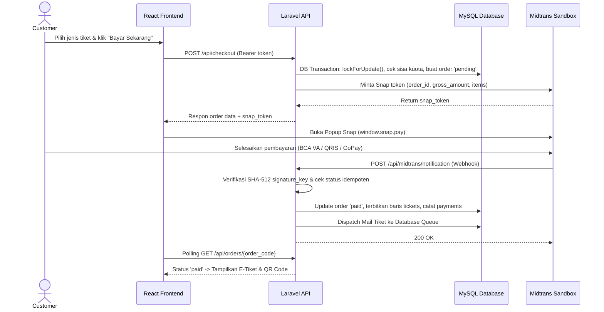

<div align="center">
  <br />
  <h1>🎟️ TiketEvent Core API</h1>
  <p><strong>High-Performance Event Ticketing & Reservation RESTful API Engine</strong></p>
  <p><em>Equipped with Pessimistic Quota Locking, Midtrans Snap Payment Gateway, Secure Webhook Verification, Automated Ticket Issuance & QR Generation.</em></p>

  <p>
    <a href="https://laravel.com"></a>
    <a href="https://www.php.net"></a>
    <a href="https://laravel.com/docs/sanctum"></a>
    <a href="https://midtrans.com"></a>
    <a href="https://pestphp.com"></a>
    <a href="https://www.mysql.com"></a>
    <a href="LICENSE"></a>
  </p>
  <br />
</div>

---

## ⚡ Ringkasan Proyek

**TiketEvent Core API** adalah engine backend REST API untuk sistem pemesanan tiket acara (event ticketing) yang dibangun dengan standar industri:
* **Pessimistic Quota Locking (`lockForUpdate`)**: Mencegah *overselling* saat beberapa pembeli memesan jenis tiket terbatas secara bersamaan.
* **Integrasi Midtrans Snap & Webhook Idempoten**: Menghasilkan token Snap dan menerima notifikasi webhook status (`settlement`, `expire`, `cancel`) dengan verifikasi `signature_key` SHA-512 dan perlindungan transaksi ganda.
* **Penerbitan E-Tiket Otomatis**: Menghasilkan kode tiket acak unik (`TKT-XXXXXXXXXX`) dan mengirim e-tiket ke email pembeli secara asinkron via antrean (Queue Worker).
* **Scanner Check-in Real-Time**: Validasi barcode/QR code tiket di pintu masuk dengan proteksi anti-duplikasi scan dan jeda cooldown.
* **Otomatisasi Pembatalan Kedaluwarsa**: Scheduler berjalan tiap menit via cron/artisan untuk mengembalikan kuota tiket dari order pending yang melewati batas waktu pembayaran.

---

## 🏗️ Arsitektur Alur Transaksi



---

## 🚀 Panduan Instalasi Lokal (Quick Start)

### 1. Kebutuhan Sistem
* PHP 8.4+ dengan ekstensi `pdo_mysql`, `mbstring`, `openssl`, `curl`, `fileinfo`, `gd`
* Composer 2.x
* MySQL 8.x (Laragon / XAMPP / Docker)

### 2. Langkah Menjalankan
```bash
# 1. Clone & masuk ke folder backend
git clone https://github.com/ticketing-system-platform/backend-ticketing-system.git backend
cd backend

# 2. Pasang dependensi PHP
composer install

# 3. Salin environment & generate app key
cp .env.example .env
php artisan key:generate

# 4. Atur kredensial database & third-party di .env:
#    DB_DATABASE=tiket_event
#    MIDTRANS_SERVER_KEY=SB-Mid-server-xxxx
#    MIDTRANS_CLIENT_KEY=SB-Mid-client-xxxx
#    MAIL_USERNAME=xxxx
#    MAIL_PASSWORD=xxxx

# 5. Jalankan migrasi & seeder awal
php artisan migrate:fresh --seed

# 6. Buat tautan storage (untuk gambar banner)
php artisan storage:link

# 7. Jalankan server lokal
php artisan serve
```

### 3. Worker Antrean & Scheduler
Buka terminal baru untuk memproses antrean email dan pembatalan otomatis:
```bash
# Terminal 2: Queue Worker (Pengirim email tiket)
php artisan queue:work

# Terminal 3: Scheduler (Pemeriksa order kedaluwarsa)
php artisan schedule:work
```

---

## 📋 Akun Demo Bawaan (Seeder)

| Peran | Email | Password | Hak Akses |
|---|---|---|---|
| **Admin** | `admin@tiket.test` | `password` | Dashboard penjualan, CRUD event & tiket, scan check-in |
| **Customer** | `budi@tiket.test` | `password` | Beli tiket, riwayat order, lihat e-tiket & QR |

> 💡 Untuk mengganti password akun via CLI secara aman:
> ```bash
> php artisan user:password admin@tiket.test
> ```

---

## 📡 Daftar Endpoint API

### 1. Autentikasi (`/api`)
| Method | Endpoint | Keterangan | Akses |
|---|---|---|---|
| `POST` | `/api/register` | Pendaftaran akun customer baru | Publik |
| `POST` | `/api/login` | Masuk & penerbitan Bearer token | Publik |
| `POST` | `/api/logout` | Revoke token aktif | User |
| `GET` | `/api/me` | Informasi profil akun login | User |

### 2. Event & Tiket Publik
| Method | Endpoint | Keterangan | Akses |
|---|---|---|---|
| `GET` | `/api/events` | Daftar event berstatus `published` (search & filter) | Publik |
| `GET` | `/api/events/{slug}` | Detail event lengkap beserta tier tiket & kuota | Publik |

### 3. Transaksi & Pembayaran Customer
| Method | Endpoint | Keterangan | Akses |
|---|---|---|---|
| `POST` | `/api/checkout` | Pesan tiket, kunci kuota, buat Snap token | Customer |
| `GET` | `/api/orders` | Riwayat transaksi customer | Customer |
| `GET` | `/api/orders/{order_code}` | Cek status order & kode e-tiket | Customer / Owner |
| `GET` | `/api/my-tickets` | Daftar tiket milik customer dengan status check-in | Customer |
| `POST` | `/api/midtrans/notification` | Webhook notifikasi pembayaran dari Midtrans | Midtrans Server |

### 4. Admin Management (`/api/admin`)
| Method | Endpoint | Keterangan | Akses |
|---|---|---|---|
| `GET` | `/api/admin/stats` | Statistik KPI total pendapatan, tiket, & order | Admin |
| `GET` | `/api/admin/orders` | Daftar semua transaksi dengan filter status & pencarian | Admin |
| `POST` | `/api/admin/checkin` | Verifikasi & check-in tiket barcode/QR | Admin |
| `GET\|POST` | `/api/admin/events` | Ambil semua event / Buat event baru (upload banner) | Admin |
| `GET\|PUT\|DELETE` | `/api/admin/events/{id}` | Detail / Ubah / Hapus event | Admin |
| `GET\|POST` | `/api/admin/ticket-types` | Ambil / Tambah jenis tiket per event | Admin |
| `GET\|PUT\|DELETE` | `/api/admin/ticket-types/{id}` | Detail / Ubah / Hapus jenis tiket | Admin |

---

## 🧪 Pengujian Otomatis (Testing)

Proyek ini dilengkapi dengan suite pengujian end-to-end terintegrasi menggunakan **Pest PHP**:
```bash
php artisan test
```
* **Hasil Pengujian**: `41 passed (190 assertions)` mencakup alur autentikasi, transaksi concurrency locking, webhook simulation, simulasi CLI, dan verifikasi endpoint admin.

---

## 📦 Konfigurasi Deployment (VPS)

File deployment untuk server Linux Ubuntu (Nginx, Supervisor, Cron) tersedia di direktori `deploy/`:
* `deploy/nginx.conf`: Konfigurasi reverse proxy satu domain untuk API Laravel & Frontend React.
* `deploy/supervisor.conf`: Konfigurasi worker background process `queue:work`.
* `deploy/cron`: Jadwal eksekusi `php artisan schedule:run` per menit.
* `deploy/deploy.sh`: Skrip CI/CD deployment otomatis zero-downtime.

---

## 📄 Lisensi
Didistribusikan di bawah lisensi MIT. Lihat file [LICENSE](LICENSE) untuk informasi lebih lanjut.
