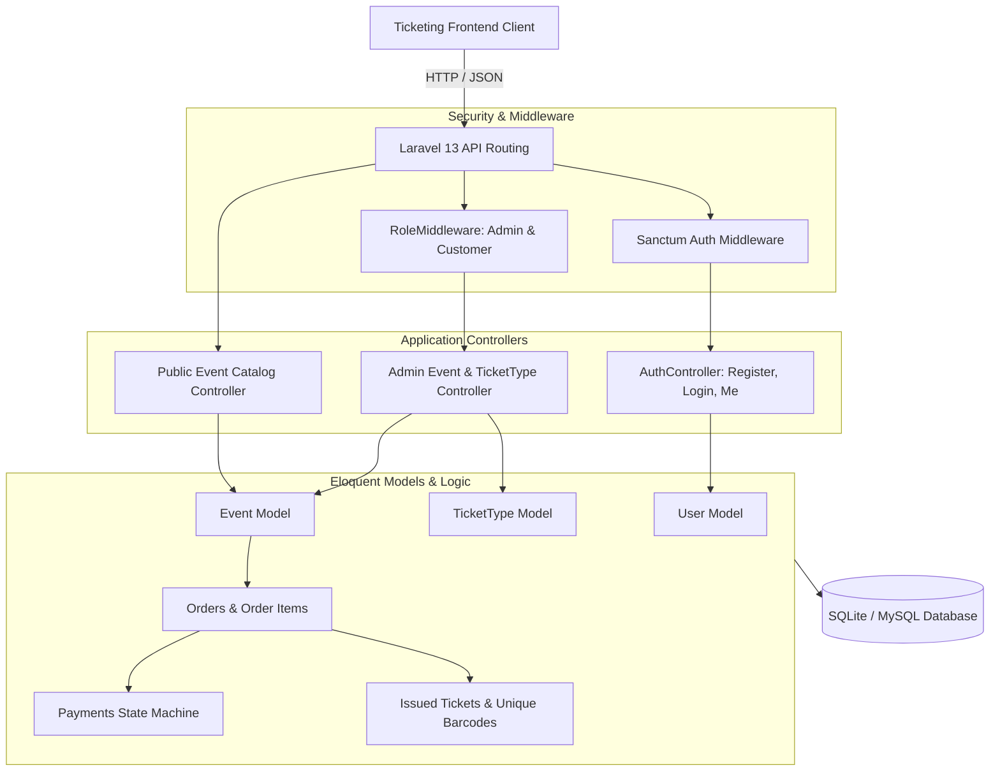
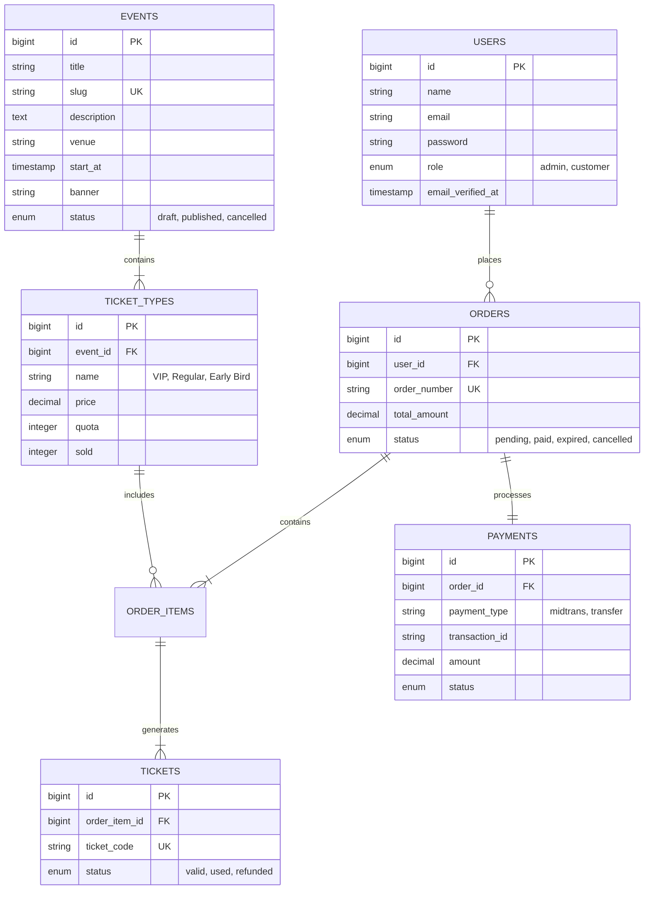

<div align="center">
  <br />
  <h1>🎟️ Ticketing System REST API</h1>
  <p><strong>The High-Performance, Secure Laravel 13 Event Booking & E-Ticketing Engine</strong></p>
  <p><em>Equipped with dynamic ticket tiers, automated quota tracking, Midtrans payment integration, and Laravel Sanctum auth.</em></p>

  <p>
    <a href="https://laravel.com"></a>
    <a href="https://php.net"></a>
    <a href="https://laravel.com/docs/sanctum"></a>
    <a href="https://pestphp.com"></a>
    <a href="https://www.sqlite.org"></a>
    <a href="LICENSE"></a>
  </p>
  <br />
</div>

---

## ⚡ What is Ticketing System API?

**Ticketing System API** is the backend engine powering the event booking platform. Built with **Laravel 13** and **PHP 8.3+**, it delivers robust, authenticated RESTful endpoints for discovering events, managing multi-tier ticket quotas, processing orders, and authenticating users.

---

## 🏗️ Architecture & Data Flow



---

## ✨ Key Capabilities

- **🎪 Comprehensive Event Lifecycle**: Support for upcoming events, slug-based SEO-friendly routing, venue management, and event banners.
- **🏷️ Multi-Tier Ticket Pricing**: Define multiple ticket categories per event (e.g. VIP, Early Bird, Regular) with distinct pricing and automated quota tracking.
- **🔐 Token-Based Authentication**: Secure authentication using Laravel Sanctum for API tokens with built-in role verification (`admin` vs `customer`).
- **🛡️ Request Validation & Resources**: Strict form request validation rules with normalized, consistent JSON responses via API Resources.
- **🧪 Comprehensive Test Suite**: 500+ lines of robust automated feature tests using **Pest PHP**.

---

## 📡 API Reference Overview

### 1. Authentication Endpoints

| Method | Endpoint | Access | Description |
| :--- | :--- | :---: | :--- |
| `POST` | `/api/register` | Public | Register new customer account |
| `POST` | `/api/login` | Public | Authenticate user and issue Sanctum token |
| `POST` | `/api/logout` | Authenticated | Revoke active token session |
| `GET` | `/api/me` | Authenticated | Fetch authenticated user profile |

### 2. Public Event Catalog

| Method | Endpoint | Access | Description |
| :--- | :--- | :---: | :--- |
| `GET` | `/api/events` | Public | List all active events with pricing & date filters |
| `GET` | `/api/events/{slug}` | Public | Get detailed event info with ticket tiers and remaining quotas |

### 3. Admin Backoffice Management (`role:admin`)

| Method | Endpoint | Access | Description |
| :--- | :--- | :---: | :--- |
| `GET` | `/api/admin/events` | Admin | List all events (including drafts and archived) |
| `POST` | `/api/admin/events` | Admin | Create a new event with venue & banner |
| `GET` | `/api/admin/events/{id}` | Admin | Retrieve single event detail |
| `PUT` | `/api/admin/events/{id}` | Admin | Update event details |
| `DELETE` | `/api/admin/events/{id}` | Admin | Delete event |
| `GET` | `/api/admin/ticket-types` | Admin | List all ticket types |
| `POST` | `/api/admin/ticket-types` | Admin | Create new ticket tier for an event |
| `PUT` | `/api/admin/ticket-types/{id}` | Admin | Update price or quota for ticket tier |
| `DELETE` | `/api/admin/ticket-types/{id}` | Admin | Remove ticket tier |

### 4. Customer Orders & Checkout

| Method | Endpoint | Access | Description |
| :--- | :--- | :---: | :--- |
| `POST` | `/api/checkout` | Authenticated | Create order with pessimistic lock & generate Midtrans Snap token |
| `GET` | `/api/orders` | Authenticated | Get customer order history |
| `GET` | `/api/orders/{order_code}` | Authenticated | Get customer order details and ticket barcodes |

### 5. Webhook Payments (Midtrans)

| Method | Endpoint | Access | Description |
| :--- | :--- | :---: | :--- |
| `POST` | `/api/midtrans/notification` | Public (SHA512 Signature) | Midtrans webhook notification: marks paid, issues tickets, queues emails |

---

## 🗄️ Database Entity Schema



---

## 🚀 Quick Start (Local Setup)

### Prerequisites
* [PHP](https://www.php.net) (v8.3 or newer)
* [Composer](https://getcomposer.org)
* SQLite or MySQL

### 1. Configure Environment
Copy `.env.example` to create `.env`:
```bash
cp .env.example .env
```

### 2. Install Dependencies
```bash
composer install
```

### 3. Generate App Key & Run Migrations
```bash
php artisan key:generate
php artisan migrate --seed
```
*The database will be migrated and seeded with initial demo events, ticket types, and user accounts.*

### 4. Start Development Server
```bash
php artisan serve
```
*API will run at `http://localhost:8000`.*

---

## 🧪 Automated Testing

Execute the test suite powered by Pest PHP:
```bash
php artisan test
```

---

## 📄 License

This software is open-sourced under the [MIT License](LICENSE).
