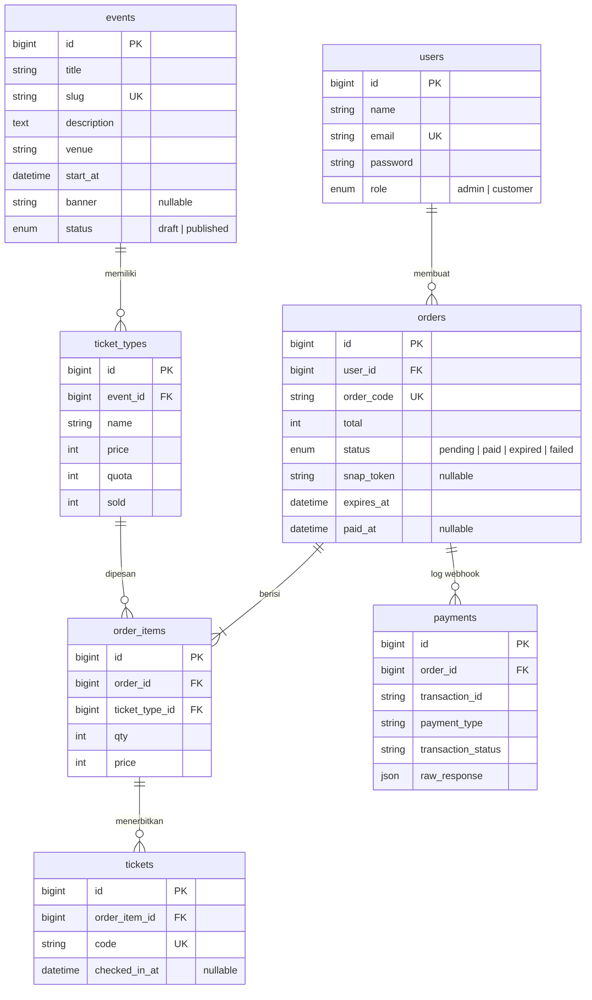

# P1 — ERD, Migration, Seeder

**Tujuan:** membuat proyek Laravel, merancang database 7 tabel, dan mengisi data contoh.

## 1.1 Membuat proyek Laravel

Buka terminal di folder proyek, lalu:

```bash
composer create-project laravel/laravel backend
cd backend
```

💡 **Penjelasan:** perintah ini mengunduh kerangka Laravel terbaru (Laravel 13) ke folder `backend`. Secara default
Laravel memakai SQLite, jadi pesan *"could not find driver"* di akhir instalasi bisa diabaikan. Kita akan mengganti ke MySQL.

## 1.2 Database & file `.env`

Buat database kosong bernama `tiket_event` (lewat HeidiSQL/phpMyAdmin di Laragon, atau terminal):

```bash
mysql -uroot -e "CREATE DATABASE tiket_event CHARACTER SET utf8mb4 COLLATE utf8mb4_unicode_ci;"
```

Ubah bagian berikut di 📄 `backend/.env`:

```env
APP_NAME="Tiket Event"
APP_URL=http://localhost:8000
FRONTEND_URL=http://localhost:5173

APP_LOCALE=id
APP_FAKER_LOCALE=id_ID

DB_CONNECTION=mysql
DB_HOST=127.0.0.1
DB_PORT=3306
DB_DATABASE=tiket_event
DB_USERNAME=root
DB_PASSWORD=

QUEUE_CONNECTION=database
```

> Di `.env` bawaan Laravel 13, `DB_CONNECTION` masih `sqlite` dan baris `DB_HOST` sampai `DB_PASSWORD` masih diawali
> tanda `#` (komentar). Hapus tanda `#` dan ubah nilainya seperti di atas. `FRONTEND_URL` belum ada, jadi tambahkan
> sendiri di bawah `APP_URL`.

Lakukan perubahan yang sama di `.env.example`, tetapi **tanpa** nilai rahasia.

Lalu di 📄 `backend/config/app.php`, ubah timezone dan tambahkan `frontend_url` di bawah `url`:

```php
    'url' => env('APP_URL', 'http://localhost'),

    // Alamat aplikasi React, dipakai untuk link di email
    'frontend_url' => env('FRONTEND_URL', 'http://localhost:5173'),

    // ...

    'timezone' => 'Asia/Jakarta',
```

💡 **Penjelasan:**
- `APP_URL` harus sama dengan alamat `php artisan serve` (`http://localhost:8000`), karena URL gambar banner dibentuk dari nilai ini.
- `timezone` Asia/Jakarta membuat jam yang disimpan sesuai WIB. API mengirim tanggal dalam format ISO UTC
  (`2026-10-28T12:00:00Z`), lalu browser menampilkannya kembali sesuai zona waktu pengguna.

## 1.3 Pasang Sanctum (API token)

```bash
php artisan install:api
```

Jawab **yes** saat ditanya apakah ingin menjalankan migration. Di akhir proses muncul pesan
`Please add the [Laravel\Sanctum\HasApiTokens] trait to your User model`. Itu dikerjakan di langkah 1.5:
model `User` yang kita salin sudah memakai `HasApiTokens`.

💡 **Penjelasan:** `install:api` memasang **Laravel Sanctum**, membuat file `routes/api.php` (semua route di dalamnya
otomatis berawalan `/api`), dan membuat tabel `personal_access_tokens` untuk menyimpan token login.

## 1.4 ERD



💡 **Penjelasan desain:**
- **`ticket_types.sold`** menyimpan jumlah tiket yang sudah dipesan (pending + paid). Sisa kuota = `quota - sold`.
  Kuota langsung "ditahan" saat checkout, dan dikembalikan jika order kedaluwarsa atau gagal.
- **`order_items.price`** menyalin harga saat checkout. Jika admin mengubah harga nanti, riwayat order tetap benar.
- **`tickets`** dibuat **satu baris per orang**. Membeli 3 tiket berarti ada 3 QR code berbeda.
- **`payments`** adalah log setiap notifikasi Midtrans, berguna untuk audit dan debugging.
- Harga disimpan sebagai **integer Rupiah** (tanpa desimal) agar tidak ada masalah pembulatan.

## 1.5 Model & migration

Buat model beserta migration. **Urutan penting**: tabel yang direferensikan (foreign key) harus dibuat lebih dulu.

```bash
php artisan make:model Event -m
php artisan make:model TicketType -m
php artisan make:model Order -m
php artisan make:model OrderItem -m
php artisan make:model Ticket -m
php artisan make:model Payment -m
```

> ⚠️ Jalankan satu per satu. Jika dua migration dibuat pada detik yang sama, urutannya bisa tertukar
> (`order_items` sebelum `orders`) dan migrate akan gagal karena foreign key.

Tambahkan kolom `role` di migration users bawaan, 📄 `backend/database/migrations/0001_01_01_000000_create_users_table.php`:

```php
        Schema::create('users', function (Blueprint $table) {
            $table->id();
            $table->string('name');
            $table->string('email')->unique();
            $table->timestamp('email_verified_at')->nullable();
            $table->string('password');
            $table->enum('role', ['admin', 'customer'])->default('customer');
            $table->rememberToken();
            $table->timestamps();
        });
```

Isi file migration lain (nama file Anda akan berbeda tanggalnya):

📄 `backend/database/migrations/xxxx_xx_xx_xxxxxx_create_events_table.php`

```php
<?php

use Illuminate\Database\Migrations\Migration;
use Illuminate\Database\Schema\Blueprint;
use Illuminate\Support\Facades\Schema;

return new class extends Migration
{
    /**
     * Run the migrations.
     */
    public function up(): void
    {
        Schema::create('events', function (Blueprint $table) {
            $table->id();
            $table->string('title');
            $table->string('slug')->unique(); // dipakai di URL: /events/konser-musik-2026
            $table->text('description');
            $table->string('venue');
            $table->dateTime('start_at');
            $table->string('banner')->nullable(); // path gambar di storage/app/public
            // draft = belum tampil ke publik, published = tampil di halaman Home
            $table->enum('status', ['draft', 'published'])->default('draft');
            $table->timestamps();
        });
    }

    /**
     * Reverse the migrations.
     */
    public function down(): void
    {
        Schema::dropIfExists('events');
    }
};
```

📄 `backend/database/migrations/xxxx_xx_xx_xxxxxx_create_ticket_types_table.php`

```php
<?php

use Illuminate\Database\Migrations\Migration;
use Illuminate\Database\Schema\Blueprint;
use Illuminate\Support\Facades\Schema;

return new class extends Migration
{
    /**
     * Run the migrations.
     */
    public function up(): void
    {
        Schema::create('ticket_types', function (Blueprint $table) {
            $table->id();
            $table->foreignId('event_id')->constrained()->cascadeOnDelete();
            $table->string('name'); // contoh: Reguler, VIP, Early Bird
            $table->unsignedInteger('price'); // Rupiah tanpa desimal
            $table->unsignedInteger('quota'); // total tiket yang tersedia
            $table->unsignedInteger('sold')->default(0); // tiket yang sudah dipesan (pending + paid)
            $table->timestamps();
        });
    }

    /**
     * Reverse the migrations.
     */
    public function down(): void
    {
        Schema::dropIfExists('ticket_types');
    }
};
```

📄 `backend/database/migrations/xxxx_xx_xx_xxxxxx_create_orders_table.php`

```php
<?php

use Illuminate\Database\Migrations\Migration;
use Illuminate\Database\Schema\Blueprint;
use Illuminate\Support\Facades\Schema;

return new class extends Migration
{
    /**
     * Run the migrations.
     */
    public function up(): void
    {
        Schema::create('orders', function (Blueprint $table) {
            $table->id();
            $table->foreignId('user_id')->constrained()->cascadeOnDelete();
            $table->string('order_code')->unique(); // dikirim ke Midtrans sebagai order_id
            $table->unsignedInteger('total');
            $table->enum('status', ['pending', 'paid', 'expired', 'failed'])->default('pending');
            $table->string('snap_token')->nullable();
            $table->dateTime('expires_at');
            $table->dateTime('paid_at')->nullable();
            $table->timestamps();
        });
    }

    /**
     * Reverse the migrations.
     */
    public function down(): void
    {
        Schema::dropIfExists('orders');
    }
};
```

📄 `backend/database/migrations/xxxx_xx_xx_xxxxxx_create_order_items_table.php`

```php
<?php

use Illuminate\Database\Migrations\Migration;
use Illuminate\Database\Schema\Blueprint;
use Illuminate\Support\Facades\Schema;

return new class extends Migration
{
    /**
     * Run the migrations.
     */
    public function up(): void
    {
        Schema::create('order_items', function (Blueprint $table) {
            $table->id();
            $table->foreignId('order_id')->constrained()->cascadeOnDelete();
            $table->foreignId('ticket_type_id')->constrained()->restrictOnDelete();
            $table->unsignedInteger('qty');
            // harga disalin saat checkout, supaya riwayat order tidak berubah
            // walaupun admin mengubah harga tiket di kemudian hari
            $table->unsignedInteger('price');
            $table->timestamps();
        });
    }

    /**
     * Reverse the migrations.
     */
    public function down(): void
    {
        Schema::dropIfExists('order_items');
    }
};
```

📄 `backend/database/migrations/xxxx_xx_xx_xxxxxx_create_tickets_table.php`

```php
<?php

use Illuminate\Database\Migrations\Migration;
use Illuminate\Database\Schema\Blueprint;
use Illuminate\Support\Facades\Schema;

return new class extends Migration
{
    /**
     * Run the migrations.
     */
    public function up(): void
    {
        Schema::create('tickets', function (Blueprint $table) {
            $table->id();
            $table->foreignId('order_item_id')->constrained()->cascadeOnDelete();
            $table->string('code')->unique(); // isi QR code
            $table->dateTime('checked_in_at')->nullable(); // null = belum masuk venue
            $table->timestamps();
        });
    }

    /**
     * Reverse the migrations.
     */
    public function down(): void
    {
        Schema::dropIfExists('tickets');
    }
};
```

📄 `backend/database/migrations/xxxx_xx_xx_xxxxxx_create_payments_table.php`

```php
<?php

use Illuminate\Database\Migrations\Migration;
use Illuminate\Database\Schema\Blueprint;
use Illuminate\Support\Facades\Schema;

return new class extends Migration
{
    /**
     * Run the migrations.
     */
    public function up(): void
    {
        // Log setiap notifikasi (webhook) dari Midtrans
        Schema::create('payments', function (Blueprint $table) {
            $table->id();
            $table->foreignId('order_id')->constrained()->cascadeOnDelete();
            $table->string('transaction_id')->nullable();
            $table->string('payment_type')->nullable(); // bank_transfer, gopay, qris, dll.
            $table->string('transaction_status'); // settlement, pending, expire, dll.
            $table->json('raw_response'); // seluruh isi notifikasi, berguna untuk debugging
            $table->timestamps();
        });
    }

    /**
     * Reverse the migrations.
     */
    public function down(): void
    {
        Schema::dropIfExists('payments');
    }
};
```

💡 **Penjelasan:**
- `foreignId('event_id')->constrained()` membuat kolom + foreign key ke tabel `events`.
- `cascadeOnDelete()` artinya jika event dihapus, jenis tiketnya ikut terhapus.
- `restrictOnDelete()` pada `order_items.ticket_type_id` **mencegah** jenis tiket yang pernah dibeli dihapus,
  sehingga riwayat transaksi tidak rusak.
- `unique()` pada `slug`, `order_code`, dan `tickets.code` menjamin tidak ada duplikat di level database.

Sekarang isi model. Laravel 13 memakai **atribut PHP** `#[Fillable([...])]`, yang setara dengan
`protected $fillable = [...]` di versi Laravel sebelumnya.

📄 `backend/app/Models/User.php`

```php
<?php

namespace App\Models;

// use Illuminate\Contracts\Auth\MustVerifyEmail;
use Database\Factories\UserFactory;
use Illuminate\Database\Eloquent\Attributes\Fillable;
use Illuminate\Database\Eloquent\Attributes\Hidden;
use Illuminate\Database\Eloquent\Factories\HasFactory;
use Illuminate\Database\Eloquent\Relations\HasMany;
use Illuminate\Foundation\Auth\User as Authenticatable;
use Illuminate\Notifications\Notifiable;
use Laravel\Sanctum\HasApiTokens;

#[Fillable(['name', 'email', 'password', 'role'])]
#[Hidden(['password', 'remember_token'])]
class User extends Authenticatable
{
    /** @use HasFactory<UserFactory> */
    use HasApiTokens, HasFactory, Notifiable;

    /**
     * Get the attributes that should be cast.
     *
     * @return array<string, string>
     */
    protected function casts(): array
    {
        return [
            'email_verified_at' => 'datetime',
            'password' => 'hashed',
        ];
    }

    public function orders(): HasMany
    {
        return $this->hasMany(Order::class);
    }

    public function isAdmin(): bool
    {
        return $this->role === 'admin';
    }
}
```

📄 `backend/app/Models/Event.php`

```php
<?php

namespace App\Models;

use Illuminate\Database\Eloquent\Attributes\Fillable;
use Illuminate\Database\Eloquent\Builder;
use Illuminate\Database\Eloquent\Model;
use Illuminate\Database\Eloquent\Relations\HasMany;
use Illuminate\Support\Facades\Storage;
use Illuminate\Support\Str;

#[Fillable(['title', 'slug', 'description', 'venue', 'start_at', 'banner', 'status'])]
class Event extends Model
{
    protected function casts(): array
    {
        return [
            'start_at' => 'datetime',
        ];
    }

    public function ticketTypes(): HasMany
    {
        return $this->hasMany(TicketType::class);
    }

    // Scope: Event::published()->get() hanya mengambil event yang sudah tayang
    public function scopePublished(Builder $query): void
    {
        $query->where('status', 'published');
    }

    // URL lengkap banner. Seeder memakai URL gambar dari internet,
    // sedangkan upload admin disimpan di storage/app/public/banners.
    public function bannerUrl(): ?string
    {
        if (! $this->banner) {
            return null;
        }

        if (Str::startsWith($this->banner, 'http')) {
            return $this->banner;
        }

        return Storage::disk('public')->url($this->banner);
    }
}
```

📄 `backend/app/Models/TicketType.php`

```php
<?php

namespace App\Models;

use Illuminate\Database\Eloquent\Attributes\Fillable;
use Illuminate\Database\Eloquent\Model;
use Illuminate\Database\Eloquent\Relations\BelongsTo;
use Illuminate\Database\Eloquent\Relations\HasMany;

#[Fillable(['event_id', 'name', 'price', 'quota', 'sold'])]
class TicketType extends Model
{
    // Nilai default saat membuat data baru
    protected $attributes = [
        'sold' => 0,
    ];

    // Data dari form berupa string ("150000"), cast agar selalu jadi angka
    protected function casts(): array
    {
        return [
            'event_id' => 'integer',
            'price' => 'integer',
            'quota' => 'integer',
            'sold' => 'integer',
        ];
    }

    public function event(): BelongsTo
    {
        return $this->belongsTo(Event::class);
    }

    public function orderItems(): HasMany
    {
        return $this->hasMany(OrderItem::class);
    }

    // Sisa tiket yang masih bisa dibeli
    public function remaining(): int
    {
        return max(0, $this->quota - $this->sold);
    }
}
```

📄 `backend/app/Models/Order.php`

```php
<?php

namespace App\Models;

use Illuminate\Database\Eloquent\Attributes\Fillable;
use Illuminate\Database\Eloquent\Model;
use Illuminate\Database\Eloquent\Relations\BelongsTo;
use Illuminate\Database\Eloquent\Relations\HasMany;
use Illuminate\Database\Eloquent\Relations\HasManyThrough;

#[Fillable(['user_id', 'order_code', 'total', 'status', 'snap_token', 'expires_at', 'paid_at'])]
class Order extends Model
{
    protected function casts(): array
    {
        return [
            'expires_at' => 'datetime',
            'paid_at' => 'datetime',
        ];
    }

    // Route model binding memakai order_code: GET /api/orders/INV-XXXX
    public function getRouteKeyName(): string
    {
        return 'order_code';
    }

    public function user(): BelongsTo
    {
        return $this->belongsTo(User::class);
    }

    public function items(): HasMany
    {
        return $this->hasMany(OrderItem::class);
    }

    // Order -> OrderItem -> Ticket
    public function tickets(): HasManyThrough
    {
        return $this->hasManyThrough(Ticket::class, OrderItem::class);
    }

    public function payments(): HasMany
    {
        return $this->hasMany(Payment::class);
    }

    // Kembalikan kuota tiket ketika order batal / kedaluwarsa
    public function releaseQuota(): void
    {
        foreach ($this->items as $item) {
            TicketType::whereKey($item->ticket_type_id)->decrement('sold', $item->qty);
        }
    }
}
```

📄 `backend/app/Models/OrderItem.php`

```php
<?php

namespace App\Models;

use Illuminate\Database\Eloquent\Attributes\Fillable;
use Illuminate\Database\Eloquent\Model;
use Illuminate\Database\Eloquent\Relations\BelongsTo;
use Illuminate\Database\Eloquent\Relations\HasMany;

#[Fillable(['order_id', 'ticket_type_id', 'qty', 'price'])]
class OrderItem extends Model
{
    public function order(): BelongsTo
    {
        return $this->belongsTo(Order::class);
    }

    public function ticketType(): BelongsTo
    {
        return $this->belongsTo(TicketType::class);
    }

    public function tickets(): HasMany
    {
        return $this->hasMany(Ticket::class);
    }

    public function subtotal(): int
    {
        return $this->price * $this->qty;
    }
}
```

📄 `backend/app/Models/Ticket.php`

```php
<?php

namespace App\Models;

use Illuminate\Database\Eloquent\Attributes\Fillable;
use Illuminate\Database\Eloquent\Model;
use Illuminate\Database\Eloquent\Relations\BelongsTo;

#[Fillable(['order_item_id', 'code', 'checked_in_at'])]
class Ticket extends Model
{
    protected function casts(): array
    {
        return [
            'checked_in_at' => 'datetime',
        ];
    }

    public function orderItem(): BelongsTo
    {
        return $this->belongsTo(OrderItem::class);
    }
}
```

📄 `backend/app/Models/Payment.php`

```php
<?php

namespace App\Models;

use Illuminate\Database\Eloquent\Attributes\Fillable;
use Illuminate\Database\Eloquent\Model;
use Illuminate\Database\Eloquent\Relations\BelongsTo;

#[Fillable(['order_id', 'transaction_id', 'payment_type', 'transaction_status', 'raw_response'])]
class Payment extends Model
{
    protected function casts(): array
    {
        return [
            'raw_response' => 'array',
        ];
    }

    public function order(): BelongsTo
    {
        return $this->belongsTo(Order::class);
    }
}
```

💡 **Penjelasan:**
- **Relasi**: `hasMany` (satu ke banyak), `belongsTo` (milik satu). Contoh: `$event->ticketTypes` dan `$ticketType->event`.
- **`casts()`** mengubah tipe data otomatis: `start_at` menjadi objek Carbon (tanggal), `raw_response` (JSON) menjadi array PHP,
  dan `password` di-hash otomatis saat disimpan.
- **`scopePublished`** membuat query siap pakai: `Event::published()->get()`.
- **`getRouteKeyName()`** pada `Order` membuat URL `/api/orders/INV-...` mencari berdasarkan `order_code`, bukan `id`.
  Kode order lebih aman ditampilkan daripada id berurutan (1, 2, 3...).
- **`releaseQuota()`** mengembalikan kuota. Method ini dipakai nanti di P6–P8.
- `HasApiTokens` di model `User` memberi method `createToken()` milik Sanctum.

## 1.6 Seeder

📄 `backend/database/seeders/DatabaseSeeder.php`

```php
<?php

namespace Database\Seeders;

use App\Models\Event;
use App\Models\User;
use Illuminate\Database\Console\Seeds\WithoutModelEvents;
use Illuminate\Database\Seeder;
use Illuminate\Support\Str;

class DatabaseSeeder extends Seeder
{
    use WithoutModelEvents;

    /**
     * Seed the application's database.
     */
    public function run(): void
    {
        // Akun untuk login saat demo (password: password)
        User::create([
            'name' => 'Admin Tiket',
            'email' => 'admin@tiket.test',
            'password' => 'password', // otomatis di-hash oleh cast 'hashed'
            'role' => 'admin',
        ]);

        User::create([
            'name' => 'Budi Customer',
            'email' => 'budi@tiket.test',
            'password' => 'password',
            'role' => 'customer',
        ]);

        $events = [
            [
                'title' => 'Jakarta Music Festival 2026',
                'venue' => 'JIExpo Kemayoran, Jakarta',
                'days' => 30,
                'status' => 'published',
                'description' => "Festival musik tahunan dengan lebih dari 20 musisi lokal dan internasional.\nNikmati 2 panggung, food court, dan area komunitas.",
                'tickets' => [
                    ['name' => 'Early Bird', 'price' => 150000, 'quota' => 50],
                    ['name' => 'Reguler', 'price' => 250000, 'quota' => 200],
                    ['name' => 'VIP', 'price' => 750000, 'quota' => 30],
                ],
            ],
            [
                'title' => 'Tech Conference Indonesia',
                'venue' => 'ICE BSD, Tangerang',
                'days' => 45,
                'status' => 'published',
                'description' => "Konferensi teknologi untuk developer, product manager, dan startup founder.\nMateri: AI, cloud, dan web modern.",
                'tickets' => [
                    ['name' => 'Student', 'price' => 100000, 'quota' => 100],
                    ['name' => 'Professional', 'price' => 350000, 'quota' => 150],
                ],
            ],
            [
                'title' => 'Stand Up Comedy Night',
                'venue' => 'Teater Salihara, Jakarta',
                'days' => 14,
                'status' => 'published',
                'description' => 'Malam penuh tawa bersama komika-komika terbaik tanah air.',
                'tickets' => [
                    ['name' => 'Reguler', 'price' => 120000, 'quota' => 100],
                    ['name' => 'Front Row', 'price' => 200000, 'quota' => 5],
                ],
            ],
            [
                'title' => 'Workshop UI/UX Design',
                'venue' => 'Co-working Space Dago, Bandung',
                'days' => 21,
                'status' => 'published',
                'description' => 'Workshop praktik merancang aplikasi dari riset pengguna sampai prototipe di Figma.',
                'tickets' => [
                    ['name' => 'Peserta', 'price' => 75000, 'quota' => 40],
                ],
            ],
            [
                'title' => 'Pameran Seni Rupa Nusantara',
                'venue' => 'Galeri Nasional, Jakarta',
                'days' => 60,
                'status' => 'draft', // belum tampil di halaman publik
                'description' => 'Pameran karya seni rupa dari 34 provinsi.',
                'tickets' => [
                    ['name' => 'Umum', 'price' => 50000, 'quota' => 300],
                ],
            ],
        ];

        foreach ($events as $data) {
            $slug = Str::slug($data['title']);

            $event = Event::create([
                'title' => $data['title'],
                'slug' => $slug,
                'description' => $data['description'],
                'venue' => $data['venue'],
                'start_at' => now()->addDays($data['days'])->setTime(19, 0),
                'banner' => "https://picsum.photos/seed/{$slug}/1200/600",
                'status' => $data['status'],
            ]);

            // createMany: membuat banyak ticket_types sekaligus lewat relasi
            $event->ticketTypes()->createMany($data['tickets']);
        }
    }
}
```

Jalankan:

```bash
php artisan migrate:fresh --seed
```

💡 **Penjelasan:** `migrate:fresh` menghapus semua tabel lalu menjalankan ulang semua migration. `--seed` menjalankan
`DatabaseSeeder`. Banner seeder memakai gambar dari `picsum.photos` agar tampilan langsung menarik.
Event "Pameran Seni Rupa" sengaja berstatus **draft** untuk mendemonstrasikan event yang tidak tampil di publik.
Tiket "Front Row" sengaja diberi kuota 5 untuk demo tiket habis.

## 🧑‍🏫 Catatan Mengajar P1

- Mulai dengan menggambar ERD di papan tulis **bersama siswa**. Tanyakan: "Kenapa harga perlu disalin ke `order_items`?",
  "Kenapa tiket dibuat per orang, bukan per order?"
- Tunjukkan hasil tabel di HeidiSQL/phpMyAdmin setelah migrate.
- Demo Tinker untuk mencoba relasi:
  ```bash
  php artisan tinker
  >>> App\Models\Event::first()->ticketTypes
  >>> App\Models\TicketType::first()->event->title
  ```
- Kesalahan umum: lupa menyalakan MySQL (`SQLSTATE[HY000] [2002]`), urutan migration tertukar, typo nama kolom di `#[Fillable]`.

## ✅ Checkpoint P1

- [ ] `php artisan migrate:fresh --seed` berjalan tanpa error
- [ ] Ada 7 tabel utama + data 2 user, 5 event, 9 jenis tiket
- [ ] Relasi bisa dicoba di Tinker

---

🏠 [Daftar isi](../../README.md#daftar-isi) · [P2 — Auth, Role, CRUD API Event & Jenis Tiket](P02-auth-role-crud-api.md) ➡️
