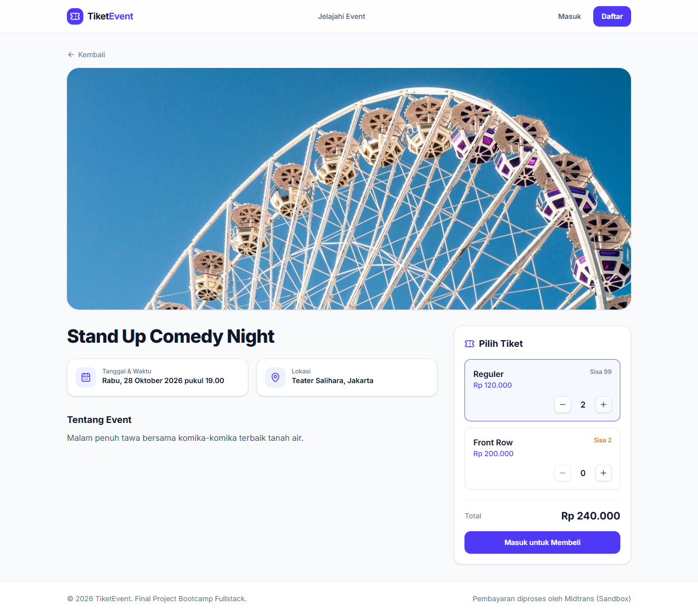

# P3 — React: Setup, Layout, Auth, Daftar & Detail Event

**Tujuan:** membuat proyek React, memasang Tailwind, menyusun layout, login/register, halaman Home dan Detail Event.

## 3.1 Membuat proyek React

Dari folder root proyek (sejajar dengan `backend`):

```bash
npm create vite@latest frontend -- --template react
cd frontend
npm install
npm install axios react-router lucide-react
npm install tailwindcss @tailwindcss/vite
```

Saat `npm create vite` berjalan, jawab dua pertanyaan berikut:

- **Which linter to use?** → pilih **Oxlint** (proyek ini memakai `npm run lint` = `oxlint`).
- **Install with npm and start now?** → pilih **No**, karena paket dipasang dengan perintah berikutnya.

Hapus file contoh yang tidak dipakai: `src/App.css`, folder `src/assets`, dan `public/icons.svg`.

💡 **Penjelasan paket:**
- `axios` untuk request HTTP ke Laravel.
- `react-router` untuk routing (versi 7 ke atas cukup memasang `react-router`, tidak perlu `react-router-dom`).
- `lucide-react` untuk ikon SVG.
- `tailwindcss` + `@tailwindcss/vite` untuk Tailwind CSS v4. Tidak perlu `tailwind.config.js` lagi.

## 3.2 Konfigurasi Vite, Tailwind & environment

📄 `frontend/vite.config.js`

```js
import tailwindcss from '@tailwindcss/vite'
import react from '@vitejs/plugin-react'
import { defineConfig } from 'vite'

// https://vite.dev/config/
export default defineConfig({
  plugins: [react(), tailwindcss()],
})
```

📄 `frontend/index.html`

```html
<!doctype html>
<html lang="id">
  <head>
    <meta charset="UTF-8" />
    <link rel="icon" type="image/svg+xml" href="/favicon.svg" />
    <meta name="viewport" content="width=device-width, initial-scale=1.0" />
    <link rel="preconnect" href="https://fonts.googleapis.com" />
    <link rel="preconnect" href="https://fonts.gstatic.com" crossorigin />
    <link
      href="https://fonts.googleapis.com/css2?family=Inter:wght@400;500;600;700;800&display=swap"
      rel="stylesheet"
    />
    <title>TiketEvent</title>
  </head>
  <body>
    <div id="root"></div>
    <script type="module" src="/src/main.jsx"></script>
  </body>
</html>
```

📄 `frontend/src/index.css`

```css
@import 'tailwindcss';

/* Ganti font default Tailwind menjadi Inter (dimuat di index.html) */
@theme {
  --font-sans: 'Inter', ui-sans-serif, system-ui, sans-serif;
}

/*
  Class komponen yang sering dipakai, supaya JSX tidak terlalu panjang.
  Contoh pemakaian: <button className="btn btn-primary">Simpan</button>
*/
@layer components {
  .btn {
    @apply inline-flex items-center justify-center gap-2 rounded-xl px-4 py-2.5 text-sm font-semibold transition focus-visible:outline-2 focus-visible:outline-offset-2 focus-visible:outline-indigo-500 disabled:cursor-not-allowed disabled:opacity-60;
  }
  .btn-primary {
    @apply bg-indigo-600 text-white shadow-sm hover:bg-indigo-700;
  }
  .btn-secondary {
    @apply border border-slate-200 bg-white text-slate-700 shadow-sm hover:bg-slate-50;
  }
  .btn-danger {
    @apply bg-rose-600 text-white shadow-sm hover:bg-rose-700;
  }
  .btn-ghost {
    @apply text-slate-600 hover:bg-slate-100 hover:text-slate-900;
  }
  .card {
    @apply rounded-2xl border border-slate-200/80 bg-white shadow-sm;
  }
  .label {
    @apply mb-1.5 block text-sm font-medium text-slate-700;
  }
  .input {
    @apply block w-full rounded-xl border border-slate-300 bg-white px-3.5 py-2.5 text-sm text-slate-900 shadow-sm placeholder:text-slate-400 focus:border-indigo-500 focus:ring-4 focus:ring-indigo-500/15 focus:outline-none;
  }
  .input-error {
    @apply border-rose-400 focus:border-rose-500 focus:ring-rose-500/15;
  }
}

body {
  @apply bg-slate-50 text-slate-900 antialiased;
}
```

📄 `frontend/.env` (dan salin ke `.env.example` dengan Client Key dikosongkan):

```env
# Alamat API Laravel
VITE_API_URL=http://localhost:8000/api

# Client Key Midtrans (aman berada di frontend)
VITE_MIDTRANS_CLIENT_KEY=SB-Mid-client-xxxxxxxxxxxxxxxx
VITE_MIDTRANS_SNAP_URL=https://app.sandbox.midtrans.com/snap/snap.js
```

Tambahkan `.env` ke 📄 `frontend/.gitignore` (template Vite belum memasukkannya):

```gitignore
# Environment (jangan di-commit)
.env
```

💡 **Penjelasan:**
- Tailwind v4 cukup di-*import* di CSS (`@import 'tailwindcss'`). Kustomisasi seperti font dilakukan di blok `@theme`.
- Class `.btn`, `.card`, `.input` dibuat dengan `@apply` agar JSX tidak terlalu panjang dan tampilan seragam.
- Variabel env Vite **wajib** berawalan `VITE_` agar bisa dibaca di kode (`import.meta.env.VITE_API_URL`).
  Setelah mengubah `.env`, **restart** `npm run dev`.

## 3.3 Helper: axios & format

📄 `frontend/src/lib/api.js`

```js
import axios from 'axios'

// Satu instance axios untuk semua request ke Laravel
const api = axios.create({
  baseURL: import.meta.env.VITE_API_URL, // http://localhost:8000/api
  headers: { Accept: 'application/json' },
})

// Interceptor: otomatis menyisipkan token Sanctum di setiap request
api.interceptors.request.use((config) => {
  const token = localStorage.getItem('token')
  if (token) {
    config.headers.Authorization = `Bearer ${token}`
  }
  return config
})

// Ambil pesan error dari response Laravel ({ message: '...' })
export function getErrorMessage(error) {
  return error.response?.data?.message || 'Terjadi kesalahan, silakan coba lagi.'
}

// Ambil error validasi per field ({ errors: { email: ['...'] } })
export function getFieldErrors(error) {
  return error.response?.data?.errors || {}
}

export default api
```

📄 `frontend/src/lib/format.js`

```js
// Kumpulan fungsi bantu untuk menampilkan angka & tanggal dalam format Indonesia

// 150000 -> "Rp 150.000"
export function formatRupiah(value) {
  return new Intl.NumberFormat('id-ID', {
    style: 'currency',
    currency: 'IDR',
    maximumFractionDigits: 0,
  }).format(value ?? 0)
}

// "2026-10-28T12:00:00Z" -> "Rabu, 28 Oktober 2026 pukul 19.00"
export function formatDateTime(iso) {
  return new Intl.DateTimeFormat('id-ID', { dateStyle: 'full', timeStyle: 'short' }).format(
    new Date(iso),
  )
}

// "2026-10-28T12:00:00Z" -> "28 Okt 2026, 19.00"
export function formatShortDateTime(iso) {
  return new Intl.DateTimeFormat('id-ID', {
    day: 'numeric',
    month: 'short',
    year: 'numeric',
    hour: '2-digit',
    minute: '2-digit',
  }).format(new Date(iso))
}

// Untuk badge tanggal di kartu event: { day: "28", month: "OKT" }
export function dateParts(iso) {
  const date = new Date(iso)
  return {
    day: date.getDate(),
    month: new Intl.DateTimeFormat('id-ID', { month: 'short' }).format(date).toUpperCase(),
  }
}

// Nilai untuk <input type="datetime-local">, contoh: "2026-10-28T19:00"
export function toDateTimeLocal(iso) {
  const date = new Date(iso)
  const pad = (n) => String(n).padStart(2, '0')
  return `${date.getFullYear()}-${pad(date.getMonth() + 1)}-${pad(date.getDate())}T${pad(
    date.getHours(),
  )}:${pad(date.getMinutes())}`
}
```

💡 **Penjelasan:**
- **Interceptor** menyisipkan token ke setiap request, sehingga tidak perlu menulis header di setiap halaman.
- `Intl.NumberFormat('id-ID')` dan `Intl.DateTimeFormat('id-ID')` adalah fitur bawaan JavaScript untuk format Rupiah dan tanggal Indonesia.

## 3.4 AuthContext (state login global)

📄 `frontend/src/context/AuthContext.jsx`

```jsx
import { createContext, useContext, useEffect, useState } from 'react'
import api from '../lib/api'

const AuthContext = createContext(null)

export function AuthProvider({ children }) {
  const [user, setUser] = useState(null)
  // loading = true selama kita mengecek token yang tersimpan ke /api/me
  const [loading, setLoading] = useState(() => Boolean(localStorage.getItem('token')))

  // Saat aplikasi pertama dibuka: jika ada token, ambil data user
  useEffect(() => {
    if (!localStorage.getItem('token')) return

    api
      .get('/me')
      .then((res) => setUser(res.data.data))
      .catch(() => localStorage.removeItem('token')) // token sudah tidak valid
      .finally(() => setLoading(false))
  }, [])

  async function login(email, password) {
    const res = await api.post('/login', { email, password })
    localStorage.setItem('token', res.data.token)
    setUser(res.data.data)
    return res.data.data
  }

  async function register(form) {
    const res = await api.post('/register', form)
    localStorage.setItem('token', res.data.token)
    setUser(res.data.data)
    return res.data.data
  }

  async function logout() {
    try {
      await api.post('/logout')
    } finally {
      localStorage.removeItem('token')
      setUser(null)
    }
  }

  // React 19: context bisa langsung dipakai sebagai provider
  // (versi lama: <AuthContext.Provider value={...}>)
  return <AuthContext value={{ user, loading, login, register, logout }}>{children}</AuthContext>
}

// Hook agar komponen cukup menulis: const { user } = useAuth()
// eslint-disable-next-line react/only-export-components
export function useAuth() {
  return useContext(AuthContext)
}
```

💡 **Penjelasan:**
- **Context** membuat data `user` bisa dipakai di komponen mana pun lewat `useAuth()`, tanpa *prop drilling*.
- Token disimpan di `localStorage` agar tetap login setelah refresh. Saat aplikasi dibuka, token dicek ke `/api/me`.
- `loading` mencegah halaman terlindungi langsung me-redirect ke login sebelum pengecekan token selesai.

## 3.5 Komponen UI

📄 `frontend/src/components/Loading.jsx`

```jsx
import { LoaderCircle } from 'lucide-react'

// Ikon berputar kecil, mis. di dalam tombol
export function Spinner({ className = 'size-4' }) {
  return <LoaderCircle className={`animate-spin ${className}`} />
}

// Loading satu halaman penuh
export default function PageLoader({ text = 'Memuat data...' }) {
  return (
    <div className="flex min-h-[40vh] flex-col items-center justify-center gap-3 text-slate-500">
      <Spinner className="size-7 text-indigo-600" />
      <p className="text-sm">{text}</p>
    </div>
  )
}
```

📄 `frontend/src/components/Alert.jsx`

```jsx
import { CircleAlert, CircleCheck, Info } from 'lucide-react'

const styles = {
  error: { box: 'border-rose-200 bg-rose-50 text-rose-800', Icon: CircleAlert },
  success: { box: 'border-emerald-200 bg-emerald-50 text-emerald-800', Icon: CircleCheck },
  info: { box: 'border-indigo-200 bg-indigo-50 text-indigo-800', Icon: Info },
}

// Kotak pesan. Contoh: <Alert type="error">Email salah</Alert>
export default function Alert({ type = 'info', children }) {
  if (!children) return null
  const { box, Icon } = styles[type]

  return (
    <div className={`flex items-start gap-3 rounded-xl border px-4 py-3 text-sm ${box}`}>
      <Icon className="mt-0.5 size-4 shrink-0" />
      <div>{children}</div>
    </div>
  )
}
```

📄 `frontend/src/components/EmptyState.jsx`

```jsx
import { Inbox } from 'lucide-react'

// Tampilan ketika data kosong
export default function EmptyState({ icon: Icon = Inbox, title, description, action }) {
  return (
    <div className="card flex flex-col items-center px-6 py-14 text-center">
      <div className="mb-4 rounded-2xl bg-indigo-50 p-4 text-indigo-600">
        <Icon className="size-7" />
      </div>
      <h3 className="text-base font-semibold text-slate-900">{title}</h3>
      {description && <p className="mt-1 max-w-sm text-sm text-slate-500">{description}</p>}
      {action && <div className="mt-6">{action}</div>}
    </div>
  )
}
```

📄 `frontend/src/components/StatusBadge.jsx`

```jsx
// Label status dengan warna. Warna selalu ditemani teks, tidak hanya warna saja.
const statuses = {
  pending: { label: 'Menunggu Bayar', className: 'bg-amber-50 text-amber-700 ring-amber-600/20' },
  paid: { label: 'Lunas', className: 'bg-emerald-50 text-emerald-700 ring-emerald-600/20' },
  expired: { label: 'Kedaluwarsa', className: 'bg-slate-100 text-slate-600 ring-slate-500/20' },
  failed: { label: 'Gagal', className: 'bg-rose-50 text-rose-700 ring-rose-600/20' },
  published: { label: 'Tayang', className: 'bg-emerald-50 text-emerald-700 ring-emerald-600/20' },
  draft: { label: 'Draft', className: 'bg-slate-100 text-slate-600 ring-slate-500/20' },
}

export default function StatusBadge({ status }) {
  const { label, className } = statuses[status] ?? { label: status, className: 'bg-slate-100' }

  return (
    <span
      className={`inline-flex items-center gap-1.5 rounded-full px-2.5 py-0.5 text-xs font-medium ring-1 ring-inset ${className}`}
    >
      <span className="size-1.5 rounded-full bg-current" />
      {label}
    </span>
  )
}
```

📄 `frontend/src/components/PageHeader.jsx`

```jsx
// Judul halaman yang seragam (dipakai di halaman customer & admin)
export default function PageHeader({ title, description, action }) {
  return (
    <div className="mb-6 flex flex-col gap-4 sm:flex-row sm:items-end sm:justify-between">
      <div>
        <h1 className="text-2xl font-bold tracking-tight text-slate-900">{title}</h1>
        {description && <p className="mt-1 text-sm text-slate-500">{description}</p>}
      </div>
      {action}
    </div>
  )
}
```

📄 `frontend/src/components/EventCard.jsx`

```jsx
import { MapPin, Ticket } from 'lucide-react'
import { Link } from 'react-router'
import { dateParts, formatRupiah, formatShortDateTime } from '../lib/format'

// Gambar banner event. Jika tidak ada banner, tampilkan gradasi.
export function EventBanner({ event, className = '' }) {
  if (event.banner_url) {
    return (
      
    )
  }

  return (
    <div
      className={`flex h-full w-full items-center justify-center bg-linear-to-br from-indigo-500 via-violet-500 to-fuchsia-500 ${className}`}
    >
      <Ticket className="size-12 text-white/70" />
    </div>
  )
}

export default function EventCard({ event }) {
  const { day, month } = dateParts(event.start_at)
  const soldOut = event.ticket_types?.every((type) => type.remaining === 0)

  return (
    <Link
      to={`/events/${event.slug}`}
      className="group card overflow-hidden transition hover:-translate-y-1 hover:shadow-lg hover:shadow-slate-200"
    >
      <div className="relative aspect-[2/1] overflow-hidden bg-slate-100">
        <EventBanner event={event} className="transition duration-500 group-hover:scale-105" />

        {/* Badge tanggal */}
        <div className="absolute top-3 left-3 rounded-xl bg-white/95 px-3 py-1.5 text-center shadow-sm backdrop-blur">
          <div className="text-lg leading-none font-bold text-slate-900">{day}</div>
          <div className="text-[10px] font-semibold tracking-wider text-indigo-600">{month}</div>
        </div>

        {soldOut && (
          <span className="absolute top-3 right-3 rounded-full bg-slate-900/80 px-3 py-1 text-xs font-semibold text-white">
            Habis
          </span>
        )}
      </div>

      <div className="p-5">
        <p className="text-xs font-medium text-indigo-600">{formatShortDateTime(event.start_at)}</p>
        <h3 className="mt-1 line-clamp-1 text-lg font-semibold text-slate-900 group-hover:text-indigo-600">
          {event.title}
        </h3>
        <p className="mt-1 flex items-center gap-1.5 text-sm text-slate-500">
          <MapPin className="size-4 shrink-0" />
          <span className="line-clamp-1">{event.venue}</span>
        </p>

        <div className="mt-4 flex items-center justify-between border-t border-slate-100 pt-4">
          <span className="text-xs text-slate-500">Mulai dari</span>
          <span className="font-semibold text-slate-900">
            {event.min_price != null ? formatRupiah(event.min_price) : '-'}
          </span>
        </div>
      </div>
    </Link>
  )
}
```

📄 `frontend/src/components/Navbar.jsx`

```jsx
import { LayoutDashboard, LogOut, Menu, Ticket, X } from 'lucide-react'
import { useState } from 'react'
import { Link, NavLink, useNavigate } from 'react-router'
import { useAuth } from '../context/AuthContext'

// Logo aplikasi, juga dipakai di halaman login & admin
export function Logo() {
  return (
    <Link to="/" className="flex items-center gap-2 font-bold text-slate-900">
      <span className="rounded-xl bg-indigo-600 p-1.5 text-white shadow-sm shadow-indigo-200">
        <Ticket className="size-5" />
      </span>
      <span className="text-lg tracking-tight">
        Tiket<span className="text-indigo-600">Event</span>
      </span>
    </Link>
  )
}

// className NavLink bisa berupa fungsi: isActive = true jika URL sedang dibuka
const navClass = ({ isActive }) =>
  `rounded-lg px-3 py-2 text-sm font-medium transition ${
    isActive ? 'bg-indigo-50 text-indigo-700' : 'text-slate-600 hover:text-slate-900'
  }`

export default function Navbar() {
  const { user, logout } = useAuth()
  const navigate = useNavigate()
  const [open, setOpen] = useState(false) // menu mobile

  async function handleLogout() {
    await logout()
    navigate('/login')
  }

  const links = (
    <>
      <NavLink to="/" end className={navClass} onClick={() => setOpen(false)}>
        Jelajahi Event
      </NavLink>
      {user && (
        <>
          <NavLink to="/my-tickets" className={navClass} onClick={() => setOpen(false)}>
            Tiket Saya
          </NavLink>
          <NavLink to="/orders" className={navClass} onClick={() => setOpen(false)}>
            Pesanan
          </NavLink>
        </>
      )}
      {user?.role === 'admin' && (
        <NavLink to="/admin" className={navClass} onClick={() => setOpen(false)}>
          <span className="inline-flex items-center gap-1.5">
            <LayoutDashboard className="size-4" /> Admin
          </span>
        </NavLink>
      )}
    </>
  )

  return (
    <header className="sticky top-0 z-40 border-b border-slate-200/70 bg-white/80 backdrop-blur-lg">
      <nav className="mx-auto flex h-16 max-w-6xl items-center justify-between gap-4 px-4 sm:px-6">
        <Logo />

        <div className="hidden items-center gap-1 md:flex">{links}</div>

        <div className="hidden items-center gap-2 md:flex">
          {user ? (
            <>
              <div className="flex items-center gap-2 rounded-full bg-slate-100 py-1 pr-3 pl-1">
                <span className="flex size-7 items-center justify-center rounded-full bg-indigo-600 text-xs font-bold text-white">
                  {user.name.charAt(0).toUpperCase()}
                </span>
                <span className="text-sm font-medium text-slate-700">{user.name}</span>
              </div>
              <button onClick={handleLogout} className="btn btn-ghost px-3" title="Keluar">
                <LogOut className="size-4" />
              </button>
            </>
          ) : (
            <>
              <Link to="/login" className="btn btn-ghost">
                Masuk
              </Link>
              <Link to="/register" className="btn btn-primary">
                Daftar
              </Link>
            </>
          )}
        </div>

        {/* Tombol menu untuk layar kecil */}
        <button className="btn btn-ghost px-2 md:hidden" onClick={() => setOpen(!open)}>
          {open ? <X className="size-5" /> : <Menu className="size-5" />}
        </button>
      </nav>

      {open && (
        <div className="space-y-3 border-t border-slate-200 bg-white px-4 py-4 md:hidden">
          <div className="flex flex-col gap-1">{links}</div>
          <div className="border-t border-slate-100 pt-3">
            {user ? (
              <button onClick={handleLogout} className="btn btn-secondary w-full">
                <LogOut className="size-4" /> Keluar ({user.name})
              </button>
            ) : (
              <div className="grid grid-cols-2 gap-2">
                <Link to="/login" className="btn btn-secondary" onClick={() => setOpen(false)}>
                  Masuk
                </Link>
                <Link to="/register" className="btn btn-primary" onClick={() => setOpen(false)}>
                  Daftar
                </Link>
              </div>
            )}
          </div>
        </div>
      )}
    </header>
  )
}
```

📄 `frontend/src/components/AuthCard.jsx`

```jsx
import { Logo } from './Navbar'

// Bingkai kartu untuk halaman Login & Register
export default function AuthCard({ title, subtitle, children, footer }) {
  return (
    <div className="relative flex min-h-[calc(100vh-8rem)] items-center justify-center overflow-hidden px-4 py-12">
      {/* Hiasan latar belakang */}
      <div className="absolute top-10 -left-24 size-80 rounded-full bg-indigo-200/50 blur-3xl" />
      <div className="absolute -right-24 bottom-0 size-80 rounded-full bg-fuchsia-200/40 blur-3xl" />

      <div className="relative w-full max-w-md">
        <div className="mb-6 flex justify-center">
          <Logo />
        </div>
        <div className="card p-8 shadow-xl shadow-slate-200/60">
          <h1 className="text-2xl font-bold tracking-tight text-slate-900">{title}</h1>
          <p className="mt-1 text-sm text-slate-500">{subtitle}</p>
          <div className="mt-6">{children}</div>
        </div>
        {footer && <p className="mt-6 text-center text-sm text-slate-500">{footer}</p>}
      </div>
    </div>
  )
}
```

📄 `frontend/src/layouts/MainLayout.jsx`

```jsx
import { Outlet } from 'react-router'
import Navbar from '../components/Navbar'

const YEAR = new Date().getFullYear()

// Layout untuk halaman publik & customer: navbar di atas, footer di bawah
export default function MainLayout() {
  return (
    <div className="flex min-h-screen flex-col">
      <Navbar />

      <main className="flex-1">
        <Outlet />
      </main>

      <footer className="border-t border-slate-200 bg-white">
        <div className="mx-auto flex max-w-6xl flex-col items-center justify-between gap-2 px-4 py-6 text-sm text-slate-500 sm:flex-row sm:px-6">
          <p>© {YEAR} TiketEvent. Final Project Bootcamp Fullstack.</p>
          <p>Pembayaran diproses oleh Midtrans (Sandbox)</p>
        </div>
      </footer>
    </div>
  )
}
```

💡 **Penjelasan:**
- **Komponen kecil yang dipakai ulang** (Alert, EmptyState, StatusBadge) membuat halaman lebih ringkas dan konsisten.
- `NavLink` memberi tahu link mana yang aktif lewat `isActive`, sehingga menu aktif bisa diberi warna.
- `<Outlet />` di layout adalah tempat halaman anak (child route) dirender.
- Link "Tiket Saya", "Pesanan", dan "Admin" baru berfungsi setelah P4–P8. Sebelum itu akan tampil halaman 404.

## 3.6 Halaman

📄 `frontend/src/pages/Home.jsx`

```jsx
import { CalendarDays, Search } from 'lucide-react'
import { useEffect, useState } from 'react'
import { useSearchParams } from 'react-router'
import Alert from '../components/Alert'
import EmptyState from '../components/EmptyState'
import EventCard from '../components/EventCard'
import api from '../lib/api'

export default function Home() {
  const [events, setEvents] = useState([])
  const [loading, setLoading] = useState(true)
  const [error, setError] = useState('')

  // Kata kunci disimpan di URL (?search=musik) supaya bisa dibagikan/di-refresh
  const [searchParams, setSearchParams] = useSearchParams()
  const search = searchParams.get('search') ?? ''
  const [keyword, setKeyword] = useState(search)

  // Ambil data setiap kali kata kunci di URL berubah
  useEffect(() => {
    api
      .get('/events', { params: { search } })
      .then((res) => {
        setEvents(res.data.data)
        setError('')
      })
      .catch(() => setError('Gagal memuat event. Pastikan server Laravel sudah berjalan.'))
      .finally(() => setLoading(false))
  }, [search])

  function handleSearch(e) {
    e.preventDefault()
    if (keyword === search) return
    setLoading(true)
    setSearchParams(keyword ? { search: keyword } : {})
  }

  return (
    <>
      {/* Hero */}
      <section className="relative overflow-hidden bg-linear-to-br from-indigo-600 via-indigo-700 to-violet-700">
        <div className="absolute -top-24 -right-24 size-96 rounded-full bg-fuchsia-500/30 blur-3xl" />
        <div className="absolute -bottom-32 -left-20 size-96 rounded-full bg-sky-400/20 blur-3xl" />

        <div className="relative mx-auto max-w-6xl px-4 py-20 sm:px-6 sm:py-24">
          <span className="inline-flex items-center gap-2 rounded-full bg-white/10 px-3 py-1 text-xs font-medium text-indigo-100 ring-1 ring-white/20">
            <CalendarDays className="size-3.5" /> Konser · Seminar · Workshop
          </span>
          <h1 className="mt-5 max-w-2xl text-4xl font-extrabold tracking-tight text-white sm:text-5xl">
            Temukan event seru, pesan tiketnya dalam hitungan detik.
          </h1>
          <p className="mt-4 max-w-xl text-lg text-indigo-100">
            Bayar dengan transfer bank, e-wallet, atau QRIS. Tiket QR langsung terbit setelah
            pembayaran berhasil.
          </p>

          <form
            onSubmit={handleSearch}
            className="mt-8 flex max-w-xl gap-2 rounded-2xl bg-white p-2 shadow-xl shadow-indigo-900/20"
          >
            <div className="flex flex-1 items-center gap-2 pl-3">
              <Search className="size-5 text-slate-400" />
              <input
                type="text"
                value={keyword}
                onChange={(e) => setKeyword(e.target.value)}
                placeholder="Cari nama event atau kota..."
                className="w-full bg-transparent py-2 text-sm text-slate-900 placeholder:text-slate-400 focus:outline-none"
              />
            </div>
            <button type="submit" className="btn btn-primary">
              Cari
            </button>
          </form>
        </div>
      </section>

      {/* Daftar event */}
      <section className="mx-auto max-w-6xl px-4 py-12 sm:px-6">
        <div className="mb-6 flex items-end justify-between">
          <div>
            <h2 className="text-2xl font-bold tracking-tight text-slate-900">
              {search ? `Hasil pencarian "${search}"` : 'Event Mendatang'}
            </h2>
            <p className="mt-1 text-sm text-slate-500">
              {loading ? 'Memuat...' : `${events.length} event tersedia`}
            </p>
          </div>
        </div>

        {error && <Alert type="error">{error}</Alert>}

        {loading ? (
          <div className="grid gap-6 sm:grid-cols-2 lg:grid-cols-3">
            {[1, 2, 3].map((i) => (
              // Skeleton: kotak abu-abu berkedip selama data dimuat
              <div key={i} className="card animate-pulse overflow-hidden">
                <div className="aspect-[2/1] bg-slate-200" />
                <div className="space-y-3 p-5">
                  <div className="h-3 w-1/3 rounded bg-slate-200" />
                  <div className="h-5 w-3/4 rounded bg-slate-200" />
                  <div className="h-3 w-1/2 rounded bg-slate-200" />
                </div>
              </div>
            ))}
          </div>
        ) : events.length === 0 && !error ? (
          <EmptyState
            icon={CalendarDays}
            title="Event tidak ditemukan"
            description="Coba kata kunci lain atau kembali lagi nanti."
          />
        ) : (
          <div className="grid gap-6 sm:grid-cols-2 lg:grid-cols-3">
            {events.map((event) => (
              <EventCard key={event.id} event={event} />
            ))}
          </div>
        )}
      </section>
    </>
  )
}
```

📄 `frontend/src/pages/EventDetail.jsx`

```jsx
import { ArrowLeft, CalendarDays, MapPin, Minus, Plus, SearchX, Ticket } from 'lucide-react'
import { useEffect, useState } from 'react'
import { Link, useLocation, useNavigate, useParams } from 'react-router'
import EmptyState from '../components/EmptyState'
import { EventBanner } from '../components/EventCard'
import PageLoader from '../components/Loading'
import { useAuth } from '../context/AuthContext'
import api from '../lib/api'
import { formatDateTime, formatRupiah } from '../lib/format'

const MAX_PER_TYPE = 10 // sama dengan validasi max:10 di CheckoutRequest

export default function EventDetail() {
  const { slug } = useParams() // ambil :slug dari URL /events/:slug
  const { user } = useAuth()
  const navigate = useNavigate()
  const location = useLocation()

  const [event, setEvent] = useState(null)
  const [loading, setLoading] = useState(true)
  const [quantities, setQuantities] = useState({}) // { ticketTypeId: qty }

  useEffect(() => {
    api
      .get(`/events/${slug}`)
      .then((res) => setEvent(res.data.data))
      .catch(() => setEvent(null))
      .finally(() => setLoading(false))
  }, [slug])

  if (loading) return <PageLoader />

  if (!event) {
    return (
      <div className="mx-auto max-w-xl px-4 py-16">
        <EmptyState
          icon={SearchX}
          title="Event tidak ditemukan"
          description="Event mungkin sudah dihapus atau belum dipublikasikan."
          action={
            <Link to="/" className="btn btn-primary">
              Kembali ke Beranda
            </Link>
          }
        />
      </div>
    )
  }

  function changeQty(ticketType, delta) {
    const max = Math.min(ticketType.remaining, MAX_PER_TYPE)
    const current = quantities[ticketType.id] ?? 0
    const next = Math.max(0, Math.min(max, current + delta))
    setQuantities({ ...quantities, [ticketType.id]: next })
  }

  // Jenis tiket yang jumlahnya > 0
  const selected = event.ticket_types
    .filter((type) => (quantities[type.id] ?? 0) > 0)
    .map((type) => ({ ticketType: type, qty: quantities[type.id] }))

  const total = selected.reduce((sum, item) => sum + item.ticketType.price * item.qty, 0)

  function handleBuy() {
    if (!user) {
      // Belum login: arahkan ke login, lalu kembali ke halaman ini
      navigate('/login', { state: { from: location } })
      return
    }
    // Kirim data pilihan tiket ke halaman Checkout lewat "state" navigasi
    navigate('/checkout', { state: { event, items: selected } })
  }

  return (
    <div className="mx-auto max-w-6xl px-4 py-8 sm:px-6">
      <Link
        to="/"
        className="mb-4 inline-flex items-center gap-1.5 text-sm text-slate-500 hover:text-indigo-600"
      >
        <ArrowLeft className="size-4" /> Kembali
      </Link>

      <div className="aspect-[21/9] overflow-hidden rounded-3xl bg-slate-100 shadow-sm">
        <EventBanner event={event} />
      </div>

      <div className="mt-8 grid gap-8 lg:grid-cols-3">
        {/* Informasi event */}
        <div className="lg:col-span-2">
          <h1 className="text-3xl font-extrabold tracking-tight text-slate-900 sm:text-4xl">
            {event.title}
          </h1>

          <div className="mt-6 grid gap-4 sm:grid-cols-2">
            <div className="card flex items-start gap-3 p-4">
              <span className="rounded-xl bg-indigo-50 p-2.5 text-indigo-600">
                <CalendarDays className="size-5" />
              </span>
              <div>
                <p className="text-xs font-medium text-slate-500">Tanggal & Waktu</p>
                <p className="text-sm font-semibold text-slate-900">
                  {formatDateTime(event.start_at)}
                </p>
              </div>
            </div>
            <div className="card flex items-start gap-3 p-4">
              <span className="rounded-xl bg-indigo-50 p-2.5 text-indigo-600">
                <MapPin className="size-5" />
              </span>
              <div>
                <p className="text-xs font-medium text-slate-500">Lokasi</p>
                <p className="text-sm font-semibold text-slate-900">{event.venue}</p>
              </div>
            </div>
          </div>

          <h2 className="mt-8 text-lg font-bold text-slate-900">Tentang Event</h2>
          {/* whitespace-pre-line: baris baru (\n) di deskripsi tetap tampil */}
          <p className="mt-2 leading-relaxed whitespace-pre-line text-slate-600">
            {event.description}
          </p>
        </div>

        {/* Pilih tiket */}
        <aside>
          <div className="card sticky top-24 p-5">
            <h2 className="flex items-center gap-2 text-lg font-bold text-slate-900">
              <Ticket className="size-5 text-indigo-600" /> Pilih Tiket
            </h2>

            <div className="mt-4 space-y-3">
              {event.ticket_types.length === 0 && (
                <p className="text-sm text-slate-500">Tiket belum tersedia.</p>
              )}

              {event.ticket_types.map((type) => {
                const qty = quantities[type.id] ?? 0
                const soldOut = type.remaining === 0

                return (
                  <div
                    key={type.id}
                    className={`rounded-xl border p-4 transition ${
                      qty > 0 ? 'border-indigo-500 bg-indigo-50/50' : 'border-slate-200'
                    } ${soldOut ? 'opacity-60' : ''}`}
                  >
                    <div className="flex items-start justify-between gap-2">
                      <div>
                        <p className="font-semibold text-slate-900">{type.name}</p>
                        <p className="text-sm font-medium text-indigo-600">
                          {formatRupiah(type.price)}
                        </p>
                      </div>
                      <span
                        className={`text-xs font-medium ${
                          soldOut
                            ? 'text-rose-600'
                            : type.remaining <= 10
                              ? 'text-amber-600'
                              : 'text-slate-500'
                        }`}
                      >
                        {soldOut ? 'Habis' : `Sisa ${type.remaining}`}
                      </span>
                    </div>

                    {!soldOut && (
                      <div className="mt-3 flex items-center justify-end gap-3">
                        <button
                          type="button"
                          onClick={() => changeQty(type, -1)}
                          disabled={qty === 0}
                          className="btn btn-secondary size-8 rounded-lg p-0"
                        >
                          <Minus className="size-4" />
                        </button>
                        <span className="w-6 text-center font-semibold tabular-nums">{qty}</span>
                        <button
                          type="button"
                          onClick={() => changeQty(type, 1)}
                          disabled={qty >= Math.min(type.remaining, MAX_PER_TYPE)}
                          className="btn btn-secondary size-8 rounded-lg p-0"
                        >
                          <Plus className="size-4" />
                        </button>
                      </div>
                    )}
                  </div>
                )
              })}
            </div>

            <div className="mt-5 flex items-center justify-between border-t border-slate-100 pt-4">
              <span className="text-sm text-slate-500">Total</span>
              <span className="text-xl font-bold text-slate-900">{formatRupiah(total)}</span>
            </div>

            <button
              onClick={handleBuy}
              disabled={selected.length === 0}
              className="btn btn-primary mt-4 w-full py-3"
            >
              {user ? 'Beli Tiket' : 'Masuk untuk Membeli'}
            </button>
          </div>
        </aside>
      </div>
    </div>
  )
}
```

📄 `frontend/src/pages/Login.jsx`

```jsx
import { useState } from 'react'
import { Link, Navigate, useLocation, useNavigate } from 'react-router'
import Alert from '../components/Alert'
import AuthCard from '../components/AuthCard'
import { Spinner } from '../components/Loading'
import { useAuth } from '../context/AuthContext'
import { getErrorMessage, getFieldErrors } from '../lib/api'

// Akun hasil seeder, memudahkan demo di kelas
const demoAccounts = [
  { label: 'Admin', email: 'admin@tiket.test' },
  { label: 'Customer', email: 'budi@tiket.test' },
]

export default function Login() {
  const { user, login } = useAuth()
  const navigate = useNavigate()
  const location = useLocation()

  const [form, setForm] = useState({ email: '', password: '' })
  const [errors, setErrors] = useState({})
  const [message, setMessage] = useState('')
  const [submitting, setSubmitting] = useState(false)

  // Tujuan setelah login: halaman asal (jika ada), admin ke dashboard
  const from = location.state?.from?.pathname
  const destination = (account) => from || (account.role === 'admin' ? '/admin' : '/')

  // Sudah login? Tidak perlu melihat halaman login lagi
  if (user) return <Navigate to={destination(user)} replace />

  function handleChange(e) {
    setForm({ ...form, [e.target.name]: e.target.value })
  }

  async function handleSubmit(e) {
    e.preventDefault()
    setSubmitting(true)
    setErrors({})
    setMessage('')

    try {
      const loggedIn = await login(form.email, form.password)
      navigate(destination(loggedIn), { replace: true })
    } catch (error) {
      setErrors(getFieldErrors(error))
      setMessage(getErrorMessage(error))
    } finally {
      setSubmitting(false)
    }
  }

  return (
    <AuthCard
      title="Selamat datang kembali"
      subtitle="Masuk untuk membeli dan melihat tiket Anda."
      footer={
        <>
          Belum punya akun?{' '}
          <Link to="/register" className="font-semibold text-indigo-600 hover:text-indigo-700">
            Daftar sekarang
          </Link>
        </>
      }
    >
      <form onSubmit={handleSubmit} className="space-y-4">
        {message && <Alert type="error">{message}</Alert>}

        <div>
          <label htmlFor="email" className="label">
            Email
          </label>
          <input
            id="email"
            name="email"
            type="email"
            value={form.email}
            onChange={handleChange}
            className={`input ${errors.email ? 'input-error' : ''}`}
            placeholder="nama@email.com"
            required
          />
        </div>

        <div>
          <label htmlFor="password" className="label">
            Password
          </label>
          <input
            id="password"
            name="password"
            type="password"
            value={form.password}
            onChange={handleChange}
            className="input"
            placeholder="••••••••"
            required
          />
        </div>

        <button type="submit" disabled={submitting} className="btn btn-primary w-full py-3">
          {submitting && <Spinner />} Masuk
        </button>
      </form>

      {/* Akun demo: klik untuk mengisi form otomatis */}
      <div className="mt-6 rounded-xl bg-slate-50 p-4">
        <p className="text-xs font-semibold text-slate-500">Akun demo (password: password)</p>
        <div className="mt-2 flex flex-wrap gap-2">
          {demoAccounts.map((account) => (
            <button
              key={account.email}
              type="button"
              onClick={() => setForm({ email: account.email, password: 'password' })}
              className="rounded-lg bg-white px-3 py-1.5 text-xs font-medium text-slate-700 ring-1 ring-slate-200 hover:ring-indigo-300"
            >
              {account.label}: {account.email}
            </button>
          ))}
        </div>
      </div>
    </AuthCard>
  )
}
```

📄 `frontend/src/pages/Register.jsx`

```jsx
import { useState } from 'react'
import { Link, Navigate, useNavigate } from 'react-router'
import AuthCard from '../components/AuthCard'
import { Spinner } from '../components/Loading'
import { useAuth } from '../context/AuthContext'
import { getFieldErrors } from '../lib/api'

// Satu input + pesan error di bawahnya
function Field({ label, name, type = 'text', value, onChange, error, placeholder }) {
  return (
    <div>
      <label htmlFor={name} className="label">
        {label}
      </label>
      <input
        id={name}
        name={name}
        type={type}
        value={value}
        onChange={onChange}
        placeholder={placeholder}
        className={`input ${error ? 'input-error' : ''}`}
      />
      {error && <p className="mt-1.5 text-xs text-rose-600">{error[0]}</p>}
    </div>
  )
}

export default function Register() {
  const { user, register } = useAuth()
  const navigate = useNavigate()

  const [form, setForm] = useState({
    name: '',
    email: '',
    password: '',
    password_confirmation: '',
  })
  const [errors, setErrors] = useState({})
  const [submitting, setSubmitting] = useState(false)

  if (user) return <Navigate to="/" replace />

  function handleChange(e) {
    setForm({ ...form, [e.target.name]: e.target.value })
  }

  async function handleSubmit(e) {
    e.preventDefault()
    setSubmitting(true)
    setErrors({})

    try {
      await register(form)
      navigate('/', { replace: true })
    } catch (error) {
      setErrors(getFieldErrors(error)) // error validasi dari Laravel (422)
    } finally {
      setSubmitting(false)
    }
  }

  return (
    <AuthCard
      title="Buat akun baru"
      subtitle="Daftar gratis dan mulai pesan tiket event favoritmu."
      footer={
        <>
          Sudah punya akun?{' '}
          <Link to="/login" className="font-semibold text-indigo-600 hover:text-indigo-700">
            Masuk
          </Link>
        </>
      }
    >
      <form onSubmit={handleSubmit} className="space-y-4">
        <Field
          label="Nama lengkap"
          name="name"
          value={form.name}
          onChange={handleChange}
          error={errors.name}
          placeholder="Budi Santoso"
        />
        <Field
          label="Email"
          name="email"
          type="email"
          value={form.email}
          onChange={handleChange}
          error={errors.email}
          placeholder="nama@email.com"
        />
        <Field
          label="Password"
          name="password"
          type="password"
          value={form.password}
          onChange={handleChange}
          error={errors.password}
          placeholder="Minimal 8 karakter"
        />
        <Field
          label="Ulangi password"
          name="password_confirmation"
          type="password"
          value={form.password_confirmation}
          onChange={handleChange}
          error={errors.password_confirmation}
          placeholder="Ketik ulang password"
        />

        <button type="submit" disabled={submitting} className="btn btn-primary w-full py-3">
          {submitting && <Spinner />} Daftar
        </button>
      </form>
    </AuthCard>
  )
}
```

📄 `frontend/src/pages/NotFound.jsx`

```jsx
import { Compass } from 'lucide-react'
import { Link } from 'react-router'
import EmptyState from '../components/EmptyState'

export default function NotFound() {
  return (
    <div className="mx-auto max-w-xl px-4 py-16">
      <EmptyState
        icon={Compass}
        title="Halaman tidak ditemukan"
        description="Alamat yang Anda buka tidak tersedia."
        action={
          <Link to="/" className="btn btn-primary">
            Kembali ke Beranda
          </Link>
        }
      />
    </div>
  )
}
```

💡 **Penjelasan:**
- **`useEffect` + axios**: ambil data saat komponen tampil. Dependency `[search]` atau `[slug]` membuat data diambil ulang saat nilainya berubah.
- **`useSearchParams`** menyimpan kata kunci pencarian di URL (`/?search=musik`), sehingga hasil pencarian bisa di-refresh atau dibagikan.
- **Skeleton loading** (kotak abu-abu berkedip) terasa lebih halus daripada spinner untuk daftar kartu.
- Di Detail Event, pilihan tiket dikirim ke halaman Checkout lewat `navigate('/checkout', { state })`. Halaman Checkout dibuat di P6.
- Jika belum login, tombol beli mengarahkan ke login dengan menyimpan halaman asal (`state.from`), lalu kembali setelah login.

## 3.7 Entry point & routing (versi P3)

📄 `frontend/src/main.jsx`

```jsx
import { StrictMode } from 'react'
import { createRoot } from 'react-dom/client'
import { BrowserRouter } from 'react-router'
import App from './App.jsx'
import { AuthProvider } from './context/AuthContext.jsx'
import './index.css'

createRoot(document.getElementById('root')).render(
  <StrictMode>
    {/* BrowserRouter: mengaktifkan routing berbasis URL */}
    <BrowserRouter>
      {/* AuthProvider: data user login bisa diakses dari komponen mana pun */}
      <AuthProvider>
        <App />
      </AuthProvider>
    </BrowserRouter>
  </StrictMode>,
)
```

📄 `frontend/src/App.jsx`

```jsx
import { Route, Routes } from 'react-router'
import MainLayout from './layouts/MainLayout'
import EventDetail from './pages/EventDetail'
import Home from './pages/Home'
import Login from './pages/Login'
import NotFound from './pages/NotFound'
import Register from './pages/Register'

export default function App() {
  return (
    <Routes>
      {/* Halaman dengan Navbar */}
      <Route element={<MainLayout />}>
        <Route path="/" element={<Home />} />
        <Route path="/events/:slug" element={<EventDetail />} />
        <Route path="/login" element={<Login />} />
        <Route path="/register" element={<Register />} />
        <Route path="*" element={<NotFound />} />
      </Route>
    </Routes>
  )
}
```

Jalankan (pastikan `php artisan serve` juga berjalan):

```bash
npm run dev
```

Buka <http://localhost:5173>.



## 🧑‍🏫 Catatan Mengajar P3

- Jika waktu tidak cukup, bagian **3.4 AuthContext + Login/Register** boleh dipindah ke awal P4.
- Tunjukkan tab **Network** di DevTools: request ke `/api/events`, header `Authorization`, dan isi response.
- Di mode development, React `StrictMode` menjalankan `useEffect` **dua kali**, jadi request terlihat dobel.
  Itu normal dan tidak terjadi di build produksi. Namun, jika respons dipakai untuk mengisi **form**, respons yang
  datang belakangan bisa menimpa isian pengguna. Cara mengatasinya ada di `EventForm` (P4).
- Error CORS biasanya berarti server Laravel mati atau `VITE_API_URL` salah.

## ✅ Checkpoint P3

- [ ] Home menampilkan 4 event published, pencarian berfungsi
- [ ] Detail event menampilkan jenis tiket dan sisa kuota
- [ ] Register, login, logout berfungsi; navbar berubah sesuai status login

> Uji login dengan akun customer `budi@tiket.test`. Akun admin langsung diarahkan ke `/admin`, yang baru dibuat di P4,
> jadi untuk sementara tampil halaman "tidak ditemukan". Itu normal.

---

⬅️ [P2 — Auth, Role, CRUD API Event & Jenis Tiket](P02-auth-role-crud-api.md) · 🏠 [Daftar isi](../../README.md#daftar-isi) · [P4 — Halaman Admin: CRUD Event & Jenis Tiket](P04-halaman-admin.md) ➡️
