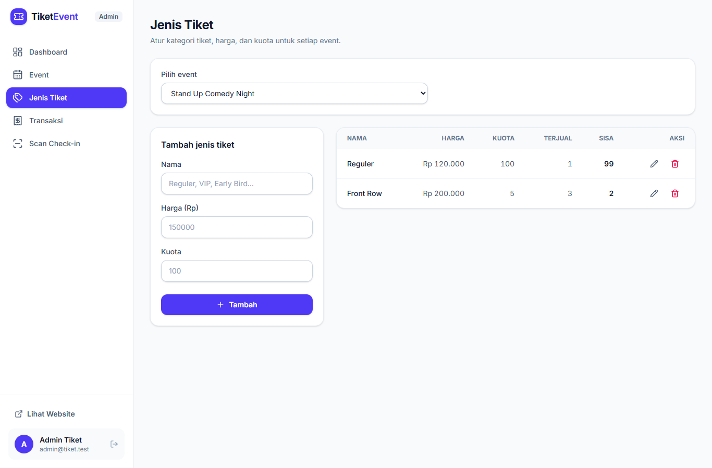

# P4 — Halaman Admin: CRUD Event & Jenis Tiket

**Tujuan:** membuat area admin dengan sidebar, CRUD event (upload banner), dan pengelolaan jenis tiket.

## 4.1 Proteksi route & layout admin

📄 `frontend/src/components/ProtectedRoute.jsx`

```jsx
import { Navigate, Outlet, useLocation } from 'react-router'
import { useAuth } from '../context/AuthContext'
import PageLoader from './Loading'

/**
 * Pembungkus route yang wajib login.
 * <Route element={<ProtectedRoute />}>             -> wajib login
 * <Route element={<ProtectedRoute role="admin" />}> -> wajib login sebagai admin
 */
export default function ProtectedRoute({ role }) {
  const { user, loading } = useAuth()
  const location = useLocation()

  if (loading) return <PageLoader />

  if (!user) {
    // Simpan halaman asal agar setelah login bisa kembali ke sini
    return <Navigate to="/login" replace state={{ from: location }} />
  }

  if (role && user.role !== role) {
    return <Navigate to="/" replace />
  }

  // Outlet = tempat halaman anak (child route) ditampilkan
  return <Outlet />
}
```

📄 `frontend/src/layouts/AdminLayout.jsx`

```jsx
import {
  CalendarDays,
  ExternalLink,
  LayoutDashboard,
  LogOut,
  Receipt,
  ScanLine,
  Tags,
} from 'lucide-react'
import { Link, NavLink, Outlet, useNavigate } from 'react-router'
import { Logo } from '../components/Navbar'
import { useAuth } from '../context/AuthContext'

const menu = [
  { to: '/admin', label: 'Dashboard', icon: LayoutDashboard, end: true },
  { to: '/admin/events', label: 'Event', icon: CalendarDays },
  { to: '/admin/ticket-types', label: 'Jenis Tiket', icon: Tags },
  { to: '/admin/orders', label: 'Transaksi', icon: Receipt },
  { to: '/admin/scanner', label: 'Scan Check-in', icon: ScanLine },
]

const linkClass = ({ isActive }) =>
  `flex shrink-0 items-center gap-3 rounded-xl px-3 py-2.5 text-sm font-medium transition ${
    isActive
      ? 'bg-indigo-600 text-white shadow-sm shadow-indigo-200'
      : 'text-slate-600 hover:bg-slate-100 hover:text-slate-900'
  }`

export default function AdminLayout() {
  const { user, logout } = useAuth()
  const navigate = useNavigate()

  async function handleLogout() {
    await logout()
    navigate('/login')
  }

  return (
    <div className="min-h-screen lg:flex">
      {/* Sidebar (desktop) / menu atas (mobile) */}
      <aside className="border-b border-slate-200 bg-white lg:fixed lg:inset-y-0 lg:flex lg:w-64 lg:flex-col lg:border-r lg:border-b-0">
        <div className="flex h-16 items-center justify-between px-5">
          <Logo />
          <div className="flex items-center gap-2">
            <span className="rounded-md bg-slate-100 px-2 py-0.5 text-xs font-semibold text-slate-600">
              Admin
            </span>
            {/* Tombol keluar khusus layar kecil */}
            <button onClick={handleLogout} className="btn btn-ghost px-2 lg:hidden" title="Keluar">
              <LogOut className="size-4" />
            </button>
          </div>
        </div>

        <nav className="flex gap-1 overflow-x-auto px-3 pb-3 lg:flex-1 lg:flex-col lg:pt-4">
          {menu.map(({ to, label, icon: Icon, end }) => (
            <NavLink key={to} to={to} end={end} className={linkClass}>
              <Icon className="size-5" />
              {label}
            </NavLink>
          ))}
        </nav>

        <div className="hidden border-t border-slate-200 p-4 lg:block">
          <Link to="/" className="btn btn-ghost mb-2 w-full justify-start px-3">
            <ExternalLink className="size-4" /> Lihat Website
          </Link>
          <div className="flex items-center gap-3 rounded-xl bg-slate-50 p-3">
            <span className="flex size-9 items-center justify-center rounded-full bg-indigo-600 text-sm font-bold text-white">
              {user.name.charAt(0).toUpperCase()}
            </span>
            <div className="min-w-0 flex-1">
              <p className="truncate text-sm font-semibold text-slate-900">{user.name}</p>
              <p className="truncate text-xs text-slate-500">{user.email}</p>
            </div>
            <button
              onClick={handleLogout}
              className="text-slate-400 hover:text-rose-600"
              title="Keluar"
            >
              <LogOut className="size-4" />
            </button>
          </div>
        </div>
      </aside>

      <main className="flex-1 lg:pl-64">
        <div className="mx-auto max-w-6xl px-4 py-8 sm:px-6 lg:px-8">
          <Outlet />
        </div>
      </main>
    </div>
  )
}
```

💡 **Penjelasan:** `ProtectedRoute` dipakai sebagai **layout route**. Semua route di dalamnya otomatis wajib login.
Jika diberi `role="admin"`, customer akan dikembalikan ke beranda. Ingat bahwa proteksi di frontend hanya untuk
kenyamanan; keamanan sebenarnya tetap di backend (middleware `role:admin`).

## 4.2 Halaman kelola event

📄 `frontend/src/pages/admin/Events.jsx`

```jsx
import { CalendarDays, Pencil, Plus, Tags, Trash2 } from 'lucide-react'
import { useEffect, useState } from 'react'
import { Link } from 'react-router'
import Alert from '../../components/Alert'
import EmptyState from '../../components/EmptyState'
import { EventBanner } from '../../components/EventCard'
import PageLoader from '../../components/Loading'
import PageHeader from '../../components/PageHeader'
import StatusBadge from '../../components/StatusBadge'
import api, { getErrorMessage } from '../../lib/api'
import { formatShortDateTime } from '../../lib/format'

export default function Events() {
  const [events, setEvents] = useState([])
  const [loading, setLoading] = useState(true)
  const [message, setMessage] = useState({ type: 'success', text: '' })

  function loadEvents() {
    return api
      .get('/admin/events')
      .then((res) => setEvents(res.data.data))
      .finally(() => setLoading(false))
  }

  useEffect(() => {
    loadEvents()
  }, [])

  async function handleDelete(event) {
    if (!confirm(`Hapus event "${event.title}"?`)) return

    try {
      const res = await api.delete(`/admin/events/${event.id}`)
      setMessage({ type: 'success', text: res.data.message })
      loadEvents()
    } catch (error) {
      // mis. event sudah punya transaksi -> 422
      setMessage({ type: 'error', text: getErrorMessage(error) })
    }
  }

  if (loading) return <PageLoader />

  return (
    <>
      <PageHeader
        title="Kelola Event"
        description="Tambah, ubah, dan atur status tayang event."
        action={
          <Link to="/admin/events/new" className="btn btn-primary">
            <Plus className="size-4" /> Tambah Event
          </Link>
        }
      />

      {message.text && (
        <div className="mb-4">
          <Alert type={message.type}>{message.text}</Alert>
        </div>
      )}

      {events.length === 0 ? (
        <EmptyState
          icon={CalendarDays}
          title="Belum ada event"
          description="Mulai dengan menambahkan event pertama."
        />
      ) : (
        <div className="card overflow-x-auto">
          <table className="w-full text-left text-sm">
            <thead className="border-b border-slate-200 bg-slate-50 text-xs font-semibold text-slate-500 uppercase">
              <tr>
                <th className="px-5 py-3">Event</th>
                <th className="px-5 py-3">Tanggal</th>
                <th className="px-5 py-3">Status</th>
                <th className="px-5 py-3 text-right">Terjual</th>
                <th className="px-5 py-3 text-right">Aksi</th>
              </tr>
            </thead>
            <tbody className="divide-y divide-slate-100">
              {events.map((event) => (
                <tr key={event.id} className="hover:bg-slate-50/60">
                  <td className="px-5 py-3">
                    <div className="flex items-center gap-3">
                      <div className="h-10 w-16 shrink-0 overflow-hidden rounded-lg bg-slate-100">
                        <EventBanner event={event} />
                      </div>
                      <div className="min-w-0">
                        <p className="truncate font-medium text-slate-900">{event.title}</p>
                        <p className="truncate text-xs text-slate-500">{event.venue}</p>
                      </div>
                    </div>
                  </td>
                  <td className="px-5 py-3 whitespace-nowrap text-slate-600">
                    {formatShortDateTime(event.start_at)}
                  </td>
                  <td className="px-5 py-3">
                    <StatusBadge status={event.status} />
                  </td>
                  <td className="px-5 py-3 text-right whitespace-nowrap text-slate-600 tabular-nums">
                    {event.tickets_sold} / {event.tickets_quota}
                  </td>
                  <td className="px-5 py-3">
                    <div className="flex justify-end gap-1">
                      <Link
                        to={`/admin/ticket-types?event_id=${event.id}`}
                        className="btn btn-ghost px-2.5 py-2"
                        title="Jenis tiket"
                      >
                        <Tags className="size-4" />
                      </Link>
                      <Link
                        to={`/admin/events/${event.id}/edit`}
                        className="btn btn-ghost px-2.5 py-2"
                        title="Ubah"
                      >
                        <Pencil className="size-4" />
                      </Link>
                      <button
                        onClick={() => handleDelete(event)}
                        className="btn btn-ghost px-2.5 py-2 text-rose-600 hover:bg-rose-50 hover:text-rose-700"
                        title="Hapus"
                      >
                        <Trash2 className="size-4" />
                      </button>
                    </div>
                  </td>
                </tr>
              ))}
            </tbody>
          </table>
        </div>
      )}
    </>
  )
}
```

📄 `frontend/src/pages/admin/EventForm.jsx`

```jsx
import { ArrowLeft, ImagePlus } from 'lucide-react'
import { useEffect, useState } from 'react'
import { Link, useNavigate, useParams } from 'react-router'
import Alert from '../../components/Alert'
import PageLoader, { Spinner } from '../../components/Loading'
import PageHeader from '../../components/PageHeader'
import api, { getErrorMessage, getFieldErrors } from '../../lib/api'
import { toDateTimeLocal } from '../../lib/format'

// Pesan error di bawah input
function FieldError({ error }) {
  return error ? <p className="mt-1.5 text-xs text-rose-600">{error[0]}</p> : null
}

export default function EventForm() {
  const { id } = useParams() // ada id = mode edit, tidak ada = mode tambah
  const isEdit = Boolean(id)
  const navigate = useNavigate()

  const [form, setForm] = useState({
    title: '',
    venue: '',
    start_at: '',
    status: 'draft',
    description: '',
  })
  const [bannerFile, setBannerFile] = useState(null)
  const [preview, setPreview] = useState(null)
  const [errors, setErrors] = useState({})
  const [message, setMessage] = useState('')
  const [loading, setLoading] = useState(isEdit)
  const [saving, setSaving] = useState(false)

  // Mode edit: isi form dengan data event yang sudah ada
  useEffect(() => {
    if (!isEdit) return
    // Abaikan respons yang datang terlambat (mis. effect dijalankan dua kali oleh
    // StrictMode, atau pindah ke event lain). Tanpa ini, respons lama bisa menimpa
    // isian form yang sudah diubah admin.
    let active = true

    api
      .get(`/admin/events/${id}`)
      .then((res) => {
        if (!active) return
        const event = res.data.data
        setForm({
          title: event.title,
          venue: event.venue,
          start_at: toDateTimeLocal(event.start_at),
          status: event.status,
          description: event.description,
        })
        setPreview(event.banner_url)
      })
      .finally(() => active && setLoading(false))

    return () => {
      active = false // cleanup: respons dari request ini tidak dipakai lagi
    }
  }, [id, isEdit])

  function handleChange(e) {
    setForm({ ...form, [e.target.name]: e.target.value })
  }

  function handleFile(e) {
    const file = e.target.files[0]
    if (!file) return
    setBannerFile(file)
    setPreview(URL.createObjectURL(file)) // pratinjau gambar sebelum di-upload
  }

  async function handleSubmit(e) {
    e.preventDefault()
    setSaving(true)
    setErrors({})
    setMessage('')

    // Upload file wajib memakai FormData (multipart/form-data), bukan JSON
    const data = new FormData()
    Object.entries(form).forEach(([key, value]) => data.append(key, value))
    if (bannerFile) data.append('banner', bannerFile)

    try {
      if (isEdit) {
        // PHP tidak bisa membaca file dari request PUT,
        // jadi kirim POST + _method=PUT (method spoofing Laravel)
        data.append('_method', 'PUT')
        await api.post(`/admin/events/${id}`, data)
        navigate('/admin/events')
      } else {
        const res = await api.post('/admin/events', data)
        // Event baru belum punya tiket: langsung arahkan ke halaman jenis tiket
        navigate(`/admin/ticket-types?event_id=${res.data.data.id}`)
      }
    } catch (error) {
      const fieldErrors = getFieldErrors(error)
      setErrors(fieldErrors)
      // Pesan umum hanya ditampilkan jika bukan error validasi per field
      if (Object.keys(fieldErrors).length === 0) setMessage(getErrorMessage(error))
    } finally {
      setSaving(false)
    }
  }

  if (loading) return <PageLoader />

  return (
    <>
      <Link
        to="/admin/events"
        className="mb-4 inline-flex items-center gap-1.5 text-sm text-slate-500 hover:text-indigo-600"
      >
        <ArrowLeft className="size-4" /> Kembali ke daftar event
      </Link>

      <PageHeader
        title={isEdit ? 'Ubah Event' : 'Tambah Event'}
        description="Event berstatus Draft tidak tampil di halaman publik."
      />

      <form onSubmit={handleSubmit} className="grid gap-6 lg:grid-cols-3">
        <div className="card space-y-5 p-6 lg:col-span-2">
          {message && <Alert type="error">{message}</Alert>}

          <div>
            <label htmlFor="title" className="label">
              Judul event
            </label>
            <input
              id="title"
              name="title"
              value={form.title}
              onChange={handleChange}
              className={`input ${errors.title ? 'input-error' : ''}`}
              placeholder="Contoh: Jakarta Music Festival 2026"
            />
            <FieldError error={errors.title} />
          </div>

          <div className="grid gap-5 sm:grid-cols-2">
            <div>
              <label htmlFor="venue" className="label">
                Lokasi
              </label>
              <input
                id="venue"
                name="venue"
                value={form.venue}
                onChange={handleChange}
                className={`input ${errors.venue ? 'input-error' : ''}`}
                placeholder="Nama gedung, kota"
              />
              <FieldError error={errors.venue} />
            </div>
            <div>
              <label htmlFor="start_at" className="label">
                Waktu mulai
              </label>
              <input
                id="start_at"
                name="start_at"
                type="datetime-local"
                value={form.start_at}
                onChange={handleChange}
                className={`input ${errors.start_at ? 'input-error' : ''}`}
              />
              <FieldError error={errors.start_at} />
            </div>
          </div>

          <div>
            <label htmlFor="description" className="label">
              Deskripsi
            </label>
            <textarea
              id="description"
              name="description"
              rows={6}
              value={form.description}
              onChange={handleChange}
              className={`input ${errors.description ? 'input-error' : ''}`}
              placeholder="Ceritakan tentang event ini..."
            />
            <FieldError error={errors.description} />
          </div>
        </div>

        <div className="space-y-6">
          <div className="card p-6">
            <label className="label">Banner</label>
            {/* Label membungkus input file agar area gambar bisa diklik */}
            <label className="group relative flex aspect-[2/1] cursor-pointer items-center justify-center overflow-hidden rounded-xl border-2 border-dashed border-slate-300 bg-slate-50 hover:border-indigo-400">
              {preview ? (
                
              ) : (
                <div className="text-center text-slate-500">
                  <ImagePlus className="mx-auto size-8" />
                  <p className="mt-1 text-xs">Klik untuk memilih gambar</p>
                </div>
              )}
              <input type="file" accept="image/*" onChange={handleFile} className="hidden" />
            </label>
            <p className="mt-2 text-xs text-slate-500">JPG/PNG, maksimal 2 MB.</p>
            <FieldError error={errors.banner} />
          </div>

          <div className="card p-6">
            <label htmlFor="status" className="label">
              Status
            </label>
            <select
              id="status"
              name="status"
              value={form.status}
              onChange={handleChange}
              className="input"
            >
              <option value="draft">Draft (disembunyikan)</option>
              <option value="published">Tayang (tampil di publik)</option>
            </select>

            <button type="submit" disabled={saving} className="btn btn-primary mt-6 w-full py-3">
              {saving && <Spinner />}
              {isEdit ? 'Simpan Perubahan' : 'Simpan & Atur Tiket'}
            </button>
          </div>
        </div>
      </form>
    </>
  )
}
```

💡 **Penjelasan:**
- Satu komponen `EventForm` dipakai untuk **tambah** dan **ubah**. Bedanya dideteksi dari ada tidaknya `:id` di URL.
- Upload file memakai **`FormData`**, bukan JSON. Axios otomatis mengirim `multipart/form-data`.
- `URL.createObjectURL(file)` membuat pratinjau gambar sebelum di-upload.
- `<input type="datetime-local">` butuh format `YYYY-MM-DDTHH:mm`, makanya ada helper `toDateTimeLocal()`.
- Flag `active` + fungsi cleanup di `useEffect` membuat respons yang datang terlambat **diabaikan**. Tanpa ini,
  StrictMode memicu dua request, respons kedua menimpa status yang baru dipilih admin, dan perubahan tidak tersimpan.
  Bug ini ditemukan oleh smoke test Playwright (P10).

## 4.3 Halaman jenis tiket

📄 `frontend/src/pages/admin/TicketTypes.jsx`

```jsx
import { Pencil, Plus, Tags, Trash2 } from 'lucide-react'
import { useEffect, useState } from 'react'
import { useSearchParams } from 'react-router'
import Alert from '../../components/Alert'
import EmptyState from '../../components/EmptyState'
import { Spinner } from '../../components/Loading'
import PageHeader from '../../components/PageHeader'
import api, { getErrorMessage, getFieldErrors } from '../../lib/api'
import { formatRupiah } from '../../lib/format'

const emptyForm = { name: '', price: '', quota: '' }

export default function TicketTypes() {
  const [events, setEvents] = useState([])
  const [ticketTypes, setTicketTypes] = useState([])
  const [form, setForm] = useState(emptyForm)
  const [editing, setEditing] = useState(null) // jenis tiket yang sedang diubah
  const [errors, setErrors] = useState({})
  const [message, setMessage] = useState({ type: 'success', text: '' })
  const [saving, setSaving] = useState(false)

  // Event yang dipilih disimpan di URL: /admin/ticket-types?event_id=1
  const [searchParams, setSearchParams] = useSearchParams()
  const selectedId = searchParams.get('event_id') || String(events[0]?.id ?? '')

  // Daftar event untuk dropdown
  useEffect(() => {
    api.get('/admin/events').then((res) => setEvents(res.data.data))
  }, [])

  function loadTicketTypes(eventId) {
    api
      .get('/admin/ticket-types', { params: { event_id: eventId } })
      .then((res) => setTicketTypes(res.data.data))
  }

  // Muat ulang jenis tiket setiap kali event yang dipilih berubah
  useEffect(() => {
    if (selectedId) loadTicketTypes(selectedId)
  }, [selectedId])

  function resetForm() {
    setForm(emptyForm)
    setEditing(null)
    setErrors({})
  }

  function handleSelectEvent(e) {
    setSearchParams({ event_id: e.target.value })
    resetForm()
    setMessage({ type: 'success', text: '' })
  }

  function handleEdit(ticketType) {
    setEditing(ticketType)
    setForm({ name: ticketType.name, price: ticketType.price, quota: ticketType.quota })
    setErrors({})
  }

  async function handleSubmit(e) {
    e.preventDefault()
    setSaving(true)
    setErrors({})

    try {
      if (editing) {
        await api.put(`/admin/ticket-types/${editing.id}`, form)
        setMessage({ type: 'success', text: 'Jenis tiket berhasil diubah.' })
      } else {
        await api.post('/admin/ticket-types', { ...form, event_id: selectedId })
        setMessage({ type: 'success', text: 'Jenis tiket berhasil ditambahkan.' })
      }
      resetForm()
      loadTicketTypes(selectedId)
    } catch (error) {
      setErrors(getFieldErrors(error))
    } finally {
      setSaving(false)
    }
  }

  async function handleDelete(ticketType) {
    if (!confirm(`Hapus jenis tiket "${ticketType.name}"?`)) return

    try {
      const res = await api.delete(`/admin/ticket-types/${ticketType.id}`)
      setMessage({ type: 'success', text: res.data.message })
      loadTicketTypes(selectedId)
    } catch (error) {
      setMessage({ type: 'error', text: getErrorMessage(error) })
    }
  }

  return (
    <>
      <PageHeader
        title="Jenis Tiket"
        description="Atur kategori tiket, harga, dan kuota untuk setiap event."
      />

      <div className="card mb-6 p-5">
        <label htmlFor="event" className="label">
          Pilih event
        </label>
        <select
          id="event"
          value={selectedId}
          onChange={handleSelectEvent}
          className="input max-w-lg"
        >
          {events.map((event) => (
            <option key={event.id} value={event.id}>
              {event.title} {event.status === 'draft' ? '(Draft)' : ''}
            </option>
          ))}
        </select>
      </div>

      {message.text && (
        <div className="mb-4">
          <Alert type={message.type}>{message.text}</Alert>
        </div>
      )}

      <div className="grid gap-6 lg:grid-cols-3">
        {/* Form tambah / ubah */}
        <form onSubmit={handleSubmit} className="card h-fit space-y-4 p-5">
          <h2 className="font-semibold text-slate-900">
            {editing ? `Ubah "${editing.name}"` : 'Tambah jenis tiket'}
          </h2>

          <div>
            <label htmlFor="name" className="label">
              Nama
            </label>
            <input
              id="name"
              value={form.name}
              onChange={(e) => setForm({ ...form, name: e.target.value })}
              className={`input ${errors.name ? 'input-error' : ''}`}
              placeholder="Reguler, VIP, Early Bird..."
            />
            {errors.name && <p className="mt-1.5 text-xs text-rose-600">{errors.name[0]}</p>}
          </div>

          <div>
            <label htmlFor="price" className="label">
              Harga (Rp)
            </label>
            <input
              id="price"
              type="number"
              min="0"
              value={form.price}
              onChange={(e) => setForm({ ...form, price: e.target.value })}
              className={`input ${errors.price ? 'input-error' : ''}`}
              placeholder="150000"
            />
            {errors.price && <p className="mt-1.5 text-xs text-rose-600">{errors.price[0]}</p>}
          </div>

          <div>
            <label htmlFor="quota" className="label">
              Kuota
            </label>
            <input
              id="quota"
              type="number"
              min="1"
              value={form.quota}
              onChange={(e) => setForm({ ...form, quota: e.target.value })}
              className={`input ${errors.quota ? 'input-error' : ''}`}
              placeholder="100"
            />
            {errors.quota && <p className="mt-1.5 text-xs text-rose-600">{errors.quota[0]}</p>}
          </div>

          <div className="flex gap-2 pt-2">
            <button
              type="submit"
              disabled={saving || !selectedId}
              className="btn btn-primary flex-1"
            >
              {saving ? <Spinner /> : <Plus className="size-4" />}
              {editing ? 'Simpan' : 'Tambah'}
            </button>
            {editing && (
              <button type="button" onClick={resetForm} className="btn btn-secondary">
                Batal
              </button>
            )}
          </div>
        </form>

        {/* Tabel jenis tiket */}
        <div className="lg:col-span-2">
          {ticketTypes.length === 0 ? (
            <EmptyState
              icon={Tags}
              title="Belum ada jenis tiket"
              description="Tambahkan jenis tiket agar event bisa dibeli."
            />
          ) : (
            <div className="card overflow-x-auto">
              <table className="w-full text-left text-sm">
                <thead className="border-b border-slate-200 bg-slate-50 text-xs font-semibold text-slate-500 uppercase">
                  <tr>
                    <th className="px-5 py-3">Nama</th>
                    <th className="px-5 py-3 text-right">Harga</th>
                    <th className="px-5 py-3 text-right">Kuota</th>
                    <th className="px-5 py-3 text-right">Terjual</th>
                    <th className="px-5 py-3 text-right">Sisa</th>
                    <th className="px-5 py-3 text-right">Aksi</th>
                  </tr>
                </thead>
                <tbody className="divide-y divide-slate-100 tabular-nums">
                  {ticketTypes.map((type) => (
                    <tr
                      key={type.id}
                      className={
                        editing?.id === type.id ? 'bg-indigo-50/60' : 'hover:bg-slate-50/60'
                      }
                    >
                      <td className="px-5 py-3 font-medium text-slate-900">{type.name}</td>
                      <td className="px-5 py-3 text-right text-slate-600">
                        {formatRupiah(type.price)}
                      </td>
                      <td className="px-5 py-3 text-right text-slate-600">{type.quota}</td>
                      <td className="px-5 py-3 text-right text-slate-600">{type.sold}</td>
                      <td className="px-5 py-3 text-right font-semibold text-slate-900">
                        {type.remaining}
                      </td>
                      <td className="px-5 py-3">
                        <div className="flex justify-end gap-1">
                          <button
                            onClick={() => handleEdit(type)}
                            className="btn btn-ghost px-2.5 py-2"
                            title="Ubah"
                          >
                            <Pencil className="size-4" />
                          </button>
                          <button
                            onClick={() => handleDelete(type)}
                            className="btn btn-ghost px-2.5 py-2 text-rose-600 hover:bg-rose-50 hover:text-rose-700"
                            title="Hapus"
                          >
                            <Trash2 className="size-4" />
                          </button>
                        </div>
                      </td>
                    </tr>
                  ))}
                </tbody>
              </table>
            </div>
          )}
        </div>
      </div>
    </>
  )
}
```

💡 **Penjelasan:** event yang dipilih disimpan di URL (`?event_id=3`), sehingga tombol "Jenis tiket" di daftar event
bisa langsung membuka event yang benar. Form yang sama dipakai untuk tambah dan ubah (`editing`).

## 4.4 Routing (versi P4)

Tambahkan import dan blok route admin di 📄 `frontend/src/App.jsx`. Karena Dashboard baru dibuat di P9,
untuk sementara `/admin` diarahkan ke daftar event:

```jsx
import { Navigate, Route, Routes } from 'react-router'
import ProtectedRoute from './components/ProtectedRoute'
import AdminLayout from './layouts/AdminLayout'
import EventForm from './pages/admin/EventForm'
import AdminEvents from './pages/admin/Events'
import TicketTypes from './pages/admin/TicketTypes'
// ... import halaman P3 tetap ada

      {/* di dalam <Routes>, setelah blok MainLayout */}
      <Route path="/admin" element={<ProtectedRoute role="admin" />}>
        <Route element={<AdminLayout />}>
          <Route index element={<Navigate to="events" replace />} />
          <Route path="events" element={<AdminEvents />} />
          <Route path="events/new" element={<EventForm />} />
          <Route path="events/:id/edit" element={<EventForm />} />
          <Route path="ticket-types" element={<TicketTypes />} />
        </Route>
      </Route>
```



## 🧑‍🏫 Catatan Mengajar P4

- Demo **method spoofing**: tunjukkan bahwa `PUT` + file gagal terbaca di Laravel, lalu perbaiki dengan `POST` + `_method=PUT`.
- Diskusi: "Kenapa tombol hapus event bisa ditolak?" (karena ada transaksi → menjaga integritas data).
- Menu Transaksi dan Scan Check-in baru aktif di P9.

## ✅ Checkpoint P4

- [ ] Login sebagai admin langsung masuk ke `/admin`
- [ ] Tambah event + banner, lalu event muncul di Home jika berstatus "Tayang"
- [ ] Tambah/ubah/hapus jenis tiket; kuota tidak bisa diturunkan di bawah jumlah terjual

---

⬅️ [P3 — React: Setup, Layout, Auth, Daftar & Detail Event](P03-react-daftar-detail-event.md) · 🏠 [Daftar isi](../../README.md#daftar-isi) · [P5 — Checkout + Penguncian Kuota](P05-checkout-penguncian-kuota.md) ➡️
