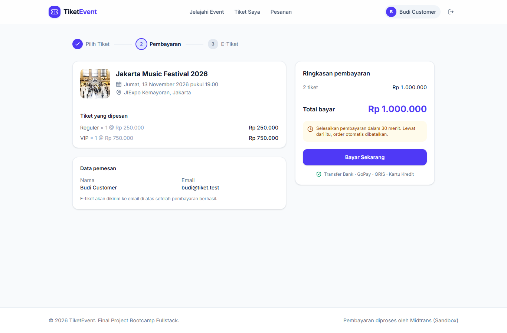
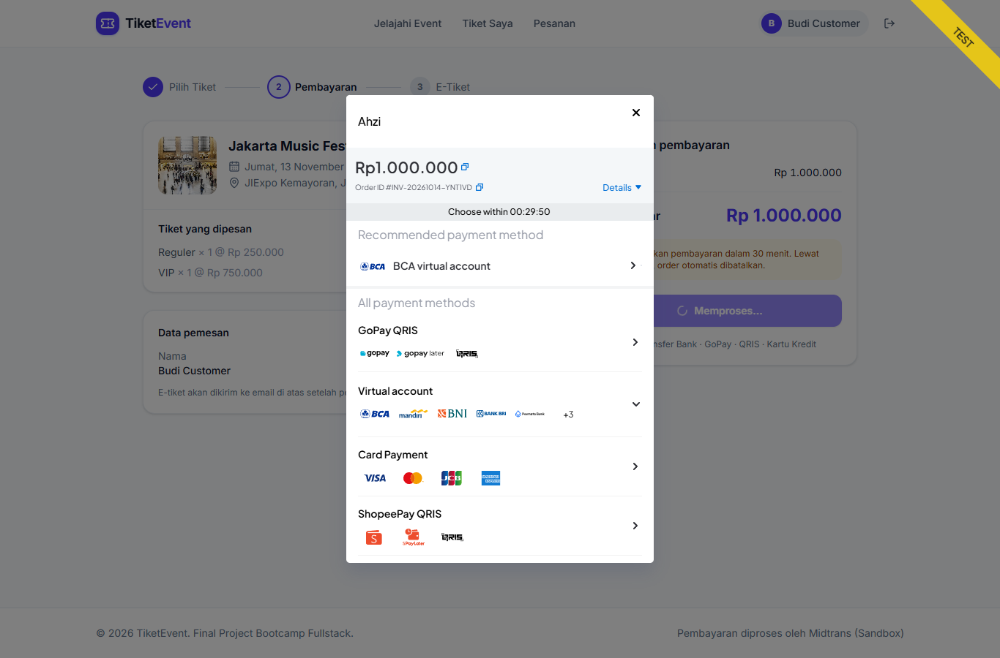

# P6 — Snap Token + Popup Pembayaran

**Tujuan:** meminta Snap token ke Midtrans, membuka popup pembayaran di React, dan membuat halaman status & riwayat order.

## 6.1 Konfigurasi Midtrans

```bash
composer require midtrans/midtrans-php
```

Tambahkan di 📄 `backend/.env` (nilai dari **Dashboard Midtrans Sandbox → Settings → Access Keys**):

```env
MIDTRANS_MERCHANT_ID=Gxxxxxxxxx
MIDTRANS_SERVER_KEY=SB-Mid-server-xxxxxxxxxxxxxxxx
MIDTRANS_CLIENT_KEY=SB-Mid-client-xxxxxxxxxxxxxxxx
MIDTRANS_IS_PRODUCTION=false
```

Di `.env.example`, tulis nama variabelnya saja dengan nilai kosong.

📄 `backend/config/midtrans.php`

```php
<?php

// Konfigurasi Midtrans. Nilai asli disimpan di .env, JANGAN ditulis di kode.
return [
    'merchant_id' => env('MIDTRANS_MERCHANT_ID'),
    'server_key' => env('MIDTRANS_SERVER_KEY'),
    'client_key' => env('MIDTRANS_CLIENT_KEY'),
    'is_production' => env('MIDTRANS_IS_PRODUCTION', false),

    // Opsional. Jika diisi, webhook transaksi dari server ini dikirim ke URL ini,
    // bukan ke Notification URL di dashboard Midtrans. Berguna agar laptop (ngrok)
    // dan VPS bisa memakai satu akun Sandbox yang sama.
    'notification_url' => env('MIDTRANS_NOTIFICATION_URL'),

    // Lama waktu pembayaran sebelum order kedaluwarsa (menit)
    'expiry_minutes' => 30,
];
```

> Setelah mengubah `.env` atau file config, jalankan `php artisan config:clear` jika nilai baru belum terbaca.
>
> `MIDTRANS_NOTIFICATION_URL` biarkan kosong selama development. Variabel ini baru dipakai saat deploy (P10, Langkah 7).

## 6.2 MidtransService

📄 `backend/app/Services/MidtransService.php`

```php
<?php

namespace App\Services;

use App\Models\Order;
use App\Models\OrderItem;
use Illuminate\Support\Str;
use Midtrans\Config;
use Midtrans\Snap;

/**
 * Semua komunikasi dengan Midtrans dikumpulkan di sini,
 * supaya controller tetap ringkas dan mudah dibaca.
 */
class MidtransService
{
    public function __construct()
    {
        Config::$serverKey = config('midtrans.server_key');
        Config::$isProduction = (bool) config('midtrans.is_production');
        Config::$isSanitized = true; // bersihkan input sebelum dikirim
        Config::$is3ds = true; // aktifkan 3D Secure untuk kartu kredit
        // Kosong = Midtrans memakai Notification URL dari dashboard
        Config::$overrideNotifUrl = config('midtrans.notification_url');
    }

    /**
     * Minta Snap token untuk sebuah order.
     * Token ini dipakai React untuk membuka popup pembayaran (window.snap.pay).
     */
    public function createSnapToken(Order $order): string
    {
        $order->loadMissing('user', 'items.ticketType.event');

        $itemDetails = $order->items->map(fn (OrderItem $item) => [
            'id' => (string) $item->ticket_type_id,
            'price' => $item->price,
            'quantity' => $item->qty,
            // Midtrans membatasi nama item maksimal 50 karakter
            'name' => Str::limit($item->ticketType->event->title.' - '.$item->ticketType->name, 47),
        ])->all();

        $params = [
            'transaction_details' => [
                'order_id' => $order->order_code, // harus unik, tidak boleh dipakai ulang
                'gross_amount' => $order->total, // harus SAMA dengan jumlah price × quantity
            ],
            'item_details' => $itemDetails,
            'customer_details' => [
                'first_name' => $order->user->name,
                'email' => $order->user->email,
            ],
            // Batas waktu pembayaran, sama dengan expires_at di tabel orders
            'expiry' => [
                'start_time' => $order->created_at->format('Y-m-d H:i:s O'),
                'unit' => 'minutes',
                'duration' => config('midtrans.expiry_minutes'),
            ],
        ];

        return Snap::getSnapToken($params);
    }

    /**
     * Pastikan notifikasi benar-benar dari Midtrans, bukan request palsu.
     * signature_key = sha512(order_id + status_code + gross_amount + server_key)
     *
     * Catatan: gross_amount dari Midtrans berupa string, mis. "150000.00".
     * Pakai apa adanya, JANGAN diubah menjadi angka.
     */
    public function isValidSignature(array $payload): bool
    {
        $expected = hash('sha512',
            ($payload['order_id'] ?? '').
            ($payload['status_code'] ?? '').
            ($payload['gross_amount'] ?? '').
            config('midtrans.server_key')
        );

        // hash_equals lebih aman daripada === untuk membandingkan hash
        return hash_equals($expected, (string) ($payload['signature_key'] ?? ''));
    }
}
```

💡 **Penjelasan parameter Snap:**
- `order_id` = `order_code`. **Tidak boleh dipakai ulang**. Jika customer ingin mencoba lagi setelah gagal, buat order baru.
- `gross_amount` **harus sama persis** dengan jumlah `price × quantity` di `item_details`. Jika tidak, Midtrans menolak dengan error 400.
- `expiry` 30 menit disamakan dengan `expires_at` di tabel orders.
- Method `isValidSignature()` dipakai di P7 untuk memverifikasi webhook.

## 6.3 Hubungkan ke OrderService

Ubah 📄 `backend/app/Services/OrderService.php`:

**a.** Tambahkan import dan constructor di dalam class:

```php
use Throwable;

class OrderService
{
    public function __construct(private MidtransService $midtrans) {}
```

**b.** Di method `checkout()`, ganti `return DB::transaction(...)` menjadi `$order = DB::transaction(...)`, lalu
tambahkan blok berikut setelah transaksi selesai:

```php
        $order = DB::transaction(function () use ($user, $items) {
            // ... isi sama seperti P5 ...
        });

        // Snap token diminta DI LUAR transaksi supaya lock database
        // tidak tertahan selama menunggu respons HTTP dari Midtrans.
        try {
            $order->update(['snap_token' => $this->midtrans->createSnapToken($order)]);
        } catch (Throwable $e) {
            report($e); // catat ke storage/logs/laravel.log

            // Gagal menghubungi Midtrans: batalkan order & kembalikan kuota
            DB::transaction(function () use ($order) {
                $order->update(['status' => 'failed']);
                $order->releaseQuota();
            });

            abort(502, 'Gagal terhubung ke Midtrans. Silakan coba lagi.');
        }

        return $order;
```

**c.** Ganti `now()->addMinutes(30)` menjadi `now()->addMinutes(config('midtrans.expiry_minutes'))`.

💡 **Penjelasan:** kenapa Snap token tidak diminta di dalam transaksi? Request HTTP ke Midtrans bisa memakan waktu 1–3 detik.
Jika dilakukan di dalam transaksi, baris `ticket_types` terkunci selama itu dan semua pembeli lain ikut menunggu.

## 6.4 Frontend: Snap, Checkout, Status, Riwayat

📄 `frontend/src/lib/midtrans.js`

```js
// Memuat script Snap Midtrans satu kali saja, lalu membuka popup pembayaran.
let snapPromise = null

function loadSnap() {
  if (window.snap) return Promise.resolve(window.snap)

  if (!snapPromise) {
    snapPromise = new Promise((resolve, reject) => {
      const script = document.createElement('script')
      script.src = import.meta.env.VITE_MIDTRANS_SNAP_URL
      // Client Key boleh berada di frontend (berbeda dengan Server Key!)
      script.setAttribute('data-client-key', import.meta.env.VITE_MIDTRANS_CLIENT_KEY)
      script.onload = () => resolve(window.snap)
      script.onerror = () => {
        snapPromise = null
        reject(new Error('Gagal memuat Midtrans Snap. Periksa koneksi internet.'))
      }
      document.body.appendChild(script)
    })
  }

  return snapPromise
}

/**
 * Buka popup pembayaran Midtrans.
 * Callback hanya untuk navigasi/UI. Status pembayaran yang SEBENARNYA
 * ditentukan oleh webhook di backend, bukan oleh callback ini.
 */
export async function payWithSnap(snapToken, callbacks = {}) {
  const snap = await loadSnap()
  // callbacks: { onSuccess, onPending, onError, onClose }, semuanya opsional.
  // Kirim apa adanya: Snap menolak callback yang bernilai undefined
  // ("onSuccess should be of type function").
  snap.pay(snapToken, callbacks)
}
```

📄 `frontend/src/pages/customer/Checkout.jsx`

```jsx
import { CalendarDays, Check, Clock, MapPin, ShieldCheck, ShoppingBag } from 'lucide-react'
import { useState } from 'react'
import { Link, useLocation, useNavigate } from 'react-router'
import Alert from '../../components/Alert'
import EmptyState from '../../components/EmptyState'
import { EventBanner } from '../../components/EventCard'
import { Spinner } from '../../components/Loading'
import { useAuth } from '../../context/AuthContext'
import api, { getErrorMessage } from '../../lib/api'
import { formatDateTime, formatRupiah } from '../../lib/format'
import { payWithSnap } from '../../lib/midtrans'

// Indikator langkah: Pilih Tiket -> Pembayaran -> E-Tiket
function Steps() {
  const steps = ['Pilih Tiket', 'Pembayaran', 'E-Tiket']
  return (
    <ol className="mb-8 flex items-center gap-2 text-sm">
      {steps.map((step, index) => (
        <li key={step} className="flex items-center gap-2">
          <span
            className={`flex size-7 items-center justify-center rounded-full text-xs font-bold ${
              index === 0
                ? 'bg-indigo-600 text-white'
                : index === 1
                  ? 'bg-indigo-100 text-indigo-700 ring-2 ring-indigo-600'
                  : 'bg-slate-200 text-slate-500'
            }`}
          >
            {index === 0 ? <Check className="size-4" /> : index + 1}
          </span>
          <span className={index === 1 ? 'font-semibold text-slate-900' : 'text-slate-500'}>
            {step}
          </span>
          {index < steps.length - 1 && <span className="mx-1 h-px w-8 bg-slate-300 sm:w-12" />}
        </li>
      ))}
    </ol>
  )
}

export default function Checkout() {
  const { state } = useLocation() // data dari halaman Detail Event
  const { user } = useAuth()
  const navigate = useNavigate()
  const [processing, setProcessing] = useState(false)
  const [error, setError] = useState('')

  // Halaman di-refresh / dibuka langsung: data pilihan tiket hilang
  if (!state?.items?.length) {
    return (
      <div className="mx-auto max-w-xl px-4 py-16">
        <EmptyState
          icon={ShoppingBag}
          title="Belum ada tiket yang dipilih"
          description="Pilih event dan jumlah tiket terlebih dahulu."
          action={
            <Link to="/" className="btn btn-primary">
              Lihat Event
            </Link>
          }
        />
      </div>
    )
  }

  const { event, items } = state
  const total = items.reduce((sum, item) => sum + item.ticketType.price * item.qty, 0)

  async function handlePay() {
    setProcessing(true)
    setError('')

    try {
      // 1. Buat order di backend (kuota dikunci, Snap token dibuat)
      const res = await api.post('/checkout', {
        items: items.map((item) => ({ ticket_type_id: item.ticketType.id, qty: item.qty })),
      })
      const order = res.data.data

      // 2. Buka popup Midtrans. Apa pun hasilnya, arahkan ke halaman status.
      //    Status final tetap ditentukan webhook di backend.
      const goToStatus = () => navigate(`/orders/${order.order_code}`, { replace: true })
      await payWithSnap(order.snap_token, {
        onSuccess: goToStatus,
        onPending: goToStatus,
        onError: goToStatus,
        onClose: goToStatus,
      })
    } catch (err) {
      setError(getErrorMessage(err)) // mis. "Sisa kuota tiket VIP tinggal 1."
      setProcessing(false)
    }
  }

  return (
    <div className="mx-auto max-w-5xl px-4 py-10 sm:px-6">
      <Steps />

      <div className="grid gap-6 lg:grid-cols-5">
        <div className="space-y-6 lg:col-span-3">
          {/* Ringkasan event */}
          <section className="card overflow-hidden">
            <div className="flex gap-4 p-5">
              <div className="size-20 shrink-0 overflow-hidden rounded-xl bg-slate-100">
                <EventBanner event={event} />
              </div>
              <div className="min-w-0">
                <h2 className="truncate text-lg font-bold text-slate-900">{event.title}</h2>
                <p className="mt-1 flex items-center gap-1.5 text-sm text-slate-500">
                  <CalendarDays className="size-4" /> {formatDateTime(event.start_at)}
                </p>
                <p className="mt-0.5 flex items-center gap-1.5 text-sm text-slate-500">
                  <MapPin className="size-4" /> {event.venue}
                </p>
              </div>
            </div>

            <div className="border-t border-slate-100 px-5 py-4">
              <h3 className="text-sm font-semibold text-slate-900">Tiket yang dipesan</h3>
              <ul className="mt-3 space-y-2">
                {items.map(({ ticketType, qty }) => (
                  <li key={ticketType.id} className="flex justify-between text-sm">
                    <span className="text-slate-600">
                      {ticketType.name}{' '}
                      <span className="text-slate-400">
                        × {qty} @ {formatRupiah(ticketType.price)}
                      </span>
                    </span>
                    <span className="font-medium text-slate-900 tabular-nums">
                      {formatRupiah(ticketType.price * qty)}
                    </span>
                  </li>
                ))}
              </ul>
            </div>
          </section>

          {/* Data pemesan */}
          <section className="card p-5">
            <h3 className="text-sm font-semibold text-slate-900">Data pemesan</h3>
            <dl className="mt-3 grid gap-3 text-sm sm:grid-cols-2">
              <div>
                <dt className="text-slate-500">Nama</dt>
                <dd className="font-medium text-slate-900">{user.name}</dd>
              </div>
              <div>
                <dt className="text-slate-500">Email</dt>
                <dd className="font-medium text-slate-900">{user.email}</dd>
              </div>
            </dl>
            <p className="mt-3 text-xs text-slate-500">
              E-tiket akan dikirim ke email di atas setelah pembayaran berhasil.
            </p>
          </section>
        </div>

        {/* Pembayaran */}
        <aside className="lg:col-span-2">
          <div className="card sticky top-24 p-5">
            <h3 className="font-semibold text-slate-900">Ringkasan pembayaran</h3>

            <div className="mt-4 flex items-center justify-between border-b border-slate-100 pb-4 text-sm">
              <span className="text-slate-500">
                {items.reduce((sum, item) => sum + item.qty, 0)} tiket
              </span>
              <span className="text-slate-900 tabular-nums">{formatRupiah(total)}</span>
            </div>
            <div className="mt-4 flex items-center justify-between">
              <span className="font-semibold text-slate-900">Total bayar</span>
              <span className="text-2xl font-bold text-indigo-600">{formatRupiah(total)}</span>
            </div>

            <div className="mt-4 flex items-start gap-2 rounded-xl bg-amber-50 p-3 text-xs text-amber-800">
              <Clock className="mt-0.5 size-4 shrink-0" />
              Selesaikan pembayaran dalam 30 menit. Lewat dari itu, order otomatis dibatalkan.
            </div>

            {error && (
              <div className="mt-4">
                <Alert type="error">{error}</Alert>
              </div>
            )}

            <button
              onClick={handlePay}
              disabled={processing}
              className="btn btn-primary mt-5 w-full py-3"
            >
              {processing && <Spinner />}
              {processing ? 'Memproses...' : 'Bayar Sekarang'}
            </button>

            <p className="mt-4 flex items-center justify-center gap-1.5 text-xs text-slate-500">
              <ShieldCheck className="size-4 text-emerald-600" />
              Transfer Bank · GoPay · QRIS · Kartu Kredit
            </p>
          </div>
        </aside>
      </div>
    </div>
  )
}
```

📄 `frontend/src/pages/customer/PaymentStatus.jsx`

```jsx
import { CircleCheck, CircleX, Clock, SearchX, TimerOff } from 'lucide-react'
import { useEffect, useState } from 'react'
import { Link, useParams } from 'react-router'
import Alert from '../../components/Alert'
import EmptyState from '../../components/EmptyState'
import PageLoader from '../../components/Loading'
import StatusBadge from '../../components/StatusBadge'
import api, { getErrorMessage } from '../../lib/api'
import { formatRupiah, formatShortDateTime } from '../../lib/format'
import { payWithSnap } from '../../lib/midtrans'

// Tampilan untuk setiap status order
const views = {
  pending: {
    icon: Clock,
    color: 'bg-amber-100 text-amber-600',
    title: 'Menunggu Pembayaran',
    text: 'Selesaikan pembayaran sebelum waktu habis. Halaman ini otomatis diperbarui setelah pembayaran diterima.',
  },
  paid: {
    icon: CircleCheck,
    color: 'bg-emerald-100 text-emerald-600',
    title: 'Pembayaran Berhasil',
    text: 'E-tiket sudah terbit dan dikirim ke email Anda. Tunjukkan QR code saat masuk ke lokasi acara.',
  },
  expired: {
    icon: TimerOff,
    color: 'bg-slate-100 text-slate-500',
    title: 'Order Kedaluwarsa',
    text: 'Batas waktu pembayaran sudah habis dan kuota tiket dikembalikan. Silakan pesan ulang.',
  },
  failed: {
    icon: CircleX,
    color: 'bg-rose-100 text-rose-600',
    title: 'Pembayaran Gagal',
    text: 'Pembayaran dibatalkan atau ditolak. Silakan pesan ulang.',
  },
}

// Hitung mundur menuju batas waktu pembayaran
function Countdown({ expiresAt }) {
  const [now, setNow] = useState(() => Date.now())

  useEffect(() => {
    const id = setInterval(() => setNow(Date.now()), 1000)
    return () => clearInterval(id)
  }, [])

  const diff = Math.max(0, new Date(expiresAt).getTime() - now)
  const minutes = String(Math.floor(diff / 60000)).padStart(2, '0')
  const seconds = String(Math.floor((diff % 60000) / 1000)).padStart(2, '0')

  return (
    <span className="font-mono text-3xl font-bold text-slate-900 tabular-nums">
      {minutes}:{seconds}
    </span>
  )
}

export default function PaymentStatus() {
  const { code } = useParams()
  const [order, setOrder] = useState(null)
  const [loading, setLoading] = useState(true)
  const [error, setError] = useState('')

  // Ambil data order. Selama masih "pending", cek ulang setiap 5 detik (polling)
  // karena status berubah di backend saat webhook Midtrans masuk.
  useEffect(() => {
    let active = true
    let timer

    function fetchOrder() {
      api
        .get(`/orders/${code}`)
        .then((res) => {
          if (!active) return
          setOrder(res.data.data)
          if (res.data.data.status === 'pending') {
            timer = setTimeout(fetchOrder, 5000)
          }
        })
        .catch((err) => active && setError(getErrorMessage(err)))
        .finally(() => active && setLoading(false))
    }

    fetchOrder()

    // Cleanup: hentikan polling saat pindah halaman
    return () => {
      active = false
      clearTimeout(timer)
    }
  }, [code])

  async function handlePayAgain() {
    try {
      // Snap token yang sama masih bisa dipakai selama order belum kedaluwarsa
      await payWithSnap(order.snap_token)
    } catch (err) {
      setError(err.message)
    }
  }

  if (loading) return <PageLoader text="Memeriksa status pembayaran..." />

  if (!order) {
    return (
      <div className="mx-auto max-w-xl px-4 py-16">
        <EmptyState
          icon={SearchX}
          title="Order tidak ditemukan"
          description={error}
          action={
            <Link to="/orders" className="btn btn-primary">
              Lihat Pesanan Saya
            </Link>
          }
        />
      </div>
    )
  }

  const view = views[order.status]
  const Icon = view.icon
  const tickets = order.items.flatMap((item) =>
    item.tickets.map((ticket) => ({ ...ticket, typeName: item.ticket_type.name })),
  )

  return (
    <div className="mx-auto max-w-2xl px-4 py-10 sm:px-6">
      {/* Kartu status */}
      <div className="card p-8 text-center">
        <div
          className={`mx-auto flex size-16 items-center justify-center rounded-full ${view.color}`}
        >
          <Icon className="size-8" />
        </div>
        <h1 className="mt-4 text-2xl font-bold text-slate-900">{view.title}</h1>
        <p className="mx-auto mt-2 max-w-md text-sm text-slate-500">{view.text}</p>

        {order.status === 'pending' && (
          <div className="mt-6">
            <p className="text-xs font-medium text-slate-500">Sisa waktu pembayaran</p>
            <Countdown expiresAt={order.expires_at} />
            <div className="mt-5">
              <button onClick={handlePayAgain} className="btn btn-primary px-8 py-3">
                Bayar Sekarang
              </button>
            </div>
          </div>
        )}

        {order.status === 'paid' && (
          <Link to="/my-tickets" className="btn btn-primary mt-6 px-8 py-3">
            Lihat Tiket Saya
          </Link>
        )}

        {['expired', 'failed'].includes(order.status) && (
          <Link to="/" className="btn btn-secondary mt-6 px-8 py-3">
            Cari Event Lain
          </Link>
        )}

        {error && (
          <div className="mt-4 text-left">
            <Alert type="error">{error}</Alert>
          </div>
        )}
      </div>

      {/* Detail order */}
      <div className="card mt-6 divide-y divide-slate-100">
        <div className="flex items-center justify-between p-5">
          <div>
            <p className="text-xs text-slate-500">Kode order</p>
            <p className="font-mono font-semibold text-slate-900">{order.order_code}</p>
          </div>
          <StatusBadge status={order.status} />
        </div>

        <ul className="space-y-3 p-5">
          {order.items.map((item) => (
            <li key={item.id} className="flex justify-between gap-4 text-sm">
              <div>
                <p className="font-medium text-slate-900">{item.ticket_type.event.title}</p>
                <p className="text-slate-500">
                  {item.ticket_type.name} × {item.qty}
                </p>
              </div>
              <span className="font-medium text-slate-900 tabular-nums">
                {formatRupiah(item.subtotal)}
              </span>
            </li>
          ))}
        </ul>

        <div className="flex justify-between p-5">
          <span className="font-semibold text-slate-900">Total</span>
          <span className="text-lg font-bold text-indigo-600">{formatRupiah(order.total)}</span>
        </div>

        <div className="grid grid-cols-2 gap-4 p-5 text-sm">
          <div>
            <p className="text-slate-500">Dipesan</p>
            <p className="font-medium text-slate-900">{formatShortDateTime(order.created_at)}</p>
          </div>
          <div>
            <p className="text-slate-500">{order.paid_at ? 'Dibayar' : 'Batas bayar'}</p>
            <p className="font-medium text-slate-900">
              {formatShortDateTime(order.paid_at ?? order.expires_at)}
            </p>
          </div>
        </div>

        {tickets.length > 0 && (
          <div className="p-5">
            <p className="text-sm font-semibold text-slate-900">Kode tiket</p>
            <div className="mt-3 flex flex-wrap gap-2">
              {tickets.map((ticket) => (
                <span
                  key={ticket.id}
                  className="rounded-lg bg-slate-100 px-2.5 py-1 font-mono text-xs text-slate-700"
                >
                  {ticket.code} · {ticket.typeName}
                </span>
              ))}
            </div>
          </div>
        )}
      </div>
    </div>
  )
}
```

📄 `frontend/src/pages/customer/MyOrders.jsx`

```jsx
import { ChevronRight, Receipt } from 'lucide-react'
import { useEffect, useState } from 'react'
import { Link } from 'react-router'
import EmptyState from '../../components/EmptyState'
import PageLoader from '../../components/Loading'
import PageHeader from '../../components/PageHeader'
import StatusBadge from '../../components/StatusBadge'
import api from '../../lib/api'
import { formatRupiah, formatShortDateTime } from '../../lib/format'

export default function MyOrders() {
  const [orders, setOrders] = useState([])
  const [loading, setLoading] = useState(true)

  useEffect(() => {
    api
      .get('/orders')
      .then((res) => setOrders(res.data.data))
      .finally(() => setLoading(false))
  }, [])

  if (loading) return <PageLoader />

  return (
    <div className="mx-auto max-w-4xl px-4 py-10 sm:px-6">
      <PageHeader title="Pesanan Saya" description="Riwayat semua pembelian tiket Anda." />

      {orders.length === 0 ? (
        <EmptyState
          icon={Receipt}
          title="Belum ada pesanan"
          description="Pesanan yang Anda buat akan muncul di sini."
          action={
            <Link to="/" className="btn btn-primary">
              Cari Event
            </Link>
          }
        />
      ) : (
        <div className="space-y-4">
          {orders.map((order) => {
            // Nama event (tanpa duplikat) dan ringkasan tiket
            const events = [...new Set(order.items.map((item) => item.ticket_type.event.title))]
            const summary = order.items
              .map((item) => `${item.qty}× ${item.ticket_type.name}`)
              .join(', ')

            return (
              <Link
                key={order.id}
                to={`/orders/${order.order_code}`}
                className="card group flex flex-col gap-4 p-5 transition hover:border-indigo-200 hover:shadow-md sm:flex-row sm:items-center"
              >
                <div className="min-w-0 flex-1">
                  <div className="flex flex-wrap items-center gap-2">
                    <span className="font-mono text-sm font-semibold text-slate-900">
                      {order.order_code}
                    </span>
                    <StatusBadge status={order.status} />
                  </div>
                  <p className="mt-2 truncate font-semibold text-slate-900">{events.join(', ')}</p>
                  <p className="text-sm text-slate-500">
                    {summary} · {formatShortDateTime(order.created_at)}
                  </p>
                </div>

                <div className="flex items-center justify-between gap-4 sm:justify-end">
                  <div className="text-right">
                    <p className="text-xs text-slate-500">Total</p>
                    <p className="font-bold text-slate-900">{formatRupiah(order.total)}</p>
                  </div>
                  <ChevronRight className="size-5 text-slate-400 transition group-hover:translate-x-1 group-hover:text-indigo-600" />
                </div>
              </Link>
            )
          })}
        </div>
      )}
    </div>
  )
}
```

Tambahkan route customer di 📄 `frontend/src/App.jsx`, di dalam blok `MainLayout` (sebelum route `*`):

```jsx
import Checkout from './pages/customer/Checkout'
import MyOrders from './pages/customer/MyOrders'
import PaymentStatus from './pages/customer/PaymentStatus'

        {/* Wajib login */}
        <Route element={<ProtectedRoute />}>
          <Route path="/checkout" element={<Checkout />} />
          <Route path="/orders" element={<MyOrders />} />
          <Route path="/orders/:code" element={<PaymentStatus />} />
        </Route>
```

💡 **Penjelasan:**
- Script `snap.js` dimuat **dinamis** hanya saat dibutuhkan, dengan atribut `data-client-key`.
- Semua callback Snap (`onSuccess`, `onPending`, `onError`, `onClose`) hanya mengarahkan ke halaman status.
  **Status tidak pernah diubah dari frontend**.
- `payWithSnap()` meneruskan objek callback **apa adanya**. Snap menolak callback bernilai `undefined`
  (`onSuccess should be of type function`), sehingga tombol bayar ulang di halaman status, yang tidak memakai callback,
  harus mengirim objek kosong.
- **Polling**: halaman status menanyakan `/api/orders/{code}` setiap 5 detik selama status masih `pending`.
  `active` dan `clearTimeout` di cleanup mencegah polling berjalan terus setelah pindah halaman.
- Selama order masih `pending`, tombol "Bayar Sekarang" membuka ulang popup dengan **Snap token yang sama**,
  karena token berlaku sampai batas waktu.




## 6.5 Mencoba pembayaran Sandbox

1. Login sebagai `budi@tiket.test`, buka sebuah event, pilih jumlah tiket, klik **Beli Tiket**, lalu di halaman Checkout
   klik **Bayar Sekarang**.
2. Di popup, pilih **Virtual Account → BCA**, lalu salin nomor VA.
3. Buka **Midtrans Payment Simulator** <https://simulator.sandbox.midtrans.com>, pilih BCA Virtual Account,
   tempel nomor VA, lalu bayar.
4. Untuk kartu kredit sandbox: `4811 1111 1111 1114`, CVV `123`, masa berlaku bebas di masa depan, OTP `112233`.

> Pada tahap ini status order **tetap pending** walaupun pembayaran berhasil di simulator, karena webhook belum dibuat.
> Inilah alasan P7 ada.

## 🧑‍🏫 Catatan Mengajar P6

- Tunjukkan transaksi yang masuk di **Dashboard Midtrans → Transactions**.
- Diskusi: "Kenapa `onSuccess` tidak boleh dipakai untuk menandai order lunas?" Jawaban: callback berjalan di browser,
  sehingga siapa pun bisa memanggilnya lewat DevTools tanpa membayar.
- Jika popup tidak muncul: cek `VITE_MIDTRANS_CLIENT_KEY`, restart Vite, dan lihat error di tab Console.

## ✅ Checkpoint P6

- [ ] Checkout mengembalikan `snap_token` dan popup Midtrans muncul
- [ ] Halaman status menampilkan hitung mundur dan tombol bayar ulang
- [ ] Halaman Pesanan menampilkan riwayat order

---

⬅️ [P5 — Checkout + Penguncian Kuota](P05-checkout-penguncian-kuota.md) · 🏠 [Daftar isi](../../README.md#daftar-isi) · [P7 — Webhook, ngrok, Penerbitan Tiket & Email](P07-webhook-ngrok-tiket-email.md) ➡️
