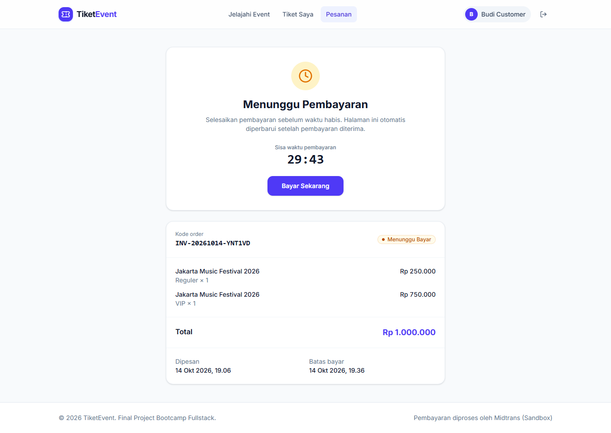

# P7 — Webhook, ngrok, Penerbitan Tiket & Email

**Tujuan:** menerima notifikasi pembayaran dari Midtrans dengan aman, menerbitkan tiket, dan mengirim email.

## 7.1 Konsep webhook yang aman

| Syarat | Implementasi |
|---|---|
| Hanya Midtrans yang boleh mengubah status | Verifikasi `signature_key = sha512(order_id + status_code + gross_amount + server_key)` |
| Notifikasi bisa datang lebih dari sekali | **Idempoten**: order yang sudah `paid` langsung dibalas 200 |
| Dua notifikasi bisa datang bersamaan | `lockForUpdate()` pada baris order |
| `gross_amount` berupa string `"150000.00"` | Dipakai **apa adanya** untuk signature (jangan di-cast ke int) |
| Midtrans mengirim ulang jika tidak dibalas 2xx | Selalu balas 200 setelah diproses |

Status Midtrans yang ditangani:

| `transaction_status` | Aksi |
|---|---|
| `settlement`, atau `capture` dengan `fraud_status = accept` | order → `paid`, isi `paid_at`, buat tiket, email "Pembayaran berhasil" |
| `expire` | order → `expired`, kembalikan kuota, email "Order kedaluwarsa" |
| `cancel`, `deny` | order → `failed`, kembalikan kuota, email |
| `pending` | hanya dicatat di tabel `payments` |

## 7.2 Email notifikasi (Mailtrap)

Tambahkan di 📄 `backend/.env` (dari **Mailtrap → Email Testing → Inbox → SMTP Settings**):

```env
MAIL_MAILER=smtp
MAIL_HOST=sandbox.smtp.mailtrap.io
MAIL_PORT=2525
MAIL_USERNAME=xxxxxxxxxxxxxx
MAIL_PASSWORD=xxxxxxxxxxxxxx
MAIL_FROM_ADDRESS="noreply@tiket-event.test"
MAIL_FROM_NAME="${APP_NAME}"
```

```bash
php artisan make:mail PaymentSuccessMail --markdown=mail.payment-success
php artisan make:mail OrderExpiredMail --markdown=mail.order-expired
```

📄 `backend/app/Mail/PaymentSuccessMail.php`

```php
<?php

namespace App\Mail;

use App\Models\Order;
use Illuminate\Bus\Queueable;
use Illuminate\Mail\Mailable;
use Illuminate\Mail\Mailables\Content;
use Illuminate\Mail\Mailables\Envelope;
use Illuminate\Queue\SerializesModels;

class PaymentSuccessMail extends Mailable
{
    use Queueable, SerializesModels;

    // Koneksi SMTP bisa terputus sesaat (mis. Mailtrap menutup koneksi yang lama menganggur).
    // Coba kirim ulang maksimal 3 kali dengan jeda 10 detik, jangan langsung gagal.
    public $tries = 3;

    public $backoff = 10;

    public function __construct(public Order $order)
    {
        // Email baru dimasukkan ke antrean setelah transaksi database commit.
        // Jika transaksi gagal (rollback), email tidak pernah terkirim.
        $this->afterCommit();
    }

    public function envelope(): Envelope
    {
        return new Envelope(
            subject: "Pembayaran Berhasil - {$this->order->order_code}",
        );
    }

    public function content(): Content
    {
        $this->order->loadMissing('user', 'items.ticketType.event', 'items.tickets');

        return new Content(
            markdown: 'mail.payment-success',
            with: [
                'ticketsUrl' => config('app.frontend_url').'/my-tickets',
            ],
        );
    }
}
```

📄 `backend/resources/views/mail/payment-success.blade.php`

```blade
<x-mail::message>
# Pembayaran Berhasil 🎉

Halo **{{ $order->user->name }}**,

Terima kasih! Pembayaran untuk order **{{ $order->order_code }}** sudah kami terima.

<x-mail::table>
| Tiket | Qty | Subtotal |
|:------|:---:|---------:|
@foreach ($order->items as $item)
| {{ $item->ticketType->event->title }} - {{ $item->ticketType->name }} | {{ $item->qty }} | Rp {{ number_format($item->subtotal(), 0, ',', '.') }} |
@endforeach
| **Total** | | **Rp {{ number_format($order->total, 0, ',', '.') }}** |
</x-mail::table>

**Kode tiket Anda:**

@foreach ($order->items as $item)
@foreach ($item->tickets as $ticket)
- {{ $ticket->code }} ({{ $item->ticketType->name }})
@endforeach
@endforeach

Tunjukkan QR code di halaman **Tiket Saya** kepada petugas saat masuk ke lokasi acara.

<x-mail::button :url="$ticketsUrl">
Lihat Tiket Saya
</x-mail::button>

Salam,<br>
{{ config('app.name') }}
</x-mail::message>
```

📄 `backend/app/Mail/OrderExpiredMail.php`

```php
<?php

namespace App\Mail;

use App\Models\Order;
use Illuminate\Bus\Queueable;
use Illuminate\Mail\Mailable;
use Illuminate\Mail\Mailables\Content;
use Illuminate\Mail\Mailables\Envelope;
use Illuminate\Queue\SerializesModels;

class OrderExpiredMail extends Mailable
{
    use Queueable, SerializesModels;

    // Sama seperti PaymentSuccessMail: coba ulang jika koneksi SMTP terputus
    public $tries = 3;

    public $backoff = 10;

    public function __construct(public Order $order)
    {
        $this->afterCommit();
    }

    public function envelope(): Envelope
    {
        $label = $this->order->status === 'expired' ? 'Kedaluwarsa' : 'Gagal';

        return new Envelope(
            subject: "Order {$label} - {$this->order->order_code}",
        );
    }

    public function content(): Content
    {
        $this->order->loadMissing('user');

        return new Content(
            markdown: 'mail.order-expired',
            with: [
                'eventsUrl' => config('app.frontend_url'),
            ],
        );
    }
}
```

📄 `backend/resources/views/mail/order-expired.blade.php`

```blade
<x-mail::message>
# Order {{ $order->status === 'expired' ? 'Kedaluwarsa' : 'Gagal' }}

Halo **{{ $order->user->name }}**,

@if ($order->status === 'expired')
Order **{{ $order->order_code }}** tidak dibayar sampai batas waktu, sehingga order dibatalkan otomatis.
@else
Pembayaran untuk order **{{ $order->order_code }}** dibatalkan atau ditolak.
@endif

Tiket yang sempat dipesan sudah dikembalikan ke kuota. Jika masih ingin hadir, silakan pesan ulang.

<x-mail::button :url="$eventsUrl">
Lihat Event
</x-mail::button>

Salam,<br>
{{ config('app.name') }}
</x-mail::message>
```

💡 **Penjelasan:**
- **Markdown mail** menghasilkan email HTML yang rapi dari komponen `<x-mail::message>`, `<x-mail::table>`, dan `<x-mail::button>`.
- `Mail::to(...)->queue(...)` **memasukkan email ke antrean** (tabel `jobs`). Webhook tidak perlu menunggu proses SMTP
  yang lambat, sehingga Midtrans cepat mendapat balasan 200.
- `$this->afterCommit()` membuat email baru masuk antrean **setelah transaksi database berhasil**. Jika transaksi gagal, email tidak terkirim.
- Antrean diproses oleh worker yang harus selalu berjalan: `php artisan queue:work`.
- `$tries = 3` dan `$backoff = 10` membuat email **dicoba ulang** (jeda 10 detik) bila pengiriman gagal. Ini penting
  karena Mailtrap menutup koneksi SMTP yang menganggur ±1,5 menit, sedangkan worker memakai ulang koneksi lama.
  Tanpa ini, `queue:work` hanya mencoba **sekali** dan email langsung masuk `failed_jobs`.
- Jangan menaruh blok Markdown dengan indentasi di file blade email, karena indentasi 4 spasi dianggap blok kode.

## 7.3 OrderService versi lengkap

Ganti seluruh isi file OrderService dengan versi lengkap berikut:

📄 `backend/app/Services/OrderService.php`

```php
<?php

namespace App\Services;

use App\Mail\OrderExpiredMail;
use App\Mail\PaymentSuccessMail;
use App\Models\Order;
use App\Models\Ticket;
use App\Models\TicketType;
use App\Models\User;
use Illuminate\Support\Facades\DB;
use Illuminate\Support\Facades\Log;
use Illuminate\Support\Facades\Mail;
use Illuminate\Support\Str;
use Illuminate\Validation\ValidationException;
use Throwable;

/**
 * Logika bisnis order: checkout, menerima notifikasi pembayaran,
 * menerbitkan tiket, dan membatalkan order.
 */
class OrderService
{
    public function __construct(private MidtransService $midtrans) {}

    /**
     * Buat order baru + tahan kuota tiket, lalu minta Snap token ke Midtrans.
     *
     * @param  array<int, array{ticket_type_id: int, qty: int}>  $items
     */
    public function checkout(User $user, array $items): Order
    {
        $order = DB::transaction(function () use ($user, $items) {
            $total = 0;
            $lines = [];

            // Urutkan berdasarkan id supaya semua request mengunci baris
            // dengan urutan yang sama (menghindari deadlock)
            foreach (collect($items)->sortBy('ticket_type_id') as $item) {
                // lockForUpdate(): baris ticket_type dikunci sampai transaksi selesai.
                // Request lain yang membeli jenis tiket yang sama harus MENUNGGU,
                // sehingga tiket tidak terjual melebihi kuota (overselling).
                $ticketType = TicketType::with('event')
                    ->lockForUpdate()
                    ->findOrFail($item['ticket_type_id']);

                if ($ticketType->event->status !== 'published') {
                    throw ValidationException::withMessages([
                        'items' => "Tiket {$ticketType->name} belum dijual.",
                    ]);
                }

                if ($ticketType->remaining() < $item['qty']) {
                    throw ValidationException::withMessages([
                        'items' => "Sisa kuota tiket {$ticketType->name} tinggal {$ticketType->remaining()}.",
                    ]);
                }

                // Kuota langsung "ditahan" untuk order ini
                $ticketType->increment('sold', $item['qty']);

                $lines[] = [
                    'ticket_type_id' => $ticketType->id,
                    'qty' => $item['qty'],
                    'price' => $ticketType->price, // harga disalin saat checkout
                ];
                $total += $ticketType->price * $item['qty'];
            }

            $order = $user->orders()->create([
                'order_code' => $this->generateOrderCode(),
                'total' => $total,
                'status' => 'pending',
                'expires_at' => now()->addMinutes(config('midtrans.expiry_minutes')),
            ]);
            $order->items()->createMany($lines);

            return $order;
        });

        // Snap token diminta DI LUAR transaksi supaya lock database
        // tidak tertahan selama menunggu respons HTTP dari Midtrans.
        try {
            $order->update(['snap_token' => $this->midtrans->createSnapToken($order)]);
        } catch (Throwable $e) {
            report($e); // catat ke storage/logs/laravel.log
            $this->cancel($order, 'failed', sendEmail: false);
            abort(502, 'Gagal terhubung ke Midtrans. Silakan coba lagi.');
        }

        return $order;
    }

    /**
     * Proses notifikasi (webhook) dari Midtrans.
     * Signature sudah diverifikasi di controller sebelum method ini dipanggil.
     */
    public function handleNotification(array $payload): void
    {
        DB::transaction(function () use ($payload) {
            // Kunci baris order: jika Midtrans mengirim notifikasi yang sama
            // dua kali bersamaan, keduanya diproses bergantian (tidak dobel).
            $order = Order::where('order_code', $payload['order_id'])->lockForUpdate()->first();

            if (! $order) {
                Log::warning('Notifikasi Midtrans untuk order yang tidak dikenal', $payload);

                return;
            }

            // IDEMPOTEN: order yang sudah lunas tidak diproses lagi,
            // jadi walaupun webhook datang berkali-kali, tiket & email tidak dobel.
            if ($order->status === 'paid') {
                return;
            }

            // Simpan log setiap notifikasi untuk keperluan audit/debugging
            $order->payments()->create([
                'transaction_id' => $payload['transaction_id'] ?? null,
                'payment_type' => $payload['payment_type'] ?? null,
                'transaction_status' => $payload['transaction_status'],
                'raw_response' => $payload,
            ]);

            // Order yang sudah expired/failed juga tidak diubah lagi
            // (mencegah kuota dikembalikan dua kali)
            if ($order->status !== 'pending') {
                return;
            }

            $status = $payload['transaction_status'];
            $fraud = $payload['fraud_status'] ?? 'accept';

            if ($status === 'settlement' || ($status === 'capture' && $fraud === 'accept')) {
                $this->markAsPaid($order);
            } elseif ($status === 'expire') {
                $this->cancel($order, 'expired');
            } elseif (in_array($status, ['cancel', 'deny'])) {
                $this->cancel($order, 'failed');
            }
            // Status lain (mis. "pending") cukup dicatat di tabel payments
        });
    }

    /**
     * Tandai order lunas, terbitkan tiket (1 tiket per orang), lalu kirim email.
     */
    public function markAsPaid(Order $order): void
    {
        $order->update(['status' => 'paid', 'paid_at' => now()]);

        foreach ($order->items as $item) {
            for ($i = 0; $i < $item->qty; $i++) {
                $item->tickets()->create(['code' => $this->generateTicketCode()]);
            }
        }

        // Masuk antrean (queue) dan baru dikirim SETELAH transaksi commit
        // (lihat afterCommit() di PaymentSuccessMail)
        Mail::to($order->user)->queue(new PaymentSuccessMail($order));
    }

    /**
     * Batalkan order (expired / failed) dan kembalikan kuota tiket.
     */
    public function cancel(Order $order, string $status, bool $sendEmail = true): void
    {
        DB::transaction(function () use ($order, $status, $sendEmail) {
            $order->update(['status' => $status]);
            $order->releaseQuota();

            if ($sendEmail) {
                Mail::to($order->user)->queue(new OrderExpiredMail($order));
            }
        });
    }

    /**
     * Cadangan jika webhook "expire" tidak pernah datang, misalnya customer
     * menutup popup Snap tanpa memilih metode pembayaran (Midtrans tidak
     * mencatat transaksi apa pun, sehingga tidak akan mengirim notifikasi).
     * Dipanggil oleh scheduler lewat command orders:expire.
     */
    public function expireOverdueOrders(): int
    {
        // Beri jeda 5 menit setelah expires_at agar notifikasi Midtrans
        // yang terlambat masih sempat diproses lebih dulu.
        $orderIds = Order::where('status', 'pending')
            ->where('expires_at', '<', now()->subMinutes(5))
            ->pluck('id');

        $count = 0;

        foreach ($orderIds as $id) {
            DB::transaction(function () use ($id, &$count) {
                $order = Order::lockForUpdate()->find($id);

                // Cek ulang: bisa saja webhook sudah mengubah statusnya
                if ($order->status === 'pending') {
                    $this->cancel($order, 'expired');
                    $count++;
                }
            });
        }

        return $count;
    }

    private function generateOrderCode(): string
    {
        // Contoh: INV-20261014-K7Q2XM
        return 'INV-'.now()->format('Ymd').'-'.Str::upper(Str::random(6));
    }

    private function generateTicketCode(): string
    {
        // Contoh: TKT-9F2KD81QZA (inilah isi QR code)
        do {
            $code = 'TKT-'.Str::upper(Str::random(10));
        } while (Ticket::where('code', $code)->exists());

        return $code;
    }
}
```

💡 **Penjelasan:**
- `handleNotification()` mengunci order, mencatat log ke `payments`, lalu mengubah status. Pengecekan
  `status !== 'pending'` mencegah kuota dikembalikan dua kali jika notifikasi `expire` datang berulang.
- `markAsPaid()` membuat **satu tiket per qty** dengan kode unik `TKT-XXXXXXXXXX`.
- `cancel()` dipakai ulang di 3 tempat: gagal minta Snap token, webhook expire/cancel/deny, dan scheduler (P8).
- `expireOverdueOrders()` akan dipanggil scheduler di P8.

## 7.4 Controller & route webhook

```bash
php artisan make:controller MidtransNotificationController --invokable
```

📄 `backend/app/Http/Controllers/MidtransNotificationController.php`

```php
<?php

namespace App\Http\Controllers;

use App\Services\MidtransService;
use App\Services\OrderService;
use Illuminate\Http\Request;

class MidtransNotificationController extends Controller
{
    // POST /api/midtrans/notification (dipanggil oleh server Midtrans, tanpa login)
    public function __invoke(Request $request, MidtransService $midtrans, OrderService $orders)
    {
        $payload = $request->all();

        // 1. Tolak request yang bukan dari Midtrans
        if (! $midtrans->isValidSignature($payload)) {
            return response()->json(['message' => 'Signature tidak valid.'], 403);
        }

        // 2. Proses status pembayaran
        $orders->handleNotification($payload);

        // 3. Balas 200 agar Midtrans tidak mengirim ulang notifikasi
        return response()->json(['message' => 'OK']);
    }
}
```

Tambahkan di 📄 `backend/routes/api.php` (baris `use` di bagian atas file), **di luar** grup `auth:sanctum`:

```php
use App\Http\Controllers\MidtransNotificationController;

// Webhook Midtrans: dipanggil server Midtrans, keamanannya lewat signature_key
Route::post('/midtrans/notification', MidtransNotificationController::class);
```

💡 **Penjelasan:** webhook tidak memakai login karena yang memanggil adalah server Midtrans. Keamanannya dijamin oleh
**signature**: hanya pihak yang tahu Server Key yang bisa membuat signature yang benar.

## 7.5 ngrok: membuat URL publik

Midtrans tidak bisa memanggil `localhost`. ngrok membuat terowongan dari internet ke laptop kita.

```bash
ngrok version                                  # minimal 3.20.0
ngrok config add-authtoken <AUTHTOKEN_ANDA>   # sekali saja
ngrok http 8000
```

> ⚠️ **Pengguna Laragon:** ngrok bawaan Laragon versi lama (3.1.0) dan ditolak server ngrok dengan error
> `ERR_NGROK_121 ... minimum supported agent version ... is "3.20.0"`. Jalankan `ngrok update`, atau unduh versi terbaru
> dari <https://ngrok.com/download> lalu timpa `C:\laragon\bin\ngrok\ngrok.exe`.

Salin URL HTTPS pada baris **Forwarding** (contoh: `https://nama-acak.ngrok-free.dev`), lalu di **Dashboard Midtrans Sandbox** buka menu
**Settings → Configuration** (cari isian **Payment Notification URL**) dan isi:

```text
https://nama-acak.ngrok-free.dev/api/midtrans/notification
```

Jalankan 3 terminal: `php artisan serve`, `php artisan queue:work`, dan `ngrok http 8000`.
Ulangi pembayaran lewat simulator, lalu amati:

1. Inspector ngrok di <http://127.0.0.1:4040> menampilkan request masuk dari Midtrans.
2. Halaman status di React berubah menjadi **Pembayaran Berhasil** dalam ≤5 detik.
3. Tabel `tickets` dan `payments` terisi.
4. Email masuk ke inbox Mailtrap.

> Akun ngrok gratis kini mendapat **satu domain tetap** (`*.ngrok-free.dev`), sehingga URL-nya tidak berubah walaupun ngrok
> di-restart dan Notification URL cukup diisi sekali. Jika URL Anda ternyata berubah (versi/akun lama), perbarui
> Notification URL di dashboard Midtrans setiap kali ngrok dijalankan.
>
> Setelah aplikasi di-deploy (P10), Notification URL di dashboard tetap ke ngrok. VPS memakai `MIDTRANS_NOTIFICATION_URL`
> di `.env`-nya sendiri, jadi laptop dan VPS bisa menerima webhook bersamaan.



## 7.6 Notifikasi yang benar-benar dikirim Midtrans

Hasil pengamatan di inspector ngrok saat proyek ini diuji dengan Midtrans Sandbox:

| Kejadian | `transaction_status` | `status_code` | Hasil di aplikasi |
|---|---|---|---|
| Customer memilih VA BCA di popup | `pending` | `"201"` | Dicatat di `payments`, order tetap `pending` |
| VA dibayar di simulator | `settlement` | `"200"` | Order `paid`, tiket terbit, email "Pembayaran Berhasil" |
| Transaksi kedaluwarsa | `expire` | `"202"` | Order `expired`, kuota kembali, email "Order Kedaluwarsa" |
| Transaksi dibatalkan | `cancel` | `"202"` | Order `failed`, kuota kembali, email |

Contoh isi notifikasi `settlement` (header `User-Agent: Veritrans`, `Content-Type: application/json`):

```json
{
  "transaction_time": "2026-10-14 21:53:12",
  "transaction_status": "settlement",
  "transaction_id": "eb7e438a-9a65-4dad-b4f6-e0548a9078f1",
  "status_message": "midtrans payment notification",
  "status_code": "200",
  "signature_key": "81a10535...bbc4548d",
  "settlement_time": "2026-10-14 21:53:20",
  "payment_type": "bank_transfer",
  "va_numbers": [{ "va_number": "17636762572914446800903", "bank": "bca" }],
  "order_id": "INV-20261014-AGGCCZ",
  "merchant_id": "G123456789",
  "gross_amount": "100000.00",
  "fraud_status": "accept",
  "currency": "IDR"
}
```

💡 **Penjelasan:**
- Satu pembayaran VA menghasilkan **minimal dua** notifikasi: `pending` lalu `settlement`. Karena itu status `pending` harus
  ditangani (cukup dicatat), bukan dianggap error.
- `status_code` berbeda-beda (`201`, `200`, `202`). Inilah alasan signature dihitung dari `status_code` **milik payload**,
  bukan angka `200` yang ditulis langsung di kode.
- `gross_amount` memang string `"100000.00"`, bukan angka `100000`.

## 🧑‍🏫 Catatan Mengajar P7

- Demo serangan: kirim notifikasi palsu dari Postman (**folder 4 → signature palsu**). Hasilnya 403.
  Untuk request **Notifikasi settlement**, isi dulu variabel koleksi `server_key` dan jalankan request **Checkout** di folder 3 agar
  `order_code` terisi. Signature dihitung otomatis oleh script Postman.
- Demo idempoten: kirim notifikasi `settlement` yang sama dua kali. Jumlah tiket tidak bertambah.
  Cara paling meyakinkan: di inspector ngrok (<http://127.0.0.1:4040>) pilih notifikasi `settlement` asli dari Midtrans,
  lalu klik **Replay**. Signature-nya asli sehingga lolos verifikasi, tetapi tiket dan email tetap tidak dobel.
- Jika jaringan kelas memblokir ngrok, gunakan `php artisan midtrans:simulate` (lihat P8). Konsep yang dipelajari tetap sama.
- Lihat isi `storage/logs/laravel.log` saat ada error 500.

## ✅ Checkpoint P7

- [ ] Pembayaran di simulator membuat order `paid` dan tiket terbit
- [ ] Notifikasi palsu ditolak 403, notifikasi ganda tidak membuat tiket dobel
- [ ] Email "Pembayaran Berhasil" muncul di Mailtrap

---

⬅️ [P6 — Snap Token + Popup Pembayaran](P06-snap-popup-pembayaran.md) · 🏠 [Daftar isi](../../README.md#daftar-isi) · [P8 — Tiket Saya + QR, Expire Otomatis](P08-tiket-saya-qr-expire.md) ➡️
