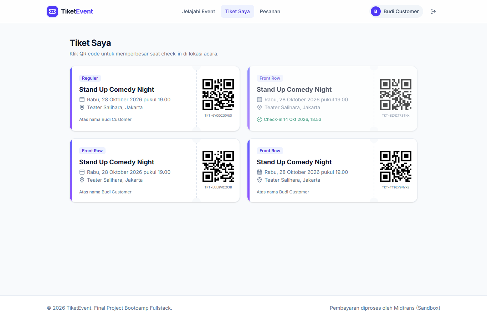

# P8 — Tiket Saya + QR, Expire Otomatis

**Tujuan:** menampilkan tiket dengan QR code, membatalkan order yang tidak dibayar secara otomatis, dan membuat simulator webhook.

## 8.1 Backend "Tiket Saya"

```bash
php artisan make:controller MyTicketController --invokable
```

📄 `backend/app/Http/Controllers/MyTicketController.php`

```php
<?php

namespace App\Http\Controllers;

use App\Http\Resources\TicketResource;
use App\Models\Ticket;
use Illuminate\Http\Request;

class MyTicketController extends Controller
{
    // GET /api/my-tickets
    public function __invoke(Request $request)
    {
        $tickets = Ticket::with('orderItem.ticketType.event', 'orderItem.order.user')
            // whereHas: filter berdasarkan relasi (tiket milik user ini & order sudah lunas)
            ->whereHas('orderItem.order', function ($query) use ($request) {
                $query->where('user_id', $request->user()->id)
                    ->where('status', 'paid');
            })
            ->latest()
            ->get();

        return TicketResource::collection($tickets);
    }
}
```

Tambahkan di `routes/api.php` (baris `use` di bagian atas file, route di dalam grup `auth:sanctum`):

```php
use App\Http\Controllers\MyTicketController;

    Route::get('/my-tickets', MyTicketController::class);
```

💡 **Penjelasan:** `whereHas('orderItem.order', ...)` memfilter tiket berdasarkan relasi bertingkat: hanya tiket milik
user yang login dan order-nya sudah `paid`.

## 8.2 Frontend "Tiket Saya" + QR

Di terminal frontend (folder `frontend`):

```bash
npm install react-qr-code
```

📄 `frontend/src/pages/customer/MyTickets.jsx`

```jsx
import { CalendarDays, CircleCheck, MapPin, Ticket, X } from 'lucide-react'
import { useEffect, useState } from 'react'
import QRCode from 'react-qr-code'
import { Link } from 'react-router'
import EmptyState from '../../components/EmptyState'
import PageLoader from '../../components/Loading'
import PageHeader from '../../components/PageHeader'
import api from '../../lib/api'
import { formatDateTime, formatShortDateTime } from '../../lib/format'

// Kartu berbentuk tiket: info di kiri, QR code di kanan
function TicketCard({ ticket, onShowQr }) {
  const used = Boolean(ticket.checked_in_at)

  return (
    <div className={`card relative flex overflow-hidden ${used ? 'opacity-70' : ''}`}>
      <div className="w-1.5 shrink-0 bg-linear-to-b from-indigo-500 to-violet-500" />

      <div className="min-w-0 flex-1 p-5">
        <span className="inline-flex rounded-md bg-indigo-50 px-2 py-0.5 text-xs font-semibold text-indigo-700">
          {ticket.ticket_type}
        </span>
        <h3 className="mt-2 truncate text-lg font-bold text-slate-900">{ticket.event.title}</h3>
        <p className="mt-1 flex items-center gap-1.5 text-sm text-slate-500">
          <CalendarDays className="size-4 shrink-0" />
          <span className="truncate">{formatDateTime(ticket.event.start_at)}</span>
        </p>
        <p className="mt-0.5 flex items-center gap-1.5 text-sm text-slate-500">
          <MapPin className="size-4 shrink-0" />
          <span className="truncate">{ticket.event.venue}</span>
        </p>

        <div className="mt-4 text-xs">
          {used ? (
            <span className="inline-flex items-center gap-1 font-medium text-emerald-700">
              <CircleCheck className="size-4" /> Check-in{' '}
              {formatShortDateTime(ticket.checked_in_at)}
            </span>
          ) : (
            <span className="text-slate-500">Atas nama {ticket.holder_name}</span>
          )}
        </div>
      </div>

      {/* Garis sobekan tiket */}
      <div className="relative border-l-2 border-dashed border-slate-200">
        <span className="absolute -top-3 -left-[13px] size-6 rounded-full bg-slate-50" />
        <span className="absolute -bottom-3 -left-[13px] size-6 rounded-full bg-slate-50" />
      </div>

      <button
        onClick={() => onShowQr(ticket)}
        className="flex shrink-0 flex-col items-center justify-center gap-2 p-4 transition hover:bg-slate-50"
        title="Perbesar QR"
      >
        <QRCode value={ticket.code} size={88} />
        <span className="font-mono text-[10px] text-slate-500">{ticket.code}</span>
      </button>
    </div>
  )
}

// Popup QR berukuran besar agar mudah di-scan petugas
function QrModal({ ticket, onClose }) {
  return (
    <div
      className="fixed inset-0 z-50 flex items-center justify-center bg-slate-900/60 p-4 backdrop-blur-sm"
      onClick={onClose}
    >
      <div
        className="card relative w-full max-w-sm p-8 text-center"
        onClick={(e) => e.stopPropagation()} // klik di dalam kartu tidak menutup popup
      >
        <button
          onClick={onClose}
          className="absolute top-4 right-4 text-slate-400 hover:text-slate-600"
        >
          <X className="size-5" />
        </button>
        <p className="text-sm font-semibold text-indigo-600">{ticket.ticket_type}</p>
        <h3 className="mt-1 text-lg font-bold text-slate-900">{ticket.event.title}</h3>
        <div className="mx-auto mt-6 w-fit rounded-2xl border border-slate-200 bg-white p-4">
          <QRCode value={ticket.code} size={220} />
        </div>
        <p className="mt-4 font-mono text-lg font-semibold tracking-wider text-slate-900">
          {ticket.code}
        </p>
        <p className="mt-2 text-xs text-slate-500">
          Tunjukkan QR code ini kepada petugas di pintu masuk.
        </p>
      </div>
    </div>
  )
}

export default function MyTickets() {
  const [tickets, setTickets] = useState([])
  const [loading, setLoading] = useState(true)
  const [activeTicket, setActiveTicket] = useState(null) // tiket yang QR-nya diperbesar

  useEffect(() => {
    api
      .get('/my-tickets')
      .then((res) => setTickets(res.data.data))
      .finally(() => setLoading(false))
  }, [])

  if (loading) return <PageLoader />

  return (
    <div className="mx-auto max-w-5xl px-4 py-10 sm:px-6">
      <PageHeader
        title="Tiket Saya"
        description="Klik QR code untuk memperbesar saat check-in di lokasi acara."
      />

      {tickets.length === 0 ? (
        <EmptyState
          icon={Ticket}
          title="Belum ada tiket"
          description="Tiket muncul di sini setelah pembayaran berhasil."
          action={
            <Link to="/" className="btn btn-primary">
              Cari Event
            </Link>
          }
        />
      ) : (
        <div className="grid gap-5 lg:grid-cols-2">
          {tickets.map((ticket) => (
            <TicketCard key={ticket.id} ticket={ticket} onShowQr={setActiveTicket} />
          ))}
        </div>
      )}

      {activeTicket && <QrModal ticket={activeTicket} onClose={() => setActiveTicket(null)} />}
    </div>
  )
}
```

Tambahkan route di blok `ProtectedRoute` pada `App.jsx`:

```jsx
import MyTickets from './pages/customer/MyTickets'

          <Route path="/my-tickets" element={<MyTickets />} />
```

💡 **Penjelasan:**
- `<QRCode value={ticket.code} />` menggambar QR dari **kode tiket**. Isi QR cukup kode unik; data lain diambil dari server saat scan.
- QR dibuat di frontend, sehingga backend tidak perlu menyimpan gambar.
- Modal memperbesar QR agar mudah di-scan dari layar HP.



## 8.3 Expire otomatis dengan scheduler

**Jebakan:** jika customer menutup popup Snap **tanpa memilih metode pembayaran**, Midtrans tidak pernah mencatat
transaksinya, sehingga **webhook `expire` tidak akan pernah datang**. Kuota tiket tertahan selamanya.
Solusinya: command terjadwal yang membatalkan order `pending` yang sudah lewat batas waktu.

```bash
php artisan make:command ExpirePendingOrders
```

📄 `backend/app/Console/Commands/ExpirePendingOrders.php`

```php
<?php

namespace App\Console\Commands;

use App\Services\OrderService;
use Illuminate\Console\Attributes\Description;
use Illuminate\Console\Attributes\Signature;
use Illuminate\Console\Command;

#[Signature('orders:expire')]
#[Description('Batalkan order pending yang sudah melewati batas waktu pembayaran')]
class ExpirePendingOrders extends Command
{
    /**
     * Execute the console command.
     */
    public function handle(OrderService $orders): int
    {
        $count = $orders->expireOverdueOrders();

        $this->info("{$count} order ditandai expired.");

        return self::SUCCESS;
    }
}
```

📄 `backend/routes/console.php`

```php
<?php

use Illuminate\Foundation\Inspiring;
use Illuminate\Support\Facades\Artisan;
use Illuminate\Support\Facades\Schedule;

Artisan::command('inspire', function () {
    $this->comment(Inspiring::quote());
})->purpose('Display an inspiring quote');

// Setiap menit: batalkan order pending yang sudah lewat batas waktu bayar.
// Jalankan saat development dengan: php artisan schedule:work
Schedule::command('orders:expire')->everyMinute();
```

Jalankan scheduler saat development:

```bash
php artisan schedule:work
```

💡 **Penjelasan:**
- `expireOverdueOrders()` (sudah ditulis di P7) memberi jeda 5 menit setelah `expires_at`, agar notifikasi Midtrans
  yang terlambat masih sempat diproses lebih dulu.
- Setiap order dikunci (`lockForUpdate`) dan dicek ulang statusnya, karena bisa saja webhook mengubahnya di saat yang sama.
- Di server produksi, `schedule:work` diganti cron yang menjalankan `php artisan schedule:run` setiap menit
  (lihat P10, 10.5 Langkah 11).

## 8.4 Simulator webhook (tanpa ngrok)

Command khusus development untuk meniru notifikasi Midtrans, lengkap dengan signature yang valid:

```bash
php artisan make:command SimulateMidtransNotification
```

📄 `backend/app/Console/Commands/SimulateMidtransNotification.php`

```php
<?php

namespace App\Console\Commands;

use App\Models\Order;
use Illuminate\Console\Attributes\Description;
use Illuminate\Console\Attributes\Signature;
use Illuminate\Console\Command;
use Illuminate\Support\Facades\Http;
use Illuminate\Support\Str;

/**
 * KHUSUS DEVELOPMENT.
 * Meniru notifikasi Midtrans ke webhook lokal, lengkap dengan signature_key yang valid.
 * Berguna saat ngrok tidak bisa dipakai (mis. jaringan kelas memblokir).
 *
 * Contoh: php artisan midtrans:simulate INV-20261014-ABC123 settlement
 */
#[Signature('midtrans:simulate {order_code} {status=settlement : settlement|pending|expire|cancel|deny}')]
#[Description('[DEV] Kirim notifikasi Midtrans palsu (bertanda tangan) ke webhook lokal')]
class SimulateMidtransNotification extends Command
{
    public function handle(): int
    {
        if (app()->isProduction()) {
            $this->error('Command ini hanya untuk development.');

            return self::FAILURE;
        }

        $order = Order::where('order_code', $this->argument('order_code'))->first();

        if (! $order) {
            $this->error('Order tidak ditemukan.');

            return self::FAILURE;
        }

        $status = $this->argument('status');
        $statusCode = in_array($status, ['settlement', 'capture']) ? '200' : ($status === 'pending' ? '201' : '202');
        // Midtrans mengirim gross_amount sebagai string dengan 2 desimal
        $grossAmount = number_format($order->total, 2, '.', '');

        $payload = [
            'transaction_status' => $status,
            'status_code' => $statusCode,
            'order_id' => $order->order_code,
            'gross_amount' => $grossAmount,
            'payment_type' => 'bank_transfer',
            'transaction_id' => (string) Str::uuid(),
            'fraud_status' => 'accept',
            'signature_key' => hash('sha512', $order->order_code.$statusCode.$grossAmount.config('midtrans.server_key')),
        ];

        // Kirim ke endpoint webhook yang sama dengan yang dipanggil Midtrans
        $response = Http::post(url('/api/midtrans/notification'), $payload);

        $this->info("Webhook membalas: {$response->status()} {$response->body()}");
        $this->info('Status order sekarang: '.$order->fresh()->status);

        return self::SUCCESS;
    }
}
```

```bash
php artisan midtrans:simulate INV-20261014-ABC123 settlement
php artisan midtrans:simulate INV-20261014-ABC123 expire
```

> Command ini mengirim HTTP ke `APP_URL`, jadi `php artisan serve` harus sedang berjalan.

## 🧑‍🏫 Catatan Mengajar P8

- Uji scheduler dengan memajukan waktu: ubah `expires_at` sebuah order pending di database menjadi 10 menit lalu,
  lalu jalankan `php artisan orders:expire`. Kuota kembali dan email "Order Kedaluwarsa" masuk antrean.
- Diskusi: "Apa yang terjadi jika scheduler dan webhook berjalan bersamaan?" Jawabannya: lock + cek ulang status.

## ✅ Checkpoint P8

- [ ] Halaman Tiket Saya menampilkan QR untuk setiap tiket lunas
- [ ] `php artisan orders:expire` membatalkan order basi dan mengembalikan kuota
- [ ] `php artisan midtrans:simulate` mengubah order menjadi `paid`

---

⬅️ [P7 — Webhook, ngrok, Penerbitan Tiket & Email](P07-webhook-ngrok-tiket-email.md) · 🏠 [Daftar isi](../../README.md#daftar-isi) · [P9 — Scanner Check-in, Transaksi & Dashboard](P09-scanner-transaksi-dashboard.md) ➡️
