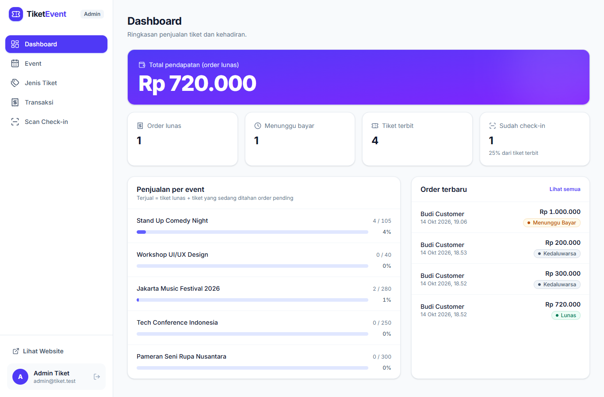
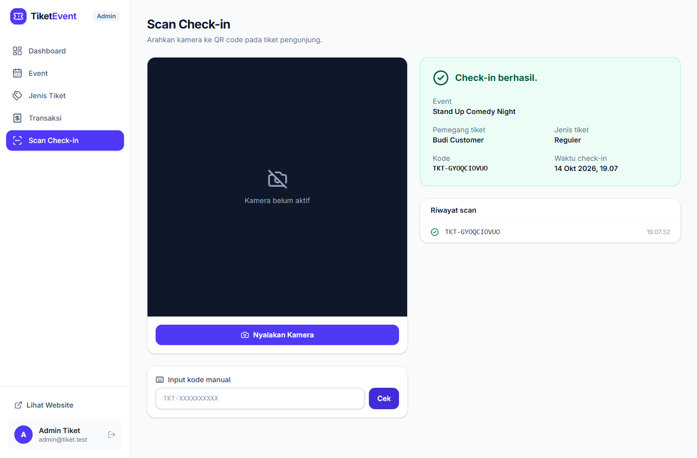

# P9 — Scanner Check-in, Transaksi & Dashboard

**Tujuan:** admin bisa men-scan QR di pintu masuk, melihat semua transaksi, dan memantau ringkasan penjualan.

## 9.1 Backend

```bash
php artisan make:request Admin/CheckinRequest
php artisan make:controller Admin/CheckinController --invokable
php artisan make:controller Admin/OrderController
php artisan make:controller Admin/StatsController --invokable
```

📄 `backend/app/Http/Requests/Admin/CheckinRequest.php`

```php
<?php

namespace App\Http\Requests\Admin;

use Illuminate\Contracts\Validation\ValidationRule;
use Illuminate\Foundation\Http\FormRequest;

class CheckinRequest extends FormRequest
{
    public function authorize(): bool
    {
        return true;
    }

    /**
     * @return array<string, ValidationRule|array<mixed>|string>
     */
    public function rules(): array
    {
        return [
            'code' => ['required', 'string', 'max:50'],
        ];
    }
}
```

📄 `backend/app/Http/Controllers/Admin/CheckinController.php`

```php
<?php

namespace App\Http\Controllers\Admin;

use App\Http\Controllers\Controller;
use App\Http\Requests\Admin\CheckinRequest;
use App\Http\Resources\TicketResource;
use App\Models\Ticket;

class CheckinController extends Controller
{
    // POST /api/admin/checkin { "code": "TKT-XXXXXXXXXX" }
    public function __invoke(CheckinRequest $request)
    {
        $ticket = Ticket::with('orderItem.order.user', 'orderItem.ticketType.event')
            ->where('code', $request->code)
            ->first();

        // 1. Tiket harus ada
        if (! $ticket) {
            return response()->json(['message' => 'Tiket tidak ditemukan.'], 404);
        }

        // 2. Order harus sudah dibayar
        if ($ticket->orderItem->order->status !== 'paid') {
            return response()->json(['message' => 'Order tiket ini belum lunas.'], 422);
        }

        // 3. Tiket belum pernah dipakai
        if ($ticket->checked_in_at) {
            return response()->json([
                'message' => 'Tiket sudah dipakai check-in pada '.$ticket->checked_in_at->format('d/m/Y H:i').'.',
                'data' => new TicketResource($ticket),
            ], 422);
        }

        $ticket->update(['checked_in_at' => now()]);

        return (new TicketResource($ticket))->additional(['message' => 'Check-in berhasil.']);
    }
}
```

📄 `backend/app/Http/Controllers/Admin/OrderController.php`

```php
<?php

namespace App\Http\Controllers\Admin;

use App\Http\Controllers\Controller;
use App\Http\Resources\OrderResource;
use App\Models\Order;
use Illuminate\Http\Request;

class OrderController extends Controller
{
    // GET /api/admin/orders?status=paid&search=budi&page=2
    public function index(Request $request)
    {
        $orders = Order::with('user', 'items.ticketType.event')
            ->when($request->status, fn ($query, $status) => $query->where('status', $status))
            ->when($request->search, function ($query, $search) {
                $query->where(function ($q) use ($search) {
                    $q->where('order_code', 'like', "%{$search}%")
                        ->orWhereHas('user', fn ($u) => $u->where('name', 'like', "%{$search}%")
                            ->orWhere('email', 'like', "%{$search}%"));
                });
            })
            ->latest()
            ->paginate(10); // response otomatis berisi data, links, dan meta

        return OrderResource::collection($orders);
    }
}
```

📄 `backend/app/Http/Controllers/Admin/StatsController.php`

```php
<?php

namespace App\Http\Controllers\Admin;

use App\Http\Controllers\Controller;
use App\Http\Resources\EventResource;
use App\Http\Resources\OrderResource;
use App\Models\Event;
use App\Models\Order;
use App\Models\Ticket;

class StatsController extends Controller
{
    // GET /api/admin/stats — ringkasan untuk halaman Dashboard
    public function __invoke()
    {
        $events = Event::withSum('ticketTypes as tickets_sold', 'sold')
            ->withSum('ticketTypes as tickets_quota', 'quota')
            ->orderBy('start_at')
            ->get();

        $recentOrders = Order::with('user')->latest()->take(5)->get();

        return response()->json([
            'data' => [
                'revenue' => (int) Order::where('status', 'paid')->sum('total'),
                'paid_orders' => Order::where('status', 'paid')->count(),
                'pending_orders' => Order::where('status', 'pending')->count(),
                'tickets_issued' => Ticket::count(),
                'tickets_checked_in' => Ticket::whereNotNull('checked_in_at')->count(),
                'events' => EventResource::collection($events),
                'recent_orders' => OrderResource::collection($recentOrders),
            ],
        ]);
    }
}
```

Route API sekarang sudah **lengkap**:

📄 `backend/routes/api.php`

```php
<?php

use App\Http\Controllers\Admin;
use App\Http\Controllers\AuthController;
use App\Http\Controllers\CheckoutController;
use App\Http\Controllers\EventController;
use App\Http\Controllers\MidtransNotificationController;
use App\Http\Controllers\MyTicketController;
use App\Http\Controllers\OrderController;
use Illuminate\Support\Facades\Route;

/*
| Semua route di file ini otomatis berawalan /api
*/

// ---------- Publik (tanpa login) ----------
Route::get('/events', [EventController::class, 'index']);
Route::get('/events/{slug}', [EventController::class, 'show']);

Route::post('/register', [AuthController::class, 'register']);
Route::post('/login', [AuthController::class, 'login']);

// Webhook Midtrans: dipanggil server Midtrans, keamanannya lewat signature_key
Route::post('/midtrans/notification', MidtransNotificationController::class);

// ---------- Wajib login (token Sanctum) ----------
Route::middleware('auth:sanctum')->group(function () {
    Route::post('/logout', [AuthController::class, 'logout']);
    Route::get('/me', [AuthController::class, 'me']);

    // Customer
    Route::post('/checkout', CheckoutController::class);
    Route::get('/orders', [OrderController::class, 'index']);
    Route::get('/orders/{order}', [OrderController::class, 'show']);
    Route::get('/my-tickets', MyTicketController::class);

    // Admin: prefix /api/admin + wajib role admin
    Route::middleware('role:admin')->prefix('admin')->group(function () {
        Route::apiResource('events', Admin\EventController::class);
        Route::apiResource('ticket-types', Admin\TicketTypeController::class);
        Route::get('orders', [Admin\OrderController::class, 'index']);
        Route::post('checkin', Admin\CheckinController::class);
        Route::get('stats', Admin\StatsController::class);
    });
});
```

💡 **Penjelasan:**
- Check-in punya 3 syarat: tiket **ada** (404), order **lunas** (422), dan **belum pernah dipakai** (422).
  Response 422 untuk tiket yang sudah dipakai tetap menyertakan data tiket, agar petugas tahu kapan tiket itu dipakai.
- `paginate(10)` otomatis menambahkan `meta` (total, halaman sekarang, halaman terakhir) dan `links` di response Resource collection.
- `withSum('ticketTypes as tickets_sold', 'sold')` menghitung total terjual per event dengan satu query.

## 9.2 Frontend

Di terminal frontend (folder `frontend`):

```bash
npm install html5-qrcode
```

📄 `frontend/src/pages/admin/Scanner.jsx`

```jsx
import { Html5Qrcode } from 'html5-qrcode'
import { Camera, CameraOff, CircleCheck, CircleX, Keyboard, TriangleAlert } from 'lucide-react'
import { useEffect, useRef, useState } from 'react'
import PageHeader from '../../components/PageHeader'
import api from '../../lib/api'
import { formatShortDateTime } from '../../lib/format'

// Tampilan hasil scan
const resultStyles = {
  success: { box: 'border-emerald-200 bg-emerald-50', text: 'text-emerald-800', Icon: CircleCheck },
  used: { box: 'border-amber-200 bg-amber-50', text: 'text-amber-800', Icon: TriangleAlert },
  error: { box: 'border-rose-200 bg-rose-50', text: 'text-rose-800', Icon: CircleX },
}

export default function Scanner() {
  const scannerRef = useRef(null) // instance Html5Qrcode
  const busyRef = useRef(false) // cegah 1 QR terkirim berkali-kali
  const [cameraOn, setCameraOn] = useState(false)
  const [cameraError, setCameraError] = useState('')
  const [manualCode, setManualCode] = useState('')
  const [result, setResult] = useState(null)
  const [history, setHistory] = useState([])

  // Kirim kode tiket ke backend
  async function checkin(code) {
    if (busyRef.current) return
    busyRef.current = true

    try {
      const res = await api.post('/admin/checkin', { code })
      showResult({ type: 'success', message: res.data.message, ticket: res.data.data, code })
    } catch (error) {
      const data = error.response?.data
      showResult({
        // 422 + data tiket = tiket sudah pernah dipakai
        type: data?.data ? 'used' : 'error',
        message: data?.message ?? 'Gagal menghubungi server.',
        ticket: data?.data,
        code,
      })
    } finally {
      // Jeda 2,5 detik sebelum bisa scan lagi
      setTimeout(() => (busyRef.current = false), 2500)
    }
  }

  function showResult(newResult) {
    setResult(newResult)
    setHistory((prev) => [{ ...newResult, time: new Date() }, ...prev].slice(0, 8))
  }

  async function startCamera() {
    setCameraError('')
    try {
      const scanner = new Html5Qrcode('reader') // 'reader' = id elemen tempat video
      scannerRef.current = scanner
      await scanner.start(
        { facingMode: 'environment' }, // kamera belakang (di HP)
        { fps: 10, qrbox: { width: 240, height: 240 } },
        (decodedText) => checkin(decodedText), // dipanggil saat QR terbaca
        () => {}, // dipanggil tiap frame yang tidak berisi QR, diabaikan
      )
      setCameraOn(true)
    } catch {
      setCameraError('Kamera tidak bisa dibuka. Izinkan akses kamera atau gunakan input manual.')
    }
  }

  async function stopCamera() {
    const scanner = scannerRef.current
    if (scanner?.isScanning) await scanner.stop()
    scanner?.clear()
    scannerRef.current = null
    setCameraOn(false)
  }

  // Matikan kamera saat meninggalkan halaman
  useEffect(() => {
    return () => {
      const scanner = scannerRef.current
      if (scanner?.isScanning) scanner.stop().then(() => scanner.clear())
    }
  }, [])

  function handleManualSubmit(e) {
    e.preventDefault()
    if (!manualCode.trim()) return
    checkin(manualCode.trim().toUpperCase())
    setManualCode('')
  }

  const style = result ? resultStyles[result.type] : null
  const ResultIcon = style?.Icon

  return (
    <>
      <PageHeader
        title="Scan Check-in"
        description="Arahkan kamera ke QR code pada tiket pengunjung."
      />

      <div className="grid gap-6 lg:grid-cols-2">
        <div className="space-y-6">
          {/* Area kamera */}
          <div className="card overflow-hidden">
            <div className="relative aspect-square bg-slate-900">
              <div id="reader" className="h-full w-full [&_video]:h-full! [&_video]:object-cover" />
              {!cameraOn && (
                <div className="absolute inset-0 flex flex-col items-center justify-center gap-3 text-slate-400">
                  <CameraOff className="size-10" />
                  <p className="text-sm">Kamera belum aktif</p>
                </div>
              )}
            </div>
            <div className="p-4">
              {cameraOn ? (
                <button onClick={stopCamera} className="btn btn-secondary w-full">
                  <CameraOff className="size-4" /> Matikan Kamera
                </button>
              ) : (
                <button onClick={startCamera} className="btn btn-primary w-full">
                  <Camera className="size-4" /> Nyalakan Kamera
                </button>
              )}
              {cameraError && <p className="mt-2 text-xs text-rose-600">{cameraError}</p>}
            </div>
          </div>

          {/* Input manual (jika kamera tidak tersedia) */}
          <form onSubmit={handleManualSubmit} className="card p-4">
            <label htmlFor="code" className="label flex items-center gap-2">
              <Keyboard className="size-4" /> Input kode manual
            </label>
            <div className="flex gap-2">
              <input
                id="code"
                value={manualCode}
                onChange={(e) => setManualCode(e.target.value)}
                placeholder="TKT-XXXXXXXXXX"
                className="input font-mono uppercase"
              />
              <button type="submit" className="btn btn-primary">
                Cek
              </button>
            </div>
          </form>
        </div>

        <div className="space-y-6">
          {/* Hasil scan terakhir */}
          {result ? (
            <div className={`rounded-2xl border p-6 ${style.box}`}>
              <div className={`flex items-center gap-3 ${style.text}`}>
                <ResultIcon className="size-8 shrink-0" />
                <p className="text-lg font-bold">{result.message}</p>
              </div>
              {result.ticket ? (
                <dl className="mt-5 grid grid-cols-2 gap-4 text-sm">
                  <div className="col-span-2">
                    <dt className="text-slate-500">Event</dt>
                    <dd className="font-semibold text-slate-900">{result.ticket.event.title}</dd>
                  </div>
                  <div>
                    <dt className="text-slate-500">Pemegang tiket</dt>
                    <dd className="font-semibold text-slate-900">{result.ticket.holder_name}</dd>
                  </div>
                  <div>
                    <dt className="text-slate-500">Jenis tiket</dt>
                    <dd className="font-semibold text-slate-900">{result.ticket.ticket_type}</dd>
                  </div>
                  <div>
                    <dt className="text-slate-500">Kode</dt>
                    <dd className="font-mono font-semibold text-slate-900">{result.ticket.code}</dd>
                  </div>
                  <div>
                    <dt className="text-slate-500">Waktu check-in</dt>
                    <dd className="font-semibold text-slate-900">
                      {formatShortDateTime(result.ticket.checked_in_at)}
                    </dd>
                  </div>
                </dl>
              ) : (
                <p className="mt-3 font-mono text-sm text-slate-600">Kode: {result.code}</p>
              )}
            </div>
          ) : (
            <div className="card flex flex-col items-center justify-center px-6 py-16 text-center text-slate-500">
              <Camera className="mb-3 size-8 text-slate-400" />
              <p className="text-sm">Hasil scan akan tampil di sini.</p>
            </div>
          )}

          {/* Riwayat scan sesi ini */}
          {history.length > 0 && (
            <div className="card">
              <h2 className="border-b border-slate-100 px-5 py-3 text-sm font-semibold text-slate-900">
                Riwayat scan
              </h2>
              <ul className="divide-y divide-slate-100">
                {history.map((item, index) => {
                  const { Icon, text } = resultStyles[item.type]
                  return (
                    <li key={index} className="flex items-center gap-3 px-5 py-2.5 text-sm">
                      <Icon className={`size-4 shrink-0 ${text}`} />
                      <span className="font-mono text-slate-700">{item.code}</span>
                      <span className="ml-auto text-xs text-slate-400">
                        {item.time.toLocaleTimeString('id-ID')}
                      </span>
                    </li>
                  )
                })}
              </ul>
            </div>
          )}
        </div>
      </div>
    </>
  )
}
```

📄 `frontend/src/pages/admin/Orders.jsx`

```jsx
import { ChevronLeft, ChevronRight, Receipt, Search } from 'lucide-react'
import { useEffect, useState } from 'react'
import EmptyState from '../../components/EmptyState'
import PageLoader from '../../components/Loading'
import PageHeader from '../../components/PageHeader'
import StatusBadge from '../../components/StatusBadge'
import api from '../../lib/api'
import { formatRupiah, formatShortDateTime } from '../../lib/format'

const tabs = [
  { value: '', label: 'Semua' },
  { value: 'pending', label: 'Menunggu' },
  { value: 'paid', label: 'Lunas' },
  { value: 'expired', label: 'Kedaluwarsa' },
  { value: 'failed', label: 'Gagal' },
]

export default function Orders() {
  const [orders, setOrders] = useState([])
  const [meta, setMeta] = useState(null) // info pagination dari Laravel
  const [loading, setLoading] = useState(true)

  const [status, setStatus] = useState('')
  const [search, setSearch] = useState('')
  const [keyword, setKeyword] = useState('')
  const [page, setPage] = useState(1)

  useEffect(() => {
    api
      .get('/admin/orders', { params: { status, search, page } })
      .then((res) => {
        setOrders(res.data.data)
        setMeta(res.data.meta)
      })
      .finally(() => setLoading(false))
  }, [status, search, page])

  function changeStatus(value) {
    setStatus(value)
    setPage(1) // kembali ke halaman 1 setiap filter berubah
  }

  function handleSearch(e) {
    e.preventDefault()
    setSearch(keyword)
    setPage(1)
  }

  if (loading) return <PageLoader />

  return (
    <>
      <PageHeader
        title="Transaksi"
        description="Semua order yang masuk beserta status pembayarannya."
      />

      {/* Filter status + pencarian */}
      <div className="mb-4 flex flex-col gap-3 lg:flex-row lg:items-center lg:justify-between">
        <div className="flex gap-1 overflow-x-auto rounded-xl bg-slate-100 p-1">
          {tabs.map((tab) => (
            <button
              key={tab.value}
              onClick={() => changeStatus(tab.value)}
              className={`shrink-0 rounded-lg px-3 py-1.5 text-sm font-medium transition ${
                status === tab.value
                  ? 'bg-white text-slate-900 shadow-sm'
                  : 'text-slate-500 hover:text-slate-900'
              }`}
            >
              {tab.label}
            </button>
          ))}
        </div>

        <form onSubmit={handleSearch} className="flex gap-2">
          <div className="relative flex-1 lg:w-72">
            <Search className="absolute top-1/2 left-3 size-4 -translate-y-1/2 text-slate-400" />
            <input
              value={keyword}
              onChange={(e) => setKeyword(e.target.value)}
              placeholder="Kode order / nama / email"
              className="input pl-9"
            />
          </div>
          <button type="submit" className="btn btn-secondary">
            Cari
          </button>
        </form>
      </div>

      {orders.length === 0 ? (
        <EmptyState
          icon={Receipt}
          title="Tidak ada transaksi"
          description="Coba ubah filter atau kata kunci."
        />
      ) : (
        <div className="card overflow-hidden">
          <div className="overflow-x-auto">
            <table className="w-full text-left text-sm">
              <thead className="border-b border-slate-200 bg-slate-50 text-xs font-semibold text-slate-500 uppercase">
                <tr>
                  <th className="px-5 py-3">Order</th>
                  <th className="px-5 py-3">Customer</th>
                  <th className="px-5 py-3">Tiket</th>
                  <th className="px-5 py-3 text-right">Total</th>
                  <th className="px-5 py-3">Status</th>
                </tr>
              </thead>
              <tbody className="divide-y divide-slate-100">
                {orders.map((order) => (
                  <tr key={order.id} className="align-top hover:bg-slate-50/60">
                    <td className="px-5 py-3 whitespace-nowrap">
                      <p className="font-mono font-medium text-slate-900">{order.order_code}</p>
                      <p className="text-xs text-slate-500">
                        {formatShortDateTime(order.created_at)}
                      </p>
                    </td>
                    <td className="px-5 py-3">
                      <p className="font-medium text-slate-900">{order.user.name}</p>
                      <p className="text-xs text-slate-500">{order.user.email}</p>
                    </td>
                    <td className="min-w-64 px-5 py-3">
                      {order.items.map((item) => (
                        <p key={item.id} className="text-slate-600">
                          {item.qty}× {item.ticket_type.name}{' '}
                          <span className="text-xs text-slate-400">
                            · {item.ticket_type.event.title}
                          </span>
                        </p>
                      ))}
                    </td>
                    <td className="px-5 py-3 text-right font-semibold whitespace-nowrap text-slate-900 tabular-nums">
                      {formatRupiah(order.total)}
                    </td>
                    <td className="px-5 py-3">
                      <StatusBadge status={order.status} />
                    </td>
                  </tr>
                ))}
              </tbody>
            </table>
          </div>

          {/* Pagination */}
          <div className="flex items-center justify-between border-t border-slate-200 px-5 py-3 text-sm">
            <p className="text-slate-500">
              {meta.from}–{meta.to} dari {meta.total} order
            </p>
            <div className="flex gap-2">
              <button
                onClick={() => setPage(page - 1)}
                disabled={page <= 1}
                className="btn btn-secondary px-2.5 py-1.5"
              >
                <ChevronLeft className="size-4" />
              </button>
              <span className="px-2 py-1.5 text-slate-600">
                {meta.current_page} / {meta.last_page}
              </span>
              <button
                onClick={() => setPage(page + 1)}
                disabled={page >= meta.last_page}
                className="btn btn-secondary px-2.5 py-1.5"
              >
                <ChevronRight className="size-4" />
              </button>
            </div>
          </div>
        </div>
      )}
    </>
  )
}
```

📄 `frontend/src/pages/admin/Dashboard.jsx`

```jsx
import { Clock, Receipt, ScanLine, Ticket, Wallet } from 'lucide-react'
import { useEffect, useState } from 'react'
import { Link } from 'react-router'
import PageLoader from '../../components/Loading'
import PageHeader from '../../components/PageHeader'
import StatusBadge from '../../components/StatusBadge'
import api from '../../lib/api'
import { formatRupiah, formatShortDateTime } from '../../lib/format'

// Kartu angka ringkas (KPI)
function StatTile({ icon: Icon, label, value, hint }) {
  return (
    <div className="card p-5">
      <div className="flex items-center gap-2 text-sm text-slate-500">
        <Icon className="size-4" /> {label}
      </div>
      <p className="mt-2 text-2xl font-bold text-slate-900">{value}</p>
      {hint && <p className="mt-1 text-xs text-slate-500">{hint}</p>}
    </div>
  )
}

// Bar progres terjual/kuota. Warna berubah saat hampir habis & habis.
function SalesMeter({ sold, quota }) {
  const percent = quota > 0 ? Math.round((sold / quota) * 100) : 0
  const tone =
    percent >= 100
      ? { track: 'bg-rose-100', fill: 'bg-rose-500' }
      : percent >= 80
        ? { track: 'bg-amber-100', fill: 'bg-amber-500' }
        : { track: 'bg-indigo-100', fill: 'bg-indigo-500' }

  return (
    <div className="flex items-center gap-3">
      <div className={`h-2 flex-1 overflow-hidden rounded-full ${tone.track}`}>
        <div
          className={`h-full rounded-full ${tone.fill}`}
          style={{ width: `${Math.min(percent, 100)}%` }}
        />
      </div>
      <span className="w-10 text-right text-xs font-medium text-slate-600 tabular-nums">
        {percent}%
      </span>
    </div>
  )
}

export default function Dashboard() {
  const [stats, setStats] = useState(null)

  useEffect(() => {
    api.get('/admin/stats').then((res) => setStats(res.data.data))
  }, [])

  if (!stats) return <PageLoader />

  const checkinRate = stats.tickets_issued
    ? Math.round((stats.tickets_checked_in / stats.tickets_issued) * 100)
    : 0

  return (
    <>
      <PageHeader title="Dashboard" description="Ringkasan penjualan tiket dan kehadiran." />

      {/* Angka utama: total pendapatan */}
      <div className="card relative overflow-hidden bg-linear-to-br from-indigo-600 to-violet-600 p-6 text-white">
        <div className="absolute -top-16 -right-10 size-56 rounded-full bg-white/10 blur-2xl" />
        <p className="flex items-center gap-2 text-sm text-indigo-100">
          <Wallet className="size-4" /> Total pendapatan (order lunas)
        </p>
        <p className="mt-2 text-4xl font-extrabold tracking-tight sm:text-5xl">
          {formatRupiah(stats.revenue)}
        </p>
      </div>

      <div className="mt-4 grid grid-cols-2 gap-4 lg:grid-cols-4">
        <StatTile icon={Receipt} label="Order lunas" value={stats.paid_orders} />
        <StatTile icon={Clock} label="Menunggu bayar" value={stats.pending_orders} />
        <StatTile icon={Ticket} label="Tiket terbit" value={stats.tickets_issued} />
        <StatTile
          icon={ScanLine}
          label="Sudah check-in"
          value={stats.tickets_checked_in}
          hint={`${checkinRate}% dari tiket terbit`}
        />
      </div>

      <div className="mt-6 grid gap-6 lg:grid-cols-5">
        {/* Penjualan per event */}
        <section className="card lg:col-span-3">
          <div className="border-b border-slate-100 px-5 py-4">
            <h2 className="font-semibold text-slate-900">Penjualan per event</h2>
            <p className="text-xs text-slate-500">
              Terjual = tiket lunas + tiket yang sedang ditahan order pending
            </p>
          </div>
          <ul className="divide-y divide-slate-100">
            {stats.events.map((event) => (
              <li key={event.id} className="px-5 py-4">
                <div className="mb-2 flex items-baseline justify-between gap-4">
                  <p className="truncate text-sm font-medium text-slate-900">{event.title}</p>
                  <p className="shrink-0 text-xs text-slate-500 tabular-nums">
                    {event.tickets_sold} / {event.tickets_quota}
                  </p>
                </div>
                <SalesMeter sold={event.tickets_sold} quota={event.tickets_quota} />
              </li>
            ))}
          </ul>
        </section>

        {/* Order terbaru */}
        <section className="card lg:col-span-2">
          <div className="flex items-center justify-between border-b border-slate-100 px-5 py-4">
            <h2 className="font-semibold text-slate-900">Order terbaru</h2>
            <Link
              to="/admin/orders"
              className="text-xs font-semibold text-indigo-600 hover:text-indigo-700"
            >
              Lihat semua
            </Link>
          </div>
          {stats.recent_orders.length === 0 ? (
            <p className="px-5 py-8 text-center text-sm text-slate-500">Belum ada order.</p>
          ) : (
            <ul className="divide-y divide-slate-100">
              {stats.recent_orders.map((order) => (
                <li key={order.id} className="flex items-center justify-between gap-3 px-5 py-3">
                  <div className="min-w-0">
                    <p className="truncate text-sm font-medium text-slate-900">{order.user.name}</p>
                    <p className="text-xs text-slate-500">
                      {formatShortDateTime(order.created_at)}
                    </p>
                  </div>
                  <div className="text-right">
                    <p className="text-sm font-semibold text-slate-900 tabular-nums">
                      {formatRupiah(order.total)}
                    </p>
                    <StatusBadge status={order.status} />
                  </div>
                </li>
              ))}
            </ul>
          )}
        </section>
      </div>
    </>
  )
}
```

Routing **final** (route index admin kini menuju Dashboard):

📄 `frontend/src/App.jsx`

```jsx
import { Route, Routes } from 'react-router'
import ProtectedRoute from './components/ProtectedRoute'
import AdminLayout from './layouts/AdminLayout'
import MainLayout from './layouts/MainLayout'
import Dashboard from './pages/admin/Dashboard'
import EventForm from './pages/admin/EventForm'
import AdminEvents from './pages/admin/Events'
import AdminOrders from './pages/admin/Orders'
import Scanner from './pages/admin/Scanner'
import TicketTypes from './pages/admin/TicketTypes'
import Checkout from './pages/customer/Checkout'
import MyOrders from './pages/customer/MyOrders'
import MyTickets from './pages/customer/MyTickets'
import PaymentStatus from './pages/customer/PaymentStatus'
import EventDetail from './pages/EventDetail'
import Home from './pages/Home'
import Login from './pages/Login'
import NotFound from './pages/NotFound'
import Register from './pages/Register'

export default function App() {
  return (
    <Routes>
      {/* Halaman dengan Navbar */}
      <Route element={<MainLayout />}>
        {/* Publik */}
        <Route path="/" element={<Home />} />
        <Route path="/events/:slug" element={<EventDetail />} />
        <Route path="/login" element={<Login />} />
        <Route path="/register" element={<Register />} />

        {/* Wajib login */}
        <Route element={<ProtectedRoute />}>
          <Route path="/checkout" element={<Checkout />} />
          <Route path="/orders" element={<MyOrders />} />
          <Route path="/orders/:code" element={<PaymentStatus />} />
          <Route path="/my-tickets" element={<MyTickets />} />
        </Route>

        <Route path="*" element={<NotFound />} />
      </Route>

      {/* Halaman admin dengan Sidebar, wajib role admin */}
      <Route path="/admin" element={<ProtectedRoute role="admin" />}>
        <Route element={<AdminLayout />}>
          <Route index element={<Dashboard />} />
          <Route path="events" element={<AdminEvents />} />
          <Route path="events/new" element={<EventForm />} />
          <Route path="events/:id/edit" element={<EventForm />} />
          <Route path="ticket-types" element={<TicketTypes />} />
          <Route path="orders" element={<AdminOrders />} />
          <Route path="scanner" element={<Scanner />} />
        </Route>
      </Route>
    </Routes>
  )
}
```

💡 **Penjelasan:**
- `Html5Qrcode` menyalakan kamera di elemen `#reader`. Kamera hanya bisa diakses di **localhost** atau **HTTPS**.
- `busyRef` (useRef) mencegah satu QR terkirim berkali-kali, karena kamera membaca ~10 frame per detik.
  Dipakai `useRef`, bukan `useState`, karena nilainya dibaca di dalam callback kamera dan perubahannya tidak perlu me-render ulang.
- Cleanup di `useEffect` mematikan kamera saat admin meninggalkan halaman.
- Input manual adalah cadangan jika kamera rusak atau QR sulit terbaca.
- Meter penjualan berubah warna saat ≥80% (kuning) dan habis (merah), dan setiap warna selalu disertai angka.




## 🧑‍🏫 Catatan Mengajar P9

- Demo scan tanpa pengaturan jaringan: buka "Tiket Saya" di laptop, perbesar QR, lalu foto layar itu dengan HP.
  Buka halaman Scanner di laptop dan tunjukkan foto QR di HP ke webcam laptop.
- Memakai **HP sebagai scanner** butuh HTTPS dan API yang bisa dijangkau dari HP. Cara paling mudah adalah setelah
  deploy (P10, 10.5 Langkah 12). Membuka `ngrok http 5173` saja tidak cukup, karena API masih menunjuk ke
  `localhost:8000` milik laptop.
- Scan tiket yang sama dua kali untuk menunjukkan peringatan "sudah dipakai".

## ✅ Checkpoint P9

- [ ] Scan QR valid → "Check-in berhasil"; scan ulang → peringatan kuning
- [ ] Halaman Transaksi bisa difilter status, dicari, dan dipaginasi
- [ ] Dashboard menampilkan pendapatan, jumlah order, tiket, dan check-in

---

⬅️ [P8 — Tiket Saya + QR, Expire Otomatis](P08-tiket-saya-qr-expire.md) · 🏠 [Daftar isi](../../README.md#daftar-isi) · [P10 — Pengujian, Bug Fix & Deploy](P10-pengujian-bugfix-deploy.md) ➡️
