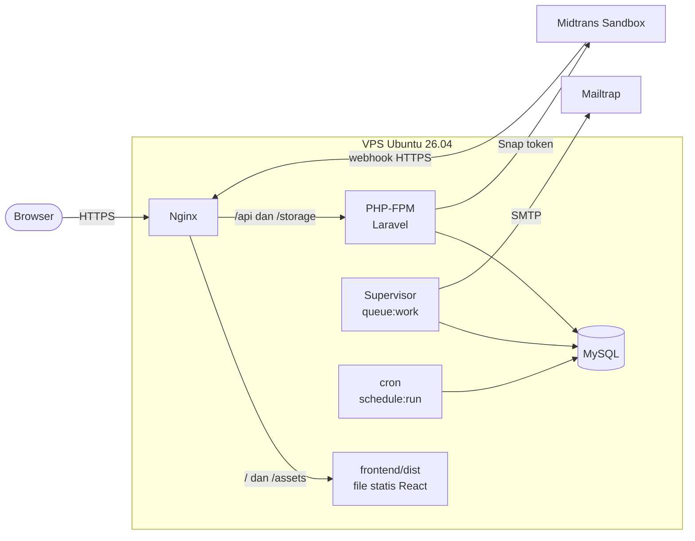

# P10 — Pengujian, Bug Fix & Deploy

## 10.1 Skenario uji end-to-end

Jalankan seluruh koleksi Postman (**Run collection**) setelah `php artisan migrate:fresh --seed`.
Isi variabel `server_key` terlebih dahulu. Koleksi menjalankan skenario lengkap:
login → checkout → webhook palsu (403) → webhook valid → order paid → tiket → check-in → check-in ulang (422)
→ CRUD admin → logout. Proyek ini lulus **29/29 assertion**.

Checklist manual di browser:

| # | Skenario | Hasil yang diharapkan |
|---|---|---|
| 1 | Beli tiket tanpa login | Diarahkan ke login, lalu kembali ke event |
| 2 | Beli melebihi sisa kuota | Tombol + berhenti di batas; API membalas 422 |
| 3 | Tutup popup Snap tanpa bayar | Halaman status "Menunggu Pembayaran" + tombol bayar ulang |
| 4 | Bayar via simulator | Status berubah sendiri menjadi lunas, email masuk |
| 5 | Biarkan order > 35 menit | Scheduler mengubahnya menjadi kedaluwarsa, kuota kembali |
| 6 | Customer membuka `/admin` | Dikembalikan ke beranda |
| 7 | Customer membuka order orang lain | 404 |
| 8 | Scan tiket dua kali | Scan kedua ditolak |
| 9 | Hapus event yang sudah punya transaksi | Ditolak dengan pesan jelas |
| 10 | Tampilan di HP (DevTools → mode responsif) | Menu hamburger, kartu tersusun satu kolom |

## 10.2 Smoke test otomatis dengan Playwright

Checklist di atas juga tersedia sebagai **tes otomatis di browser sungguhan**. Playwright membuka Chrome, mengklik
seperti pengguna, membayar lewat Midtrans Sandbox, menunggu webhook asli, lalu men-scan QR tiket dengan kamera palsu.

Pasang sekali di folder frontend (proyek ini sudah memasangnya):

```bash
cd frontend
npm install -D --save-exact @playwright/test@1.63.0
```

Playwright memakai **Google Chrome yang sudah terpasang** (`channel: 'chrome'`), jadi tidak perlu mengunduh browser.

Sebelum menjalankan tes, pastikan `php artisan serve`, `php artisan queue:work`, `npm run dev`, dan `ngrok http 8000`
sudah berjalan, serta Notification URL di dashboard Midtrans sudah diisi (P7).

```bash
cd frontend
npm run test:e2e           # window Chrome terlihat, setiap aksi diberi jeda 250 ms
npm run test:e2e:report    # laporan HTML (screenshot + trace jika ada yang gagal)
npx playwright test --ui   # mode interaktif: jalankan & amati tes satu per satu
```

Pilihan lewat environment variable (contoh PowerShell: `$env:E2E_HEADLESS=1; npm run test:e2e`):

| Variabel | Fungsi |
|---|---|
| `E2E_HEADLESS=1` | Tanpa window browser (lebih cepat, cocok untuk CI) |
| `E2E_SLOWMO=0` | Hilangkan jeda antar aksi |
| `E2E_WEBHOOK=simulate` | Tanpa ngrok: webhook diganti `php artisan midtrans:simulate` |
| `E2E_BASE_URL=https://...` | Menguji alamat lain, mis. server hasil deploy (default `http://localhost:5173`) |
| `E2E_REMOTE=1` | Menguji server hasil deploy: langkah yang butuh `php artisan` lokal dilewati (10.5 Langkah 12) |
| `E2E_ADMIN_PASSWORD=...` | Password `admin@tiket.test` jika sudah diganti (default `password`) |

Skenario yang diuji (berurutan, ±5 menit):

| # | Skenario | Yang diperiksa |
|---|---|---|
| 1 | Beranda & pencarian | Event tayang tampil, event draft tersembunyi, hasil cari & hasil kosong |
| 2 | Detail event | Tombol + berhenti di sisa kuota, beli tanpa login → halaman login |
| 3 | Halaman tidak ditemukan | Slug salah, route acak, `/my-tickets` tanpa login |
| 4 | Register & login | Pesan validasi, daftar akun baru, logout, password salah, login |
| 5 | **Checkout + Midtrans** | Popup Snap → VA BCA → bayar di simulator → webhook asli → "Pembayaran Berhasil" + 2 kode tiket |
| 6 | Pesanan & Tiket Saya | Status "Lunas", 2 QR code, popup QR besar |
| 7 | Order pending → kedaluwarsa | Tutup popup, kuota tertahan, **bayar ulang**, expire, kuota kembali |
| 8 | Hak akses | Customer tidak bisa membuka `/admin`, logout |
| 9 | Dashboard admin | KPI dan daftar penjualan tampil |
| 10 | CRUD event & jenis tiket | Validasi, upload banner, tambah/ubah/hapus, draft hilang dari publik, event bertransaksi tidak bisa dihapus |
| 11 | Transaksi | Pencarian email customer, filter Lunas & Kedaluwarsa |
| 12 | **Scan QR dengan kamera** | Kamera palsu menayangkan QR tiket → "Check-in berhasil" |
| 13 | Check-in manual | Berhasil, sudah dipakai, tidak ditemukan |
| 14 | Tiket Saya setelah check-in | Kedua tiket menampilkan waktu check-in |
| 15 | Tampilan mobile | Menu hamburger |

📄 `frontend/playwright.config.js`

```js
import { defineConfig } from '@playwright/test'

/**
 * Konfigurasi smoke test end-to-end (Playwright).
 * Server dev harus sudah berjalan: php artisan serve, queue:work, npm run dev,
 * dan ngrok (untuk webhook Midtrans asli). Jalankan: npm run test:e2e
 * Untuk menguji server hasil deploy, lihat variabel E2E_* di e2e/smoke.spec.js.
 */
export default defineConfig({
  testDir: './e2e',
  timeout: 120_000, // per tes; tes pembayaran menambah waktunya sendiri
  expect: { timeout: 15_000 },
  workers: 1, // tes saling bergantung (customer -> admin), jadi berjalan berurutan
  reporter: [['list'], ['html', { open: 'never' }]],
  use: {
    baseURL: process.env.E2E_BASE_URL ?? 'http://localhost:5173',
    channel: 'chrome', // pakai Google Chrome yang sudah terpasang (tanpa unduh browser)
    headless: process.env.E2E_HEADLESS === '1', // default: window browser terlihat
    launchOptions: { slowMo: Number(process.env.E2E_SLOWMO ?? 250) }, // jeda antar aksi (ms)
    viewport: { width: 1280, height: 800 },
    locale: 'id-ID',
    timezoneId: 'Asia/Jakarta',
    screenshot: 'only-on-failure',
    trace: 'retain-on-failure',
  },
})
```

📄 `frontend/e2e/helpers.js`

```js
import { execFileSync } from 'node:child_process'
import path from 'node:path'
import { fileURLToPath } from 'node:url'
import { expect } from '@playwright/test'

const BACKEND_DIR = path.resolve(path.dirname(fileURLToPath(import.meta.url)), '../../backend')

// Jalankan perintah artisan di folder backend, mis. artisan('midtrans:simulate', code, 'expire')
export function artisan(...args) {
  return execFileSync('php', ['artisan', ...args], { cwd: BACKEND_DIR, encoding: 'utf8' })
}

export async function login(page, email, password = 'password') {
  await page.goto('/login')
  await page.locator('#email').fill(email)
  await page.locator('#password').fill(password)
  await page.getByRole('button', { name: 'Masuk', exact: true }).click()
}

export async function logout(page) {
  await page.locator('button[title="Keluar"]:visible').click()
  await expect(page).toHaveURL(/\/login$/)
}

// Kartu jenis tiket di halaman Detail Event, mis. ticketCard(page, 'Reguler')
export function ticketCard(page, name) {
  return page
    .locator('aside .rounded-xl.border')
    .filter({ has: page.getByText(name, { exact: true }) })
}

// Baca angka "Sisa N" pada kartu jenis tiket
export async function remainingOf(card) {
  const text = await card.getByText(/^Sisa \d+$/).innerText()
  return Number(text.replace('Sisa ', ''))
}

// Popup Snap Midtrans dirender di dalam iframe #snap-midtrans
export const snapFrame = (page) => page.frameLocator('#snap-midtrans')

// Pilih BCA Virtual Account di popup Snap, lalu ambil nomor VA dan kode order
export async function chooseBcaVa(page) {
  const snap = snapFrame(page)
  await snap.getByText('Virtual account', { exact: true }).click()
  await snap.locator('a[href="#/bank-transfer/bca-va"]').click()

  const vaNumber = snap.getByText(/^\d{15,}$/).first()
  await expect(vaNumber).toBeVisible({ timeout: 30_000 })
  const orderText = await snap
    .getByText(/INV-\d{8}-[A-Z0-9]{6}/)
    .first()
    .innerText()

  return {
    va: (await vaNumber.innerText()).trim(),
    orderCode: orderText.match(/INV-\d{8}-[A-Z0-9]{6}/)[0],
  }
}

// Bayar nomor VA di Midtrans Payment Simulator (dibuka di tab baru)
export async function payBcaVaInSimulator(context, va) {
  const sim = await context.newPage()
  await sim.goto('https://simulator.sandbox.midtrans.com/bca/va/index')
  await sim.locator('input[name=va_number]').fill(va)
  await sim.locator('input[value=Inquire]').click()
  await sim.locator('input[value=Pay]').click()
  await expect(sim.getByText('Simulated payment is successful.')).toBeVisible()
  await sim.close()
}
```

📄 `frontend/e2e/smoke.spec.js`

```js
import fs from 'node:fs'
import { chromium, expect, test } from '@playwright/test'
import {
  artisan,
  chooseBcaVa,
  login,
  logout,
  payBcaVaInSimulator,
  remainingOf,
  snapFrame,
  ticketCard,
} from './helpers'

/**
 * Smoke test seluruh skenario aplikasi di browser.
 * Tes berjalan BERURUTAN dan saling berbagi data: customer baru membeli tiket,
 * lalu admin men-scan tiket tersebut.
 *
 * Webhook: secara default menunggu notifikasi ASLI dari Midtrans (lewat ngrok).
 * Tanpa ngrok, jalankan dengan E2E_WEBHOOK=simulate (memakai php artisan midtrans:simulate).
 *
 * Menguji server hasil deploy (VPS): E2E_BASE_URL=https://domain-anda E2E_REMOTE=1
 * E2E_ADMIN_PASSWORD=... (php artisan tidak bisa dipanggil dari laptop, jadi langkah
 * yang memakainya dilewati).
 */
test.describe.configure({ mode: 'serial' })

const run = Date.now().toString(36) // pembeda data antar-run
const customer = { name: 'Siti E2E', email: `e2e-${run}@tiket.test`, password: 'rahasia123' }
const eventTitle = `E2E Konser Akustik ${run}`
const simulateWebhook = process.env.E2E_WEBHOOK === 'simulate'
const remote = process.env.E2E_REMOTE === '1'
const adminPassword = process.env.E2E_ADMIN_PASSWORD ?? 'password'

if (remote && simulateWebhook) {
  throw new Error(
    'E2E_WEBHOOK=simulate butuh php artisan lokal, tidak bisa dipakai dengan E2E_REMOTE=1',
  )
}

// Data yang dibagikan antar-tes
const paidOrder = { code: '', tickets: [] }
let expiredOrderCode = ''
let qrVideoPath = ''

test.describe('Publik', () => {
  test('beranda menampilkan event tayang dan pencarian', async ({ page }) => {
    await page.goto('/')
    await expect(page.getByRole('heading', { name: 'Event Mendatang' })).toBeVisible()

    const cards = page.locator('a[href^="/events/"]')
    await expect(cards.first()).toBeVisible()
    expect(await cards.count()).toBeGreaterThanOrEqual(4)
    await expect(page.getByText('Stand Up Comedy Night')).toBeVisible()
    // Event berstatus draft tidak boleh tampil di publik
    await expect(page.getByText('Pameran Seni Rupa Nusantara')).toHaveCount(0)

    await page.getByPlaceholder('Cari nama event atau kota...').fill('comedy')
    await page.getByRole('button', { name: 'Cari' }).click()
    await expect(page.getByRole('heading', { name: 'Hasil pencarian "comedy"' })).toBeVisible()
    await expect(cards).toHaveCount(1)

    await page.getByPlaceholder('Cari nama event atau kota...').fill('tidak-ada-event-ini')
    await page.getByRole('button', { name: 'Cari' }).click()
    await expect(page.getByText('Event tidak ditemukan')).toBeVisible()
  })

  test('detail event, batas jumlah tiket, dan wajib login untuk membeli', async ({ page }) => {
    await page.goto('/events/stand-up-comedy-night')
    await expect(page.getByRole('heading', { level: 1 })).toHaveText('Stand Up Comedy Night')

    const buy = page.getByRole('button', { name: 'Masuk untuk Membeli' })
    await expect(buy).toBeDisabled() // belum memilih tiket

    // Tombol + berhenti di batas sisa kuota (maksimal 10 per jenis tiket)
    const card = ticketCard(page, 'Front Row')
    const remaining = await remainingOf(card)
    const max = Math.min(remaining, 10)
    const plus = card.locator('button').last()
    for (let i = 0; i < max; i++) await plus.click()
    await expect(card.locator('span.tabular-nums')).toHaveText(String(max))
    await expect(plus).toBeDisabled()

    await buy.click()
    await expect(page).toHaveURL(/\/login$/)
  })

  test('halaman tidak ditemukan dan route yang wajib login', async ({ page }) => {
    await page.goto('/events/slug-yang-tidak-ada')
    await expect(page.getByText('Event tidak ditemukan')).toBeVisible()

    await page.goto('/halaman-acak')
    await expect(page.getByText('Halaman tidak ditemukan')).toBeVisible()

    await page.goto('/my-tickets')
    await expect(page).toHaveURL(/\/login$/)
  })
})

test.describe('Autentikasi', () => {
  test('validasi register, daftar akun baru, logout, dan login', async ({ page }) => {
    await page.goto('/register')
    await page.getByRole('button', { name: 'Daftar' }).click()
    await expect(page.getByText('Nama wajib diisi.')).toBeVisible()
    await expect(page.getByText('Email wajib diisi.')).toBeVisible()
    await expect(page.getByText('Password wajib diisi.')).toBeVisible()

    await page.locator('#name').fill(customer.name)
    await page.locator('#email').fill(customer.email)
    await page.locator('#password').fill(customer.password)
    await page.locator('#password_confirmation').fill(customer.password)
    await page.getByRole('button', { name: 'Daftar' }).click()
    await expect(page).toHaveURL('/')
    await expect(page.getByText(customer.name)).toBeVisible()

    await logout(page)

    await login(page, customer.email, 'password-salah')
    await expect(page.getByText('Email atau password salah.')).toBeVisible()

    await login(page, customer.email, customer.password)
    await expect(page).toHaveURL('/')
    await expect(page.getByRole('link', { name: 'Tiket Saya' })).toBeVisible()
  })
})

test.describe('Customer', () => {
  test.beforeEach(async ({ page }) => {
    await login(page, customer.email, customer.password)
    await expect(page).toHaveURL('/')
  })

  test('checkout, bayar VA BCA di Midtrans Sandbox, webhook menerbitkan tiket', async ({
    page,
    context,
  }) => {
    test.setTimeout(240_000)

    await page.goto('/events/tech-conference-indonesia')
    const plus = ticketCard(page, 'Student').locator('button').last()
    await plus.click()
    await plus.click()
    await page.getByRole('button', { name: 'Beli Tiket' }).click()

    // Halaman Checkout
    await expect(page).toHaveURL(/\/checkout$/)
    await expect(page.getByText(customer.email)).toBeVisible()
    await expect(page.getByText('Total bayar').locator('..')).toContainText(/Rp\s?200\.000/)
    await page.getByRole('button', { name: 'Bayar Sekarang' }).click()

    // Popup Snap: pilih BCA Virtual Account, lalu bayar di simulator
    await expect(page.locator('#snap-midtrans')).toBeVisible({ timeout: 30_000 })
    const { va, orderCode } = await chooseBcaVa(page)
    paidOrder.code = orderCode
    await payBcaVaInSimulator(context, va)

    if (simulateWebhook) artisan('midtrans:simulate', orderCode, 'settlement')

    // Snap mendeteksi pembayaran, menutup popup, lalu onSuccess mengarahkan ke halaman status
    await expect(snapFrame(page).getByText('Payment successful')).toBeVisible({ timeout: 90_000 })
    await expect(page).toHaveURL(`/orders/${orderCode}`, { timeout: 15_000 })

    // Status LUNAS berasal dari webhook (bukan dari callback onSuccess)
    await expect(
      page.getByRole('heading', { name: 'Pembayaran Berhasil' }),
      'Webhook belum masuk: cek ngrok & Notification URL, atau jalankan dengan E2E_WEBHOOK=simulate',
    ).toBeVisible({ timeout: 60_000 })
    await expect(page.getByText('Lunas')).toBeVisible()

    const codes = page.getByText(/^TKT-[A-Z0-9]{10} · Student$/)
    await expect(codes).toHaveCount(2)
    paidOrder.tickets = (await codes.allInnerTexts()).map((text) => text.split(' · ')[0])
  })

  test('Pesanan Saya dan Tiket Saya dengan QR code', async ({ page }, testInfo) => {
    await page.goto('/orders')
    const row = page.locator('a', { hasText: paidOrder.code })
    await expect(row).toContainText('Lunas')
    await expect(row).toContainText('2× Student')

    await page.getByRole('link', { name: 'Tiket Saya' }).click()
    await expect(page.locator('button[title="Perbesar QR"] svg')).toHaveCount(2)
    for (const code of paidOrder.tickets) await expect(page.getByText(code)).toBeVisible()

    // Perbesar QR tiket pertama
    await page.locator('button[title="Perbesar QR"]', { hasText: paidOrder.tickets[0] }).click()
    const modal = page.locator('.fixed.inset-0')
    await expect(modal.locator('svg').first()).toBeVisible()
    await expect(modal).toContainText(paidOrder.tickets[0])

    // Simpan tampilan QR sebagai "video kamera palsu" untuk tes scanner admin
    // (bingkai 960x720 berpusat di QR, dibatasi agar tetap di dalam viewport 1280x800)
    const box = await modal.locator('.rounded-2xl svg').boundingBox()
    const clamp = (value, max) => Math.min(Math.max(0, value), max)
    const clip = {
      x: clamp(box.x + box.width / 2 - 480, 1280 - 960),
      y: clamp(box.y + box.height / 2 - 360, 800 - 720),
      width: 960,
      height: 720,
    }
    qrVideoPath = testInfo.outputPath('qr-tiket.mjpeg')
    fs.writeFileSync(qrVideoPath, await page.screenshot({ type: 'jpeg', quality: 90, clip }))

    await modal.locator('button').first().click() // tombol X
    await expect(modal).toHaveCount(0)
  })

  test('order pending menahan kuota, bayar ulang, lalu kedaluwarsa', async ({ page }) => {
    await page.goto('/events/stand-up-comedy-night')
    const card = ticketCard(page, 'Reguler')
    const before = await remainingOf(card)
    await card.locator('button').last().click()
    await page.getByRole('button', { name: 'Beli Tiket' }).click()
    await page.getByRole('button', { name: 'Bayar Sekarang' }).click()

    // Customer menutup popup tanpa memilih metode -> onClose -> halaman status
    await expect(page.locator('#snap-midtrans')).toBeVisible({ timeout: 30_000 })
    await snapFrame(page).locator('.close-snap-button').click()
    await expect(page).toHaveURL(/\/orders\/INV-/)
    expiredOrderCode = page.url().split('/orders/')[1]

    await expect(page.getByRole('heading', { name: 'Menunggu Pembayaran' })).toBeVisible()
    await expect(page.getByText(/^\d{2}:\d{2}$/)).toBeVisible() // hitung mundur

    // Bayar ulang: popup terbuka lagi dengan Snap token yang sama
    await page.getByRole('button', { name: 'Bayar Sekarang' }).click()
    await expect(snapFrame(page).getByText(expiredOrderCode)).toBeVisible({ timeout: 30_000 })
    await snapFrame(page).locator('.close-snap-button').click()
    await expect(page.locator('#snap-midtrans')).toBeHidden()

    // Kuota ditahan selama order pending
    await page.goto('/events/stand-up-comedy-night')
    expect(await remainingOf(ticketCard(page, 'Reguler'))).toBe(before - 1)

    if (remote) {
      // Server hasil deploy: order dibiarkan pending, scheduler orders:expire
      // yang akan membatalkannya ±35 menit lagi.
      test.info().annotations.push({ type: 'pending', description: expiredOrderCode })
      return
    }

    // Popup ditutup tanpa memilih metode = Midtrans tidak akan mengirim webhook.
    // Di aplikasi asli tugas ini dilakukan scheduler orders:expire setelah 35 menit;
    // di sini dipercepat dengan notifikasi "expire" yang bertanda tangan sah.
    await page.goto(`/orders/${expiredOrderCode}`)
    artisan('midtrans:simulate', expiredOrderCode, 'expire')
    await expect(page.getByRole('heading', { name: 'Order Kedaluwarsa' })).toBeVisible()

    // Kuota dikembalikan
    await page.goto('/events/stand-up-comedy-night')
    expect(await remainingOf(ticketCard(page, 'Reguler'))).toBe(before)
  })

  test('customer tidak bisa membuka halaman admin', async ({ page }) => {
    await expect(page.getByRole('link', { name: 'Admin' })).toHaveCount(0)
    await page.goto('/admin')
    await expect(page).toHaveURL('/')

    await logout(page)
    await page.goto('/orders')
    await expect(page).toHaveURL(/\/login$/)
  })
})

test.describe('Admin', () => {
  test.beforeEach(async ({ page }) => {
    await login(page, 'admin@tiket.test', adminPassword)
    await expect(page).toHaveURL('/admin')
  })

  test('dashboard menampilkan ringkasan penjualan', async ({ page }) => {
    await expect(page.getByText('Total pendapatan (order lunas)')).toBeVisible()
    for (const label of ['Order lunas', 'Menunggu bayar', 'Tiket terbit', 'Sudah check-in']) {
      await expect(page.getByText(label, { exact: true })).toBeVisible()
    }
    await expect(page.getByRole('heading', { name: 'Penjualan per event' })).toBeVisible()
    await expect(page.getByRole('heading', { name: 'Order terbaru' })).toBeVisible()
  })

  test('kelola event dan jenis tiket (tambah, ubah, hapus)', async ({ page }) => {
    // Banner: pakai screenshot hero beranda sebagai gambar JPG
    await page.goto('/')
    const banner = await page.locator('section').first().screenshot({ type: 'jpeg', quality: 80 })

    await page.goto('/admin/events')
    await page.getByRole('link', { name: 'Tambah Event' }).click()

    // Validasi Form Request
    await page.getByRole('button', { name: 'Simpan & Atur Tiket' }).click()
    await expect(page.getByText('Judul wajib diisi.')).toBeVisible()
    await expect(page.getByText('Lokasi wajib diisi.')).toBeVisible()

    await page.locator('#title').fill(eventTitle)
    await page.locator('#venue').fill('Taman Budaya, Yogyakarta')
    await page.locator('#start_at').fill('2026-12-20T19:00')
    await page.locator('#description').fill('Konser akustik santai hasil smoke test.')
    await page.locator('input[type=file]').setInputFiles({
      name: 'banner.jpg',
      mimeType: 'image/jpeg',
      buffer: banner,
    })
    await expect(page.getByAltText('Pratinjau banner')).toBeVisible()
    await page.locator('#status').selectOption('published')
    await page.getByRole('button', { name: 'Simpan & Atur Tiket' }).click()

    // Setelah simpan, langsung diarahkan ke halaman jenis tiket event tersebut
    await expect(page).toHaveURL(/\/admin\/ticket-types\?event_id=\d+$/)
    await expect(page.locator('#event option:checked')).toHaveText(eventTitle)

    await page.getByRole('button', { name: 'Tambah' }).click()
    await expect(page.getByText('Nama wajib diisi.')).toBeVisible()

    await page.locator('#name').fill('Reguler')
    await page.locator('#price').fill('50000')
    await page.locator('#quota').fill('10')
    await page.getByRole('button', { name: 'Tambah' }).click()
    await expect(page.getByText('Jenis tiket berhasil ditambahkan.')).toBeVisible()
    const row = page.locator('tbody tr', { hasText: 'Reguler' })
    await expect(row).toContainText(/Rp\s?50\.000/)

    await row.getByTitle('Ubah').click()
    await page.locator('#quota').fill('20')
    await page.getByRole('button', { name: 'Simpan' }).click()
    await expect(page.getByText('Jenis tiket berhasil diubah.')).toBeVisible()
    await expect(row.locator('td').nth(2)).toHaveText('20')

    // Event tayang muncul di halaman publik, lengkap dengan banner
    await page.goto(`/?search=${encodeURIComponent(eventTitle)}`)
    const publicCard = page.locator('a[href^="/events/"]', { hasText: eventTitle })
    await expect(publicCard).toBeVisible()
    await expect(publicCard.locator('img')).toHaveAttribute('src', /\/storage\/banners\//)

    // Ubah status menjadi Draft -> hilang dari publik
    await page.goto('/admin/events')
    await page.locator('tr', { hasText: eventTitle }).getByTitle('Ubah').click()
    await expect(page.locator('#title')).toHaveValue(eventTitle)
    await page.locator('#status').selectOption('draft')
    await page.getByRole('button', { name: 'Simpan Perubahan' }).click()
    await expect(page).toHaveURL('/admin/events')
    await expect(page.locator('tr', { hasText: eventTitle })).toContainText('Draft')

    await page.goto(`/?search=${encodeURIComponent(eventTitle)}`)
    await expect(page.getByText('Event tidak ditemukan')).toBeVisible()

    // Hapus jenis tiket, lalu hapus event
    page.on('dialog', (dialog) => dialog.accept()) // konfirmasi "Hapus ...?"
    await page.goto('/admin/events')
    await page.locator('tr', { hasText: eventTitle }).getByTitle('Jenis tiket').click()
    await page.locator('tbody tr', { hasText: 'Reguler' }).getByTitle('Hapus').click()
    await expect(page.getByText('Jenis tiket berhasil dihapus.')).toBeVisible()
    await expect(page.getByText('Belum ada jenis tiket')).toBeVisible()

    await page.goto('/admin/events')
    await page.locator('tr', { hasText: eventTitle }).getByTitle('Hapus').click()
    await expect(page.getByText('Event berhasil dihapus.')).toBeVisible()
    await expect(page.locator('tr', { hasText: eventTitle })).toHaveCount(0)

    // Event yang sudah punya transaksi tidak boleh dihapus
    await page.locator('tr', { hasText: 'Tech Conference Indonesia' }).getByTitle('Hapus').click()
    await expect(page.getByText(/Event sudah memiliki transaksi/)).toBeVisible()
    await expect(page.locator('tr', { hasText: 'Tech Conference Indonesia' })).toHaveCount(1)
  })

  test('transaksi: filter status dan pencarian', async ({ page }) => {
    await page.getByRole('link', { name: 'Transaksi' }).click()
    await page.getByPlaceholder('Kode order / nama / email').fill(customer.email)
    await page.getByRole('button', { name: 'Cari' }).click()
    await expect(page.locator('tbody tr')).toHaveCount(2)
    await expect(page.getByText(paidOrder.code)).toBeVisible()
    await expect(page.getByText(expiredOrderCode)).toBeVisible()

    await page.getByRole('button', { name: 'Lunas', exact: true }).click()
    await expect(page.locator('tbody tr')).toHaveCount(1)
    await expect(page.locator('tbody tr')).toContainText(paidOrder.code)

    // Di server hasil deploy, order kedua masih pending (lihat tes sebelumnya)
    await page
      .getByRole('button', { name: remote ? 'Menunggu' : 'Kedaluwarsa', exact: true })
      .click()
    await expect(page.locator('tbody tr')).toHaveCount(1)
    await expect(page.locator('tbody tr')).toContainText(expiredOrderCode)
  })

  test('scan QR tiket dengan kamera', async () => {
    // Browser khusus dengan kamera palsu yang "merekam" gambar QR tiket pertama
    const browser = await chromium.launch({
      channel: 'chrome',
      headless: process.env.E2E_HEADLESS === '1',
      slowMo: Number(process.env.E2E_SLOWMO ?? 250),
      args: [
        '--use-fake-ui-for-media-stream',
        '--use-fake-device-for-media-stream',
        `--use-file-for-fake-video-capture=${qrVideoPath}`,
      ],
    })
    const context = await browser.newContext({
      baseURL: process.env.E2E_BASE_URL ?? 'http://localhost:5173',
      viewport: { width: 1280, height: 800 },
      permissions: ['camera'],
    })
    const page = await context.newPage()

    try {
      await login(page, 'admin@tiket.test', adminPassword)
      await page.getByRole('link', { name: 'Scan Check-in' }).click()
      await page.getByRole('button', { name: 'Nyalakan Kamera' }).click()
      await expect(page.getByRole('button', { name: 'Matikan Kamera' })).toBeVisible()

      await expect(page.getByText('Check-in berhasil.')).toBeVisible({ timeout: 20_000 })
      await expect(page.locator('dd', { hasText: paidOrder.tickets[0] })).toBeVisible()
      await expect(page.getByText(customer.name)).toBeVisible()

      await page.getByRole('button', { name: 'Matikan Kamera' }).click()
      await expect(page.getByText('Kamera belum aktif')).toBeVisible()
    } finally {
      await browser.close()
    }
  })

  test('check-in manual: berhasil, sudah dipakai, dan tidak ditemukan', async ({ page }) => {
    await page.getByRole('link', { name: 'Scan Check-in' }).click()
    const input = page.locator('#code')
    const check = page.getByRole('button', { name: 'Cek' })
    const cooldown = () => page.waitForTimeout(2600) // scanner menolak scan < 2,5 detik

    await input.fill(paidOrder.tickets[1].toLowerCase()) // huruf kecil otomatis dibesarkan
    await check.click()
    await expect(page.getByText('Check-in berhasil.')).toBeVisible()

    await cooldown()
    await input.fill(paidOrder.tickets[1])
    await check.click()
    await expect(page.getByText(/^Tiket sudah dipakai check-in pada/)).toBeVisible()

    await cooldown()
    await input.fill(paidOrder.tickets[0]) // sudah di-scan kamera pada tes sebelumnya
    await check.click()
    await expect(page.locator('dd', { hasText: paidOrder.tickets[0] })).toBeVisible()
    await expect(page.getByText(/^Tiket sudah dipakai check-in pada/)).toBeVisible()

    await cooldown()
    await input.fill('TKT-TIDAKADA00')
    await check.click()
    await expect(page.getByText('Tiket tidak ditemukan.')).toBeVisible()

    await expect(page.getByRole('heading', { name: 'Riwayat scan' })).toBeVisible()
    await expect(page.locator('li', { hasText: 'TKT-TIDAKADA00' })).toBeVisible()
  })
})

test.describe('Setelah check-in', () => {
  test('Tiket Saya menampilkan status check-in', async ({ page }) => {
    await login(page, customer.email, customer.password)
    await expect(page).toHaveURL('/')
    await page.goto('/my-tickets')
    await expect(page.getByText(/Check-in \d{1,2} \w{3} \d{4}/)).toHaveCount(2)
  })

  test('tampilan mobile: menu navigasi', async ({ page }) => {
    await page.setViewportSize({ width: 390, height: 844 })
    await page.goto('/')
    await expect(page.getByRole('link', { name: 'Masuk' })).toBeHidden()

    await page.locator('header nav button').click() // tombol menu (hamburger)
    await expect(page.getByRole('link', { name: 'Jelajahi Event' })).toBeVisible()
    await expect(page.getByRole('link', { name: 'Masuk' })).toBeVisible()
    await expect(page.getByRole('link', { name: 'Daftar' })).toBeVisible()

    await page.getByRole('link', { name: 'Masuk' }).click()
    await expect(page).toHaveURL('/login')
  })
})
```

💡 **Penjelasan:**
- `test.describe.configure({ mode: 'serial' })`: tes berjalan berurutan dan berbagi data. Customer yang mendaftar
  di tes 4 membeli tiket di tes 5, lalu tiketnya di-scan admin di tes 12.
- Setiap run mendaftarkan customer baru `e2e-xxxx@tiket.test`, sehingga tidak bentrok dengan data lama. Event uji
  dihapus lagi di akhir tes. Order uji (1 lunas, 1 kedaluwarsa) tetap tersimpan sebagai riwayat.
- Popup Snap berada di dalam **iframe** `#snap-midtrans`, jadi elemennya dicari dengan `page.frameLocator()`.
- Setelah VA dibayar di simulator, Snap sendiri yang mendeteksi pembayaran (±30 detik), menampilkan
  "Payment successful", lalu memanggil `onSuccess`. Status **Lunas** tetap ditunggu dari webhook, bukan dari callback.
- Order yang popup-nya ditutup tanpa memilih metode tidak pernah tercatat di Midtrans, jadi tidak ada webhook `expire`.
  Di aplikasi asli, tugas ini dikerjakan scheduler `orders:expire`. Tes mempercepatnya dengan `midtrans:simulate`.
- **Kamera palsu:** tes menyimpan screenshot QR sebagai file `.mjpeg`, lalu membuka Chrome dengan flag
  `--use-file-for-fake-video-capture`. Chrome memakai gambar itu sebagai "video kamera", dan `html5-qrcode`
  membacanya seperti QR sungguhan.

## 🧑‍🏫 Catatan Mengajar 10.2

- Smoke test ini menemukan **2 bug nyata** yang lolos dari uji manual. Keduanya sudah diperbaiki dan bagus untuk diskusi:
  1. Tombol **Bayar Sekarang** di halaman status tidak membuka popup. `payWithSnap(token)` tanpa callback mengirim
     `{ onSuccess: undefined, ... }` ke Snap, dan Snap menolaknya (`onSuccess should be of type function`).
     Lolos dari uji manual karena saat itu tidak ada yang menutup popup lalu mencoba bayar ulang.
  2. Mengubah status event menjadi Draft **tidak tersimpan**. `useEffect` di `EventForm` berjalan dua kali (StrictMode),
     sehingga respons kedua yang datang belakangan menimpa isian admin. Playwright mengisi form lebih cepat daripada
     manusia, sehingga race condition ini muncul. Solusinya flag `active` + cleanup (lihat P4).
- Buat selector dengan merekam klik: `npx playwright codegen http://localhost:5173`.
- Jika tes gagal, buka trace-nya: `npx playwright show-trace test-results/<nama-tes>/trace.zip`. Isinya screenshot
  per langkah, request jaringan, dan console.

## 10.3 Bug yang sering ditemui siswa

| Gejala | Penyebab & solusi |
|---|---|
| `SQLSTATE[HY000] [2002]` | MySQL belum jalan → Laragon **Start All** |
| `Route [login] not defined` | Header `Accept: application/json` tidak dikirim / lupa `redirectGuestsTo` |
| Error CORS di browser | Laravel mati atau `VITE_API_URL` salah. Di produksi, frontend & API satu domain (10.5) sehingga CORS tidak diperlukan |
| Gambar banner 404 | Lupa `php artisan storage:link`, atau `APP_URL` tidak sama dengan alamat server |
| Upload saat edit tidak tersimpan | Memakai `PUT` → gunakan `POST` + `_method=PUT` |
| Popup Snap tidak muncul | `VITE_MIDTRANS_CLIENT_KEY` kosong/salah atau Vite belum di-restart |
| Midtrans 401 saat minta token | Server Key salah, atau `MIDTRANS_IS_PRODUCTION` tidak cocok dengan jenis key |
| Midtrans 400 `gross_amount` | Total tidak sama dengan jumlah `price × quantity` |
| `ERR_NGROK_121` (agent version too old) | ngrok bawaan Laragon terlalu lama → `ngrok update` atau unduh dari ngrok.com/download |
| Webhook tidak pernah masuk | ngrok mati / URL berubah / Notification URL belum disimpan / server Laravel mati |
| Webhook 403 terus | Server Key berbeda, atau `gross_amount` diubah (di-cast) sebelum menghitung signature |
| Status macet `pending` | Webhook bermasalah → cek inspector ngrok, log Laravel, atau pakai `midtrans:simulate` |
| Email tidak terkirim | `php artisan queue:work` tidak berjalan; cek tabel `failed_jobs` dan kredensial Mailtrap |
| Worker menampilkan `FAIL` dengan pesan `Connection to "sandbox.smtp.mailtrap.io:2525" has been closed unexpectedly` | Koneksi SMTP lama diputus Mailtrap. Email dicoba ulang otomatis (`$tries` di Mailable); cukup tunggu `DONE` berikutnya |
| Perubahan kode Mailable/Service tidak berpengaruh ke email | Worker menyimpan kode lama di memori → hentikan lalu jalankan ulang `queue:work` (atau `php artisan queue:restart`) |
| Perubahan `.env` tidak terbaca | `php artisan config:clear` (backend) / restart `npm run dev` (frontend) |
| Jam selisih 7 jam | `timezone` belum `Asia/Jakarta` |
| Kamera tidak menyala | Izin kamera ditolak / bukan localhost atau HTTPS → gunakan input manual |
| Error `onSuccess should be of type function` | Callback Snap bernilai `undefined` → kirim hanya callback yang ada (lihat `lib/midtrans.js`) |
| `failed_jobs` berisi `getaddrinfo for sandbox.smtp.mailtrap.io failed` | Internet/DNS sempat putus saat email dikirim → setelah koneksi pulih jalankan `php artisan queue:retry all` |
| Playwright: `Chromium distribution 'chrome' is not found` | Google Chrome belum terpasang → pasang Chrome, atau `npx playwright install chromium` lalu hapus `channel: 'chrome'` |
| Playwright: tes Checkout gagal di "Webhook belum masuk" | ngrok mati / Notification URL salah → perbaiki, atau jalankan dengan `E2E_WEBHOOK=simulate` |

## 10.4 Build frontend

```bash
cd frontend
npm run lint
npm run build      # hasil di folder dist/
npm run preview    # mencoba hasil build secara lokal
```

> Peringatan *"Some chunks are larger than 500 kB"* bukan error. Itu karena library scanner cukup besar.
> Sebagai latihan lanjutan, halaman Scanner bisa di-*lazy load* dengan `React.lazy()`.

## 10.5 Deploy ke VPS

Targetnya: aplikasi online di **satu VPS** dengan **satu domain**.

- `https://tiket.domainanda.com` → halaman React
- `https://tiket.domainanda.com/api/...` → API Laravel

Karena frontend dan API berada di domain yang sama, browser tidak memerlukan izin CORS.



Setiap alat development punya pengganti di server:

| Di laptop (development) | Di VPS (production) |
|---|---|
| `php artisan serve` | **Nginx + PHP-FPM** |
| `npm run dev` | `npm run build` → file statis di `frontend/dist`, dilayani Nginx |
| Terminal `php artisan queue:work` | **Supervisor**: worker hidup terus dan menyala lagi jika mati |
| Terminal `php artisan schedule:work` | **cron**: `schedule:run` setiap menit |
| ngrok | Domain sendiri + **HTTPS gratis** (Certbot / Let's Encrypt) |
| `.env` dengan `APP_DEBUG=true` | `.env` dengan `APP_ENV=production`, `APP_DEBUG=false` |
| MySQL Laragon (`root` tanpa password) | User MySQL khusus aplikasi dengan password kuat |

Yang perlu disiapkan:

| Kebutuhan | Keterangan |
|---|---|
| VPS | Image **Ubuntu 26.04 LTS**, RAM **2 GB**, 1 vCPU, disk 20 GB+, akses `root` lewat SSH |
| Domain | Domain atau subdomain yang DNS-nya bisa diatur, mis. `tiket.domainanda.com` |
| Repositori GitHub | Paling mudah publik (lihat catatan repo privat di Langkah 1) |
| Key Midtrans Sandbox & Mailtrap | Sama dengan yang dipakai di laptop |

Isi folder `deploy/` di proyek ini:

| File | Dipasang ke | Fungsi |
|---|---|---|
| `deploy/nginx.conf` | `/etc/nginx/sites-available/tiket-event` | Web server: React + API dalam satu domain |
| `deploy/supervisor.conf` | `/etc/supervisor/conf.d/tiket-event-worker.conf` | Queue worker (email) |
| `deploy/cron` | `/etc/cron.d/tiket-event` | Scheduler (expire otomatis) |
| `deploy/deploy.sh` | Dijalankan langsung | Deploy ulang setelah ada perubahan kode |

> ✅ **Sudah digladi.** Perintah di Langkah 3–12 sudah dijalankan pada VPS tiruan (Ubuntu 26.04.1 + systemd di Docker:
> PHP 8.5.4, Node 24.22, MySQL 8.4.11, Nginx 1.28.3). Smoke test Playwright terhadap VPS itu lulus **15/15**.
> Yang juga dicoba: `deploy.sh`, cron meng-expire order, email lewat Supervisor, dan semua layanan hidup lagi setelah reboot.
> Yang **tidak** bisa digladi tanpa VPS dan domain sungguhan: DNS, firewall `ufw`, swap, HTTPS Certbot, dan webhook yang
> dikirim Midtrans langsung lewat internet ke VPS.

### Langkah 1 — Simpan kode di GitHub (di laptop)

Buat repositori kosong di GitHub (tanpa README), lalu dari folder proyek:

```bash
git init
git add .
git status                       # pastikan TIDAK ada .env, vendor/, node_modules/, dan CLAUDE.md
git commit -m "Final project Tiket Event"
git branch -M main
git remote add origin https://github.com/USERNAME/tiket-event.git
git push -u origin main
```

💡 **Penjelasan:**
- `.env` backend dan frontend diabaikan oleh `.gitignore` di foldernya masing-masing. `.gitignore` di folder utama
  mengabaikan `CLAUDE.md`, karena file catatan itu berisi key Midtrans & Mailtrap.
- `.gitattributes` memaksa file di `deploy/` memakai line ending **LF**. Skrip `.sh` ber-line ending CRLF (Windows)
  gagal dijalankan di Linux dengan error `$'\r': command not found`.
- **Repo privat:** VPS butuh izin membaca repo. Di VPS jalankan `ssh-keygen -t ed25519`, tempel isi
  `~/.ssh/id_ed25519.pub` ke GitHub → repo → **Settings → Deploy keys**, lalu clone dengan URL
  `git@github.com:USERNAME/tiket-event.git`.

### Langkah 2 — Sewa VPS & arahkan domain

1. Saat membuat VPS, pilih image **Ubuntu 26.04 LTS**. Catat **IP publik** dan password `root` (atau pasang SSH key).
2. Di pengelola DNS domain, buat **A record**: *Name* `tiket`, *Value* `IP_VPS`.
3. Cek dari laptop: `nslookup tiket.domainanda.com` harus menampilkan IP VPS. Perubahan DNS bisa butuh beberapa menit
   sampai beberapa jam, jadi kerjakan langkah ini lebih dulu.

> ⚠️ **Hanya tersedia Ubuntu 24.04?** PHP bawaannya 8.3, padahal `composer.lock` proyek ini butuh **PHP 8.4+**
> (paket Symfony 8). Tambahkan `sudo add-apt-repository ppa:ondrej/php` sebelum Langkah 4, lalu ganti
> `php-fpm php-cli php-mysql ...` menjadi `php8.4-fpm php8.4-cli php8.4-mysql php8.4-mbstring php8.4-xml php8.4-curl
> php8.4-zip php8.4-bcmath php8.4-intl`. Langkah lain sama. *(Varian ini belum digladi.)*

### Langkah 3 — Login & amankan server

Windows 10/11 sudah punya `ssh` di PowerShell.

```bash
ssh root@IP_VPS

apt update && apt upgrade -y
adduser deploy                   # buat user biasa, isi password-nya
usermod -aG sudo deploy          # izinkan user deploy memakai sudo

# Firewall: hanya SSH, HTTP, dan HTTPS yang boleh masuk
ufw allow OpenSSH
ufw allow http
ufw allow https
ufw enable

exit
ssh deploy@IP_VPS                # mulai sekarang bekerja sebagai user deploy
```

Jika `root` login memakai SSH key, salin key itu ke user baru sebelum `exit`:
`rsync --archive --chown=deploy:deploy ~/.ssh /home/deploy`.

Opsional untuk RAM ≤ 2 GB, tambahkan swap agar `composer` dan `npm` tidak kehabisan memori:

```bash
sudo fallocate -l 2G /swapfile
sudo chmod 600 /swapfile
sudo mkswap /swapfile
sudo swapon /swapfile
echo '/swapfile none swap sw 0 0' | sudo tee -a /etc/fstab
```

💡 **Penjelasan:**
- Jangan bekerja sebagai `root` sehari-hari. Satu salah ketik bisa merusak sistem. User `deploy` memakai `sudo`
  hanya saat perlu.
- `ufw` menutup semua port lain. Contohnya MySQL (3306) tidak bisa diakses dari internet.

### Langkah 4 — Pasang software

```bash
# Node.js 24 LTS dari NodeSource (sama dengan versi di laptop)
curl -fsSL https://deb.nodesource.com/setup_24.x | sudo bash -

sudo apt install -y \
  nginx mysql-server \
  php-fpm php-cli php-mysql php-mbstring php-xml php-curl php-zip php-bcmath php-intl \
  composer nodejs git unzip acl supervisor cron \
  certbot python3-certbot-nginx

php -v                           # PHP 8.5.x
node -v                          # v24.x
composer -V
```

| Paket | Fungsi |
|---|---|
| `nginx` | Web server: melayani file React dan meneruskan `/api` ke PHP |
| `mysql-server` | Database |
| `php-fpm` + ekstensi | Menjalankan Laravel (`php-mysql` untuk MySQL, `php-curl` untuk Midtrans, dll.) |
| `composer` | Memasang dependency PHP |
| `nodejs` | Build React (`npm` ikut terpasang) |
| `git`, `unzip` | Mengambil kode dari GitHub; `unzip` dipakai Composer |
| `acl` | Memberi izin tulis folder untuk dua user sekaligus (Langkah 7) |
| `supervisor` | Menjaga queue worker tetap hidup |
| `cron` | Menjalankan scheduler setiap menit |
| `certbot`, `python3-certbot-nginx` | Sertifikat HTTPS gratis dari Let's Encrypt |

💡 Node.js dipasang dari NodeSource karena paket `npm` bawaan Ubuntu masih versi 9 dan membawa ratusan paket tambahan.
Semua layanan (Nginx, MySQL, PHP-FPM, Supervisor, cron) langsung berjalan dan otomatis menyala saat VPS reboot.

### Langkah 5 — Buat database

```bash
sudo mysql
```

```sql
CREATE DATABASE tiket_event;
CREATE USER 'tiket'@'localhost' IDENTIFIED BY 'GantiDenganPasswordKuat';
GRANT ALL PRIVILEGES ON tiket_event.* TO 'tiket'@'localhost';
EXIT;
```

💡 `root` MySQL di Ubuntu masuk lewat `sudo`, tanpa password. Aplikasi memakai user `tiket` yang hanya bisa
mengakses database `tiket_event`. Hindari karakter `#`, spasi, dan tanda kutip di password agar aman ditulis di `.env`.

### Langkah 6 — Ambil kode dari GitHub

```bash
sudo mkdir -p /var/www/tiket-event
sudo chown deploy:deploy /var/www/tiket-event
git clone https://github.com/USERNAME/tiket-event.git /var/www/tiket-event
```

### Langkah 7 — Siapkan backend

```bash
cd /var/www/tiket-event/backend
composer install --no-dev --optimize-autoloader

# Izin tulis storage & cache untuk user deploy DAN www-data (user PHP-FPM)
sudo setfacl -R -m u:www-data:rwX -m u:deploy:rwX storage bootstrap/cache
sudo setfacl -dR -m u:www-data:rwX -m u:deploy:rwX storage bootstrap/cache

cp .env.example .env
nano .env                        # simpan: Ctrl+O lalu Enter, keluar: Ctrl+X
```

Ubah baris-baris berikut di 📄 `backend/.env` (yang lain biarkan):

```env
APP_ENV=production
APP_DEBUG=false
APP_URL=https://tiket.domainanda.com
FRONTEND_URL=https://tiket.domainanda.com
LOG_LEVEL=error

DB_DATABASE=tiket_event
DB_USERNAME=tiket
DB_PASSWORD=GantiDenganPasswordKuat

# Mailtrap: sama dengan di laptop
MAIL_USERNAME=xxxxxxxxxxxxxx
MAIL_PASSWORD=xxxxxxxxxxxxxx

MIDTRANS_MERCHANT_ID=Gxxxxxxxxx
MIDTRANS_SERVER_KEY=SB-Mid-server-xxxxxxxxxxxxxxxx
MIDTRANS_CLIENT_KEY=SB-Mid-client-xxxxxxxxxxxxxxxx
MIDTRANS_IS_PRODUCTION=false
MIDTRANS_NOTIFICATION_URL=https://tiket.domainanda.com/api/midtrans/notification
```

Lanjutkan:

```bash
php artisan key:generate
php artisan migrate --force
php artisan db:seed --force                  # data demo: 5 event + akun admin & budi
php artisan user:password admin@tiket.test   # WAJIB: ganti password demo
php artisan user:password budi@tiket.test
php artisan storage:link
php artisan optimize                         # cache config, route, event, dan view
```

📄 `backend/app/Console/Commands/ChangeUserPassword.php`

```php
<?php

namespace App\Console\Commands;

use App\Models\User;
use Illuminate\Console\Attributes\Description;
use Illuminate\Console\Attributes\Signature;
use Illuminate\Console\Command;

use function Laravel\Prompts\password;

/**
 * Ganti password akun lewat terminal, mis. akun demo hasil seeder setelah deploy.
 * Password diketik tersembunyi, jadi tidak tersimpan di riwayat terminal.
 *
 * Contoh: php artisan user:password admin@tiket.test
 */
#[Signature('user:password {email : Email akun yang password-nya diganti}')]
#[Description('Ganti password sebuah akun')]
class ChangeUserPassword extends Command
{
    public function handle(): int
    {
        $user = User::where('email', $this->argument('email'))->first();

        if (! $user) {
            $this->error('Akun tidak ditemukan.');

            return self::FAILURE;
        }

        $password = password(
            label: "Password baru untuk {$user->email}",
            required: true,
            validate: fn (string $value) => strlen($value) < 8 ? 'Minimal 8 karakter.' : null,
        );

        $user->update(['password' => $password]); // otomatis di-hash oleh cast 'hashed'

        // Hapus token lama: siapa pun yang sudah login dengan password lama harus login ulang
        $user->tokens()->delete();

        $this->info('Password berhasil diganti.');

        return self::SUCCESS;
    }
}
```

💡 **Penjelasan:**
- `--no-dev`: paket khusus development (PHPUnit, Pint, Faker, dll.) tidak dipasang. `--optimize-autoloader` membuat
  peta class sekali di awal, sehingga aplikasi lebih cepat.
- **Kenapa `setfacl`?** Ada dua user yang menulis ke `storage/`: `deploy` (saat menjalankan artisan) dan `www-data`
  (PHP-FPM, worker, cron). Dengan `chmod` biasa, file log yang dibuat satu user sering tidak bisa ditulis user lain,
  hasilnya error 500 `Permission denied`. Opsi `-d` (*default*) membuat izin itu ikut berlaku untuk file baru.
- `APP_DEBUG=false` **wajib**. Jika `true`, halaman error menampilkan isi konfigurasi, termasuk Server Key Midtrans.
- `APP_URL` dipakai untuk membentuk URL banner (`/storage/banners/...`). `FRONTEND_URL` dipakai untuk link di email.
- `MIDTRANS_NOTIFICATION_URL` membuat Midtrans mengirim webhook transaksi dari server ini ke VPS
  (header `X-Override-Notification`, lihat `MidtransService`). Notification URL di dashboard tetap menunjuk ke ngrok
  laptop, sehingga laptop dan VPS bisa berjalan bersamaan dengan satu akun Sandbox.
- `--force`: di production Laravel menolak `migrate`/`db:seed` tanpa konfirmasi. Opsi ini menjawab "ya".
- `user:password` adalah perintah buatan proyek ini. Password diketik tersembunyi (tidak tersimpan di riwayat terminal),
  minimal 8 karakter, dan semua token login lama dihapus. Akun demo berpassword `password` di server publik berarti
  siapa pun bisa masuk sebagai admin.
- `php artisan optimize` membaca `.env` sekali lalu menyimpannya di cache. **Setiap kali `.env` diubah, jalankan ulang
  `php artisan optimize`.**

### Langkah 8 — Build frontend

```bash
cd /var/www/tiket-event/frontend
cp .env.example .env
nano .env
```

📄 `frontend/.env`:

```env
VITE_API_URL=https://tiket.domainanda.com/api
VITE_MIDTRANS_CLIENT_KEY=SB-Mid-client-xxxxxxxxxxxxxxxx
VITE_MIDTRANS_SNAP_URL=https://app.sandbox.midtrans.com/snap/snap.js
```

```bash
npm ci
npm run build                    # hasil di frontend/dist
```

💡 **Penjelasan:**
- Nilai `VITE_*` **ditanam ke file JavaScript saat build**. Mengubah `frontend/.env` tidak berpengaruh sampai
  `npm run build` dijalankan lagi.
- Semua `VITE_*` bisa dibaca siapa pun lewat browser, jadi hanya Client Key yang boleh ada di sini.
- `npm ci` memasang versi persis dari `package-lock.json`, sehingga hasilnya sama dengan di laptop.

### Langkah 9 — Konfigurasi Nginx

```bash
cd /var/www/tiket-event
sudo cp deploy/nginx.conf /etc/nginx/sites-available/tiket-event
sudo nano /etc/nginx/sites-available/tiket-event        # ganti tiket.domainanda.com dengan domain Anda
sudo ln -s /etc/nginx/sites-available/tiket-event /etc/nginx/sites-enabled/
sudo rm /etc/nginx/sites-enabled/default
sudo nginx -t                    # harus "syntax is ok" sebelum reload
sudo systemctl reload nginx
```

Buka `http://tiket.domainanda.com`: beranda sudah tampil (masih HTTP).

📄 `deploy/nginx.conf`

```nginx
# Nginx untuk Tiket Event: frontend React dan API Laravel dalam SATU domain.
#   https://tiket.domainanda.com/        -> React (frontend/dist)
#   https://tiket.domainanda.com/api/... -> Laravel (backend/public/index.php)
# Karena satu domain, browser tidak perlu izin CORS.
#
# Pasang di VPS (ganti dulu tiket.domainanda.com dengan domain Anda):
#   sudo cp deploy/nginx.conf /etc/nginx/sites-available/tiket-event
server {
    listen 80;
    listen [::]:80;
    server_name tiket.domainanda.com;

    # Halaman React hasil "npm run build"
    root /var/www/tiket-event/frontend/dist;
    index index.html;

    server_tokens off;          # sembunyikan versi Nginx
    client_max_body_size 5M;    # batas upload (banner maksimal 2 MB)

    gzip on;
    gzip_types text/css application/javascript application/json image/svg+xml;

    # API Laravel: semua request /api/... dijalankan oleh index.php milik Laravel
    location /api/ {
        root /var/www/tiket-event/backend/public;
        try_files $uri /index.php?$query_string;
    }

    # File upload (banner), tersedia setelah "php artisan storage:link"
    location /storage/ {
        root /var/www/tiket-event/backend/public;
        try_files $uri =404;
    }

    # Satu-satunya file PHP yang boleh dijalankan
    location = /index.php {
        root /var/www/tiket-event/backend/public;
        include fastcgi_params;
        fastcgi_param SCRIPT_FILENAME $document_root/index.php;
        fastcgi_pass unix:/run/php/php-fpm.sock;
    }

    # JS/CSS hasil build punya hash di namanya, jadi aman di-cache selama 1 tahun
    location /assets/ {
        try_files $uri =404;
        add_header Cache-Control "public, max-age=31536000, immutable";
    }

    # React Router: path yang bukan file (mis. /my-tickets) dijawab dengan index.html
    location / {
        try_files $uri $uri/ /index.html;
    }
}
```

💡 **Penjelasan:**
- `root` menunjuk ke `frontend/dist`. Folder `backend/` tidak bisa diakses langsung dari browser, jadi `.env` aman.
- `location /api/` meneruskan semua request API ke `backend/public/index.php` lewat PHP-FPM. Hanya file itu yang boleh
  dijalankan sebagai PHP.
- `location /` dengan `try_files ... /index.html`: path seperti `/my-tickets` bukan file sungguhan, jadi Nginx
  menjawabnya dengan `index.html`, lalu React Router yang menampilkan halamannya. Tanpa baris ini, refresh halaman = 404.
- `/run/php/php-fpm.sock` selalu menunjuk ke PHP-FPM versi yang terpasang, jadi config tidak perlu diubah saat PHP di-upgrade.
- `client_max_body_size`: batas bawaan Nginx 1 MB. Tanpa baris ini, upload banner 2 MB ditolak dengan error 413.
- Selalu jalankan `sudo nginx -t` sebelum reload. Config yang salah bisa mematikan Nginx.

### Langkah 10 — HTTPS gratis (Let's Encrypt)

```bash
sudo certbot --nginx -d tiket.domainanda.com
```

Isi email dan setujui syaratnya. Certbot mengambil sertifikat, menambahkan blok HTTPS ke config Nginx, dan mengalihkan
HTTP ke HTTPS. Sertifikat berlaku 90 hari dan diperpanjang otomatis. Cek perpanjangannya dengan
`sudo certbot renew --dry-run`.

💡 HTTPS **wajib** untuk aplikasi ini:
1. Kamera scanner check-in hanya mau menyala di HTTPS (atau `localhost`).
2. Login dan token Sanctum terkirim terenkripsi.
3. Browser memblokir halaman HTTPS yang memanggil API lewat HTTP (*mixed content*), jadi semua bagian harus HTTPS.

Certbot butuh DNS yang sudah mengarah ke VPS (Langkah 2) dan port 80 yang terbuka (Langkah 3).

### Langkah 11 — Queue worker & scheduler

```bash
cd /var/www/tiket-event
sudo cp deploy/supervisor.conf /etc/supervisor/conf.d/tiket-event-worker.conf
sudo supervisorctl reread
sudo supervisorctl update
sudo supervisorctl status        # tiket-event-worker   RUNNING

sudo cp deploy/cron /etc/cron.d/tiket-event
```

📄 `deploy/supervisor.conf`

```ini
; Queue worker Laravel: mengirim email dari antrean (tabel jobs).
; Supervisor menjalankannya terus-menerus dan menyalakannya lagi jika berhenti.
;
; Pasang di VPS:
;   sudo cp deploy/supervisor.conf /etc/supervisor/conf.d/tiket-event-worker.conf
[program:tiket-event-worker]
command=php /var/www/tiket-event/backend/artisan queue:work --sleep=3 --tries=3 --max-time=3600
user=www-data
autostart=true
autorestart=true
stopasgroup=true
killasgroup=true
stopwaitsecs=60
redirect_stderr=true
stdout_logfile=/var/www/tiket-event/backend/storage/logs/worker.log
```

📄 `deploy/cron`

```text
# Scheduler Laravel: setiap menit menjalankan jadwal di routes/console.php
# (orders:expire = batalkan order pending yang lewat batas waktu bayar).
#
# Pasang di VPS:
#   sudo cp deploy/cron /etc/cron.d/tiket-event
#
# menit jam tgl bln hari  user      perintah
*       *   *   *   *     www-data  cd /var/www/tiket-event/backend && php artisan schedule:run >> /dev/null 2>&1
```

💡 **Penjelasan:**
- **Supervisor** menggantikan terminal `queue:work`. Worker berjalan sebagai `www-data` dan dinyalakan lagi otomatis jika
  berhenti atau VPS reboot. `--max-time=3600` membuat worker berhenti setiap jam lalu dinyalakan ulang Supervisor,
  sehingga pemakaian memorinya tidak terus membengkak.
- **cron** menggantikan `schedule:work`. Setiap menit `schedule:run` dijalankan, lalu Laravel menjalankan
  `orders:expire` sesuai jadwal di `routes/console.php`.
- Cek cron berjalan: `journalctl -u cron -n 5` harus memuat baris
  `(www-data) CMD ( cd /var/www/tiket-event/backend && php artisan schedule:run ...)`.

### Langkah 12 — Uji aplikasi online

1. Buka `https://tiket.domainanda.com`: ada ikon gembok, daftar event tampil.
2. Masuk sebagai `admin@tiket.test` dengan password baru. Password lama `password` harus ditolak.
3. Tambah event dengan banner, lalu pastikan banner tampil di beranda.
4. Daftar akun customer, beli tiket, lalu bayar di Midtrans Payment Simulator. Status harus berubah sendiri menjadi
   **Pembayaran Berhasil** (webhook masuk ke VPS), dan email masuk ke Mailtrap.
5. Di HP, buka **Scan Check-in** (login admin), lalu scan QR tiket yang tampil di layar laptop.
6. Refresh di halaman `/my-tickets`: tidak boleh 404.

Lalu jalankan smoke test dari laptop terhadap server (PowerShell, folder `frontend`):

```powershell
$env:E2E_BASE_URL = "https://tiket.domainanda.com"
$env:E2E_REMOTE = "1"
$env:E2E_ADMIN_PASSWORD = "password-admin-yang-baru"
npm run test:e2e
```

💡 `E2E_REMOTE=1` dibutuhkan karena laptop tidak bisa menjalankan `php artisan` di VPS, jadi langkah "expire
dipercepat" dilewati. Order pending dari tes itu akan dibatalkan cron sekitar 35 menit kemudian, sekaligus membuktikan
scheduler di VPS berjalan. Smoke test meninggalkan data uji (akun `e2e-…@tiket.test` dan 2 order) di database VPS.

Tempat melihat log saat ada masalah:

| Yang dicek | Perintah |
|---|---|
| Error Laravel | `tail -f /var/www/tiket-event/backend/storage/logs/laravel.log` |
| Worker & email | `tail -f /var/www/tiket-event/backend/storage/logs/worker.log` |
| Error Nginx | `sudo tail -f /var/log/nginx/error.log` |
| Request masuk (mis. webhook) | `sudo tail -f /var/log/nginx/access.log` |
| Status layanan | `systemctl status nginx php8.5-fpm mysql` dan `sudo supervisorctl status` |
| Email gagal | `php artisan queue:failed`, kirim ulang dengan `php artisan queue:retry all` |

> Email dari VPS tetap masuk ke inbox **Mailtrap Sandbox**, bukan ke penerima asli. Untuk email sungguhan, pakai layanan
> pengirim (Mailtrap Email Sending, Brevo, Resend, dll.) dengan domain terverifikasi. Cukup ganti nilai `MAIL_*` di `.env`.

## 10.6 Deploy ulang setelah ada perubahan

Alurnya selalu sama: ubah kode di laptop → commit & push ke GitHub → jalankan skrip ini di VPS.

```bash
bash /var/www/tiket-event/deploy/deploy.sh
```

📄 `deploy/deploy.sh`

```bash
#!/usr/bin/env bash
# Deploy ulang setelah ada perubahan kode yang sudah di-push ke GitHub.
# Jalankan di VPS sebagai user deploy:
#   bash /var/www/tiket-event/deploy/deploy.sh
set -euo pipefail                 # berhenti di perintah pertama yang gagal

cd "$(dirname "$0")/.."           # pindah ke folder proyek (induk folder deploy/)

echo "==> 1/4 Ambil kode terbaru dari GitHub"
git pull --ff-only

echo "==> 2/4 Backend: dependency, migration, cache"
cd backend
composer install --no-dev --optimize-autoloader --no-interaction
php artisan migrate --force
php artisan optimize              # cache config, route, event, dan view

echo "==> 3/4 Frontend: build ulang"
cd ../frontend
npm ci
npm run build

echo "==> 4/4 Restart queue worker agar memakai kode baru"
cd ../backend
php artisan queue:restart

echo "Selesai! Aplikasi sudah memakai kode terbaru."
```

💡 **Penjelasan:**
- `set -euo pipefail` membuat skrip berhenti pada perintah pertama yang gagal, sehingga build tidak berlanjut dengan
  kode setengah jadi.
- `git pull --ff-only` menolak jika ada file yang diubah langsung di VPS. Aturannya: **jangan edit kode di server**.
  Selalu lewat laptop → GitHub → `deploy.sh`.
- `queue:restart` diperlukan karena worker menyimpan kode lama di memori. Supervisor langsung menyalakan worker baru.
- PHP-FPM membaca file PHP yang berubah secara otomatis (OPcache memeriksa perubahan), jadi tidak perlu restart.
- Mengubah `.env` tidak perlu `deploy.sh`. Cukup edit, lalu jalankan `php artisan optimize` (backend) atau
  `npm run build` (frontend). Tambahkan `php artisan queue:restart` agar worker ikut membaca nilai baru.

**Pindah ke Midtrans Production** (hanya setelah akun diverifikasi): ganti key ke Production, set
`MIDTRANS_IS_PRODUCTION=true` dan `VITE_MIDTRANS_SNAP_URL=https://app.midtrans.com/snap/snap.js`, lalu jalankan
`php artisan optimize` dan `npm run build`.

## 10.7 Masalah yang sering muncul saat deploy

| Gejala | Penyebab & solusi |
|---|---|
| `composer install`: `symfony/... requires php >=8.4.1` | PHP di VPS masih 8.3 (Ubuntu 24.04) → pakai Ubuntu 26.04 atau PPA `ondrej/php` (Langkah 2) |
| `composer` atau `npm` berhenti dengan pesan `Killed` | RAM habis → tambah swap (Langkah 3) |
| `502 Bad Gateway` | PHP-FPM mati → `sudo systemctl restart php8.5-fpm`, cek `fastcgi_pass` di config Nginx |
| Error 500, log berisi `Permission denied` di `storage/` | Izin folder → ulangi kedua perintah `setfacl` di Langkah 7 |
| Error 500 tanpa detail | Normal karena `APP_DEBUG=false` → baca `storage/logs/laravel.log` |
| Refresh `/my-tickets` menghasilkan 404 | Baris `try_files $uri $uri/ /index.html` hilang dari config Nginx |
| Upload banner: `413 Request Entity Too Large` | `client_max_body_size` belum diatur di config Nginx |
| Banner 404 atau URL-nya `localhost` | `APP_URL` salah atau lupa `storage:link` → perbaiki, lalu `php artisan optimize` |
| Mengubah `.env` backend tidak berpengaruh | Config tersimpan di cache → `php artisan optimize` |
| Frontend masih memanggil `localhost:8000` | `frontend/.env` di VPS belum diisi sebelum build → isi, lalu `npm run build` |
| Certbot gagal (`Timeout during connect` / `NXDOMAIN`) | DNS belum mengarah ke VPS atau port 80 tertutup → cek `nslookup` dan `sudo ufw status` |
| Kamera scanner tidak mau menyala | Belum HTTPS → Langkah 10 |
| Sudah bayar tapi status tetap pending | Webhook tidak sampai → cek `MIDTRANS_NOTIFICATION_URL` dan `access.log` Nginx |
| Email tidak terkirim | Worker mati → `sudo supervisorctl status`, lalu baca `worker.log` dan `php artisan queue:failed` |
| Order pending tidak pernah kedaluwarsa | cron tidak berjalan → cek `/etc/cron.d/tiket-event` dan `journalctl -u cron` |
| `deploy.sh`: `$'\r': command not found` | Skrip ter-commit dengan line ending CRLF → pastikan `.gitattributes` ikut di-commit |
| `git pull` gagal (`Not possible to fast-forward`) | Ada file yang diedit langsung di VPS → `git status`, kembalikan dengan `git checkout -- <file>` |

## 🧑‍🏫 Catatan Mengajar P10

- Minta siswa saling menguji aplikasi teman (*peer testing*) memakai checklist 10.1 dan mencatat bug di GitHub Issues.
- Jalankan `npm run test:e2e` di depan kelas sebagai penutup: semua skenario berjalan sendiri dalam ±5 menit.
- Ingatkan agar `.env` tidak ikut ter-push: cek dengan `git status` sebelum commit.
- **Persiapan demo deploy:** sewa VPS dan buat A record **sehari sebelumnya** (DNS butuh waktu). Langkah 3–4 (update +
  pasang software, ±10 menit) boleh dikerjakan sebelum kelas, agar waktu kelas fokus ke Langkah 5–12 (±60 menit termasuk penjelasan).
- Mulai demo dengan tabel "laptop vs VPS". Siswa lebih mudah mengikuti jika tahu setiap langkah menggantikan apa.
- Momen yang paling berkesan untuk ditunjukkan: refresh `/my-tickets` sebelum dan sesudah `try_files`; gembok HTTPS
  setelah Certbot; scan QR memakai kamera HP; lalu smoke test Playwright yang berjalan terhadap domain asli.
- Setelah demo, data uji bisa dibersihkan dengan `php artisan migrate:fresh --seed --force`, lalu ganti lagi password
  akun demo dengan `user:password`.

---

⬅️ [P9 — Scanner Check-in, Transaksi & Dashboard](P09-scanner-transaksi-dashboard.md) · 🏠 [Daftar isi](../../README.md#daftar-isi) · [P11 — Presentasi](P11-presentasi.md) ➡️
