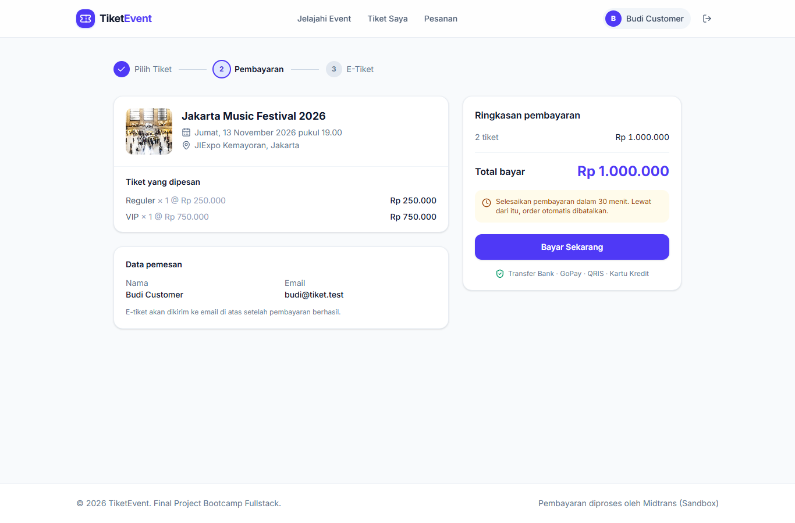
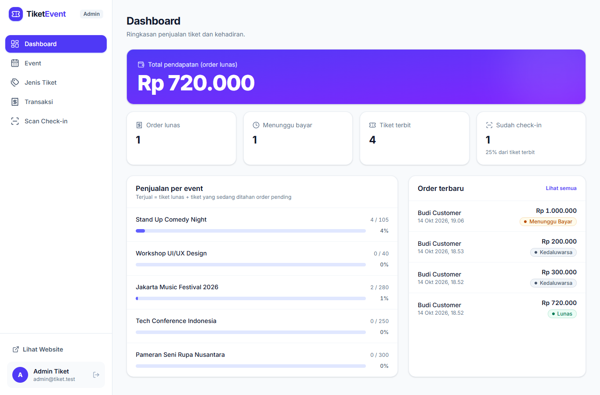
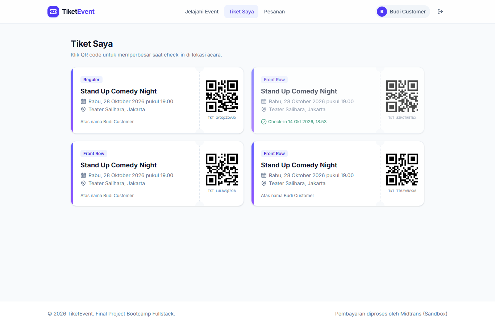
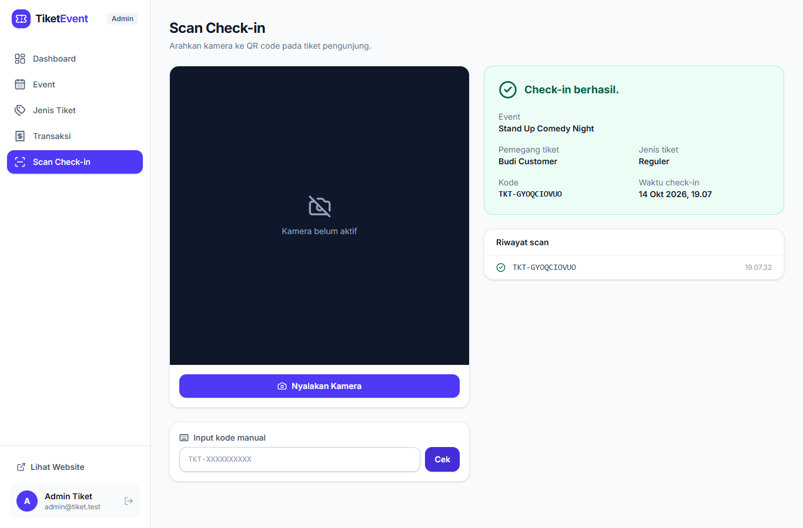
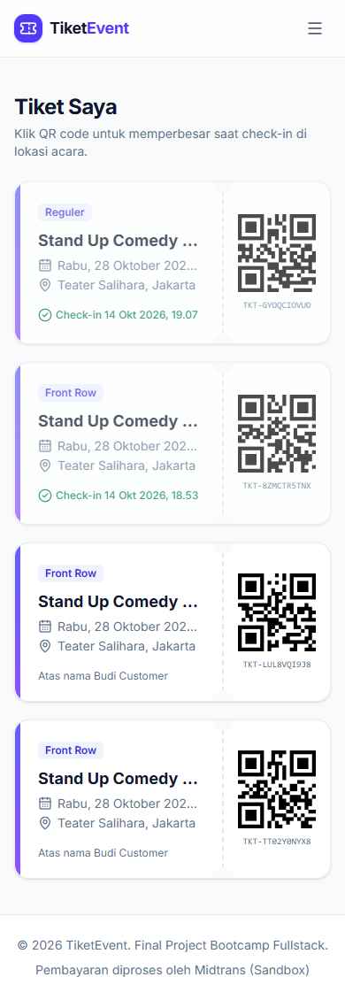

# Lampiran

## A. Daftar endpoint API

| Method | Endpoint | Akses | Keterangan |
|---|---|---|---|
| GET | `/api/events?search=` | Publik | Daftar event published + jenis tiket |
| GET | `/api/events/{slug}` | Publik | Detail event |
| POST | `/api/register` | Publik | Daftar customer, balas token |
| POST | `/api/login` | Publik | Masuk, balas token |
| POST | `/api/logout` | Login | Hapus token aktif |
| GET | `/api/me` | Login | Data user login |
| POST | `/api/checkout` | Login | Buat order + Snap token |
| GET | `/api/orders` | Login | Riwayat order milik sendiri |
| GET | `/api/orders/{order_code}` | Login | Detail order (+ tiket) |
| GET | `/api/my-tickets` | Login | Tiket dari order lunas |
| GET/POST | `/api/admin/events` | Admin | Daftar / tambah event (multipart) |
| GET/PUT/DELETE | `/api/admin/events/{id}` | Admin | Detail / ubah (`POST` + `_method=PUT` jika ada file) / hapus |
| GET/POST | `/api/admin/ticket-types?event_id=` | Admin | Daftar / tambah jenis tiket |
| GET/PUT/DELETE | `/api/admin/ticket-types/{id}` | Admin | Detail / ubah / hapus |
| GET | `/api/admin/orders?status=&search=&page=` | Admin | Semua transaksi (paginasi) |
| POST | `/api/admin/checkin` | Admin | Check-in `{ code }` |
| GET | `/api/admin/stats` | Admin | Ringkasan dashboard |
| POST | `/api/midtrans/notification` | Midtrans (signature) | Webhook pembayaran |

Contoh response checkout:

```json
{
  "data": {
    "id": 1,
    "order_code": "INV-20261014-RTCOFS",
    "total": 720000,
    "status": "pending",
    "snap_token": "826f6533-aa1e-4305-84b7-98929ca9ff8e",
    "expires_at": "2026-10-14T12:22:12.000000Z",
    "paid_at": null,
    "items": [
      { "id": 1, "qty": 3, "price": 200000, "subtotal": 600000, "ticket_type": { "name": "Front Row" } }
    ]
  }
}
```

## B. Jebakan pembayaran & di mana ditangani

| Jebakan | Ditangani di |
|---|---|
| `gross_amount` harus sama dengan total `item_details` | `MidtransService::createSnapToken()`: total dihitung dari `order_items` yang sama |
| `order_id` tidak boleh dipakai ulang | `OrderService::generateOrderCode()`, setiap checkout = order baru |
| `gross_amount` webhook berupa string | `MidtransService::isValidSignature()` memakai nilai apa adanya |
| Webhook datang lebih dari sekali | `OrderService::handleNotification()`: lock + cek status |
| Kuota tertahan order yang tidak dibayar | Webhook `expire` + scheduler `orders:expire` |
| Overselling | `lockForUpdate()` di `OrderService::checkout()` |
| Email terkirim walau transaksi gagal | `afterCommit()` di Mailable |

## C. Perintah yang sering dipakai

```bash
# Backend
php artisan serve                      # server API
php artisan queue:work                 # pengirim email (antrean)
php artisan schedule:work              # scheduler (expire otomatis)
php artisan migrate:fresh --seed       # reset database + data contoh
php artisan route:list --path=api      # daftar route
php artisan tinker                     # konsol interaktif
php artisan orders:expire              # jalankan expire manual
php artisan midtrans:simulate {kode} settlement   # simulasi webhook
php artisan user:password {email}      # ganti password akun (mis. akun demo di server)
php artisan optimize                   # cache config/route/view (production)
php artisan config:clear               # baca ulang .env
vendor/bin/pint                        # rapikan format kode PHP

# Frontend
npm run dev        # server development
npm run lint       # cek kode (oxlint)
npm run build      # build produksi

# VPS (P10)
bash /var/www/tiket-event/deploy/deploy.sh   # deploy ulang
sudo supervisorctl status                    # status queue worker
```

## D. Ide pengembangan (tugas bonus)

- Halaman profil & ganti password
- Kategori event dan filter tanggal di Home
- Kirim QR sebagai lampiran PDF di email (`barryvdh/laravel-dompdf`)
- Refund/batal order oleh admin (Midtrans Cancel API)
- Rate limiting login (`throttle:5,1`)
- Feature test PHPUnit untuk checkout & webhook
- Lazy load halaman admin dengan `React.lazy()`

## E. Screenshot

| Customer | Admin |
|---|---|
|  |  |
|  |  |

Tampilan mobile:



---

⬅️ [P11 — Presentasi](P11-presentasi.md) · 🏠 [Daftar isi](../../README.md#daftar-isi)
